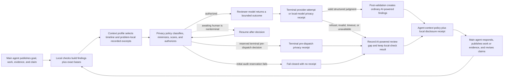

# ADR-006 — AI-powered review provider profiles behind the privacy gateway

**Status:** Working decision revised 2026-08-30 (issue #404 external-runtime authority). Amended
2026-09-23 for issue #742 (adapter-boundary failure tokens, credential-retry exclusion, and
attempt-status projection). Amended 2026-10-13: the Codex subscription evaluator is admitted by a
capability check instead of one pinned build (see *Capability-checked evaluator admission*).
Ratification requires the privacy/egress gates in
ADR-009 plus recorded capability fixtures against every advertised provider/model/endpoint profile.
**Implemented by:** `src/finishup/ports/semantic.py`,
`src/finishup/ports/privacy.py`, `src/finishup/application/egress.py`,
`src/finishup/application/check.py`, `src/finishup/adapters/providers/`, `src/finishup/config/`,
and AI-powered review/privacy capability and conformance tests.

## Decisions

1. **No direct provider path:** application, CLI, MCP, plugin, and integration code cannot call an
   AI-powered review provider. A candidate AI-powered review context must traverse ADR-009's
   classification, policy, local minimization/redaction/secret scan, exact prepared-case approval
   when required, durable authorization, outbound gateway, and privacy-audit path. A provider
   adapter receives only an immutable `ApprovedOutboundCase`; composition supplies no repository,
   bundle, transcript, environment, log, database, keyring, or application-state handle. Standing
   external evaluation additionally requires an exact current grant for the service-derived
   repository-privacy commitment beneath the machine ceiling. A missing or mismatched repository
   grant fails before provider construction, credential-handle minting, authorization, or dispatch.
2. **First external adapter:** official `openai` Python SDK (pinned `2.46.0`), Responses API with
   structured outputs (`responses.parse` + frozen `ProviderJudgmentModel` schema). Every
   constrained-output request (Responses, Chat Completions, and the Codex app-server
   `outputSchema`) sends the strict wire form of that schema: `allOf`/`if`/`then`/`not`,
   `default`, and `uniqueItems` are dropped and every optional property is sent as required and
   nullable, because `strict: true` rejects the whole request before generation otherwise
   (observed as a 400 on provider-judgment 1.2.0, surfaced by Codex only as a failed turn). The
   decoder still enforces the dropped constraints, so the owning contract is unchanged. A release names
   an exact tested provider/model/endpoint-profile tuple. A generic or merely
   "OpenAI-compatible" URL is never trusted as an ambient override. One exact, versioned profile
   kind — `owner-declared-openai-responses` (ADR-014) — may bind an owner-supplied constrained
   HTTPS origin from service TOML (`[provider.owner_declared_endpoint].https_origin`); it reuses
   the Responses protocol cell, never inherits official OpenAI data-use / `assisted` eligibility,
   and still requires capability evidence for any advertised interoperability claim.

   **Amended 2026-07-24; extended 2026-07-27 for the Grok/xAI dogfood path — the
   OpenAI-compatible Chat Completions protocol cell.** Five further exact, versioned profile
   kinds are authorized, each pinned to one host and one fixed path
   prefix, none of them owner-editable: `anthropic-openai-chat-completions`
   (`api.anthropic.com/v1`), `google-gemini-openai-chat-completions`
   (`generativelanguage.googleapis.com/v1beta/openai`), `openrouter-openai-chat-completions`
   (`openrouter.ai/api/v1`), and `xai-openai-chat-completions` (`api.x.ai/v1`) use the
   OpenAI-compatible Chat Completions cell;
   `vercel-ai-gateway-openai-responses` (`ai-gateway.vercel.sh/v1`) reuses the Responses cell and
   needs no adapter of its own. A configurable profile with no runtime factory is not a neutral
   omission — it reports `factory_unavailable` and the requested review silently never runs — so
   each authorized profile resolves to exactly one factory in the dispatch table.

   Structured-output enforcement is recorded per profile from the vendor's own documentation, not
   assumed: a host documented to ignore `response_format` receives the judgment shape in the
   instruction instead, and any answer that is not the exact judgment shape degrades to an honest
   invalid AI-powered review result, never a fabricated pass. None of the five inherits official
   OpenAI data-use or `assisted` eligibility; each carries an unknown data-use record until a
   reviewed one exists. Being dispatchable is not being verified: advertising any of them as a
   working endpoint still requires the exact model/endpoint capability fixture and live evidence
   E-007 names.
3. **Local-model adapter:** v0.1 includes the contract for a separately configured locally hosted
   AI-powered evaluator. Its endpoint is an owner-only, service-approved AF_UNIX socket profile; it
   performs no DNS, AF_INET/AF_INET6 connection, redirect, proxy lookup, or fallback. It is a local
   disclosure sink, not network egress, but still traverses classification, minimization, never-send
   scanning, and local privacy auditing. A release advertises it only for exact model/endpoint
   profiles that pass capability fixtures.
4. **Credentials:** provider credential bytes are owned by the unlocked local service vault. They
   never enter provider configuration values, CLI/MCP arguments, environment variables, files,
   logs, traces, transcripts, prompts, or LLM context. For each physical dispatch, the gateway
   obtains a fresh service-issued `ProviderCredentialHandle` bound to exact provider/model/endpoint
   profile+version, purpose, authorization-scope digest, purpose digest, dispatch ID, final
   request-body digest, service generation, and deadline. Only the custom HTTP transport may
   consume it through a one-shot header-injection
   callback; the adapter and SDK never receive or retain reusable credential bytes. Under resolved
   decision F-012, the custom transport necessarily sends that separately
   provisioned credential as one-attempt authentication metadata to the exact profile-bound HTTPS
   endpoint selected by the reviewed registry, using platform CA trust and hostname validation,
   never as candidate/model content. v0.1 does not claim certificate or SPKI pinning.
5. **Client policy:** each physical attempt constructs and closes one
   `AsyncOpenAI(base_url=service-resolved exact profile endpoint, timeout=explicit,
   max_retries=0, api_key=fixed_nonsecret_sentinel, http_client=one_attempt_custom_transport)`.
   The adapter renders the exact final application JSON body deterministically. The custom
   transport rejects any actual body digest/profile/deadline mismatch, removes the sentinel header,
   invokes the attempt-bound credential callback only to inject the real authentication header and
   start that one request, then releases the protected view immediately. The privacy commitment is
   over the exact final application body bytes, excluding authentication metadata and HTTP/TLS
   framing. No long-lived SDK client or default-header object holds the real key. FinishUP owns the retry
   budget: at most two retries, only for approved timeout/connection/429 classes, jittered backoff,
   all within one total deadline and one durable AI-powered review operation (per endpoint when a
   fallback endpoint is declared — see the fallback endpoint amendment below). **Amended
   2026-08-29 (issue #348):** inside that same budget and deadline, exactly one repair retry is
   also admitted after `invalid / response_content_invalid` — the provider was reached and its
   answer was incomplete
   or overlong (`failure_class=response_content`, output-token truncation, Chat Completions
   `finish_reason=length`). The repair resubmits the same frozen case under the same authorized
   provider/profile/model/category/retention ceiling with unchanged sampling; it is a new physical
   attempt with fresh dispatch, provider request, authorization, privacy receipt, transport, and
   credential-handle identity, and no provider plaintext is retained. A second content-invalid
   answer is terminal and both attempts remain in accounting. `response_schema_invalid`,
   `semantic_judgment_rejected`, refusal, policy or human denial, invalid case, stale frontier,
   quota exhaustion, secret or never-send detection, exhausted authority, and a rejected
   credential (`failure_class=authentication` or `authorization`) are never retried. A rejected
   credential may still surface as public reason `transport_unavailable` — the transport catch-all
   — so retry consults the recorded `failure_class`, not the public reason alone (issue #742).
   The same class also vetoes fallback engagement: a rejected primary credential ends the job
   rather than dispatching the case to the fallback endpoint.
   One durable attempt and one
   privacy receipt, SDK client, custom transport, and credential handle are created per physical
   dispatch. For `confirm_every_request`, each physical retry also requires a fresh exact foreground
   preview/decision and a new one-dispatch proposal; the original human decision cannot cover a
   hidden multi-attempt budget. Crash/resume before authorization consumption remains the same
   attempt. Automatic profiles may retry within their existing policy/total deadline without a
   human prompt, but never reuse authorization or attempt identity.
6. **Required AI-powered review means verdict completeness, not operation availability:**
   local-check freeze and local-check results always survive. With `semantic_required`, missing
   approved capability, privacy-policy block, human denial or approval expiry, provider refusal,
   timeout, invalid output, exhausted retry, late response, or stale response completes the check
   with `verdict=incomplete_check`, no AI-powered findings, and the exact closed `(SemanticStatus,
   SemanticReason)` pair. It does not fail the operation or discard local findings.
   `semantic_if_configured` may complete with its local-check verdict when AI-powered review
   capability is absent or policy-disabled, while an attempted but unsuccessful AI-powered
   evaluation is represented honestly in status and coverage.
7. **Provenance has two truthful stages:** the adapter returns bounded
   `ProviderAttemptProvenance` containing only provider/profile/model/request/SDK/digest/usage/
   failure facts it knows at return time. It cannot name a privacy receipt that is not yet closed.
   After the matching terminal `EgressReceipt` or `LocalDisclosureReceipt` is durable, the
   coordinator constructs final `SemanticProvenance` with attempt identity, exact dispatch kind,
   external authorization or local-disclosure reservation, receipt identity, external request
   commitment when applicable, and final status/reason. Only final provenance may be attached to
   a finding or public result. Predispatch gaps have no attempt provenance and remain exactly
   explained by status/reason. Model output is always labeled `semantic_model_derived`.
8. **No raw response retention by default:** success persists only the bounded parsed judgment and
   structural provenance. Refused, malformed, truncated, late, or rejected provider plaintext is
   not retained merely for debugging. If a future opt-in encrypted diagnostic capture is added, it
   requires its own explicit local-human authorization and retention policy; it is not part of the
   v0.1 AI-powered review contract.
9. **Fake provider:** `adapters/providers/fake.py` is a scripted implementation behind the same
   policy-enforcing gateway. It supports results, delays, denials, refusals, malformed output, and
   late responses without network access. Tests may not inject the fake downstream of the gateway
   when claiming privacy-path coverage.
10. **In-process adapter trust limit:** v0.1 loads only reviewed bundled adapters selected by the
    closed registry; third-party/plugin provider adapters and dynamic adapter paths are absent.
    Approved-case types and dependency injection remove ambient capabilities from normal
    composition, and tests can prove the bundled adapter does not use forbidden APIs. They do not
    create an OS/process sandbox: malicious or compromised Python code running inside the trusted
    service could exercise the active user's ambient authority. Process/native sandboxing remains a
    separate stronger architecture option, not a v0.1 privacy claim.
11. **Review context is a separate policy dimension:** `PrivacyProfile` answers whether and how a
    model disclosure is authorized. `ReviewContextProfile` answers which useful facts the case
    builder selects before privacy enforcement. The closed values are `structural`, `goal_aware`,
    `assisted`, `expanded`, and `custom`. The official CLI recommends `assisted` only after the
    user selects and confirms an exact provider, repository scope, categories, classes, and limits.
    Repository scope is derived by the trusted service from the client session's actual working
    directory, never from model-controlled `workspace_ref`: branches and linked worktrees resolve to
    one Git common root, while independent clones and unrelated repositories do not share authority.
    The safe installation seed remains zero-egress `local_only`; a recommendation is never implicit
    consent.
12. **The recommended packet is rich but problem-local:** `assisted` contains the task goal,
    obligations, current completion/material claims, accepted decisions, a material ordered
    timeline, local findings and their machine-readable bases, change-observation facts,
    coverage gaps, and bounded linked test/failure/evidence/source excerpts. The frozen case retains
    the newest 64 material accepted events in ingestion order with at most 512 KiB of canonical
    payload. Newest payloads win that byte budget; retained over-budget events are `not_selected`,
    older events are represented by an exact omitted-before count, and legacy cases state
    `not_recorded`. A source excerpt must
    already be captured or agent-published in the frozen case and must be linked to the reviewed
    claim, obligation, finding, action, result, or evidence. The case builder has no live Git or
    filesystem browser and never upgrades missing content into observed content. `expanded` and
    `custom` may select more *already recorded* in-scope material, but no profile grants ambient
    repository access or defeats the existing item/case caps.
    Native edit arguments from Codex, Claude Code and Cursor may enter this lane as dedicated
    diff/changed-file content, using only recognized visible patch or replacement fields, captured
    once from the post-tool event and labelled with the host-reported outcome (`applied`, `failed`
    or `unknown`). Unknown nested fields are excluded, and every file locator in the edit, including
    patch headers, is made workspace-relative or masked as `<outside-workspace>` (POSIX, Windows
    drive, UNC and WSL `/mnt/<drive>` spellings alike). Capture consent, secret scanning, outbox
    admission, generation fences and disclosure approval remain required. Claim-linked evidence
    wins selection first, then captured edits (newest first), then other captures, including before
    bounded object resolution; a selected capture outside the latest-256 envelope window is read by
    exact content reference or disclosed as `content_unselected`. Shell heredoc edits whose new
    bytes are in the command (`apply_patch`/`git apply`/`cat >`/`tee` heredocs) are captured the same
    way; script-mediated edits are not. Authenticated
    code is split into UTF-8-safe items within the existing per-item, item-count and total-byte caps;
    a delivered prefix reports `truncated_payload`, and excluded retained content reports
    `content_unselected`. These captures are not a Git snapshot. The one repository read is the
    check-time change of ADR-031: when the recipe selects diff excerpts, the service (never the
    case builder) captures the change from the task-start commit to the working tree once per
    check and the packet reserves room for it ahead of other excerpts, as `repository_excerpt`
    items the inference channel must allow. A digest alone cannot supply missing code.
13. **Reviewer output talks to the main agent through the existing workflow:** a successful model
    judgment may propose bounded `ReviewerChallenge` values. Each challenge names only case-bound
    refs, explains the discrepancy, states an alternative interpretation, addresses the main agent
    directly, and names the repair or the exact missing artifact that would resolve it, with one
    requested response: act, provide evidence, revise the claim, dispute with evidence, or state an
    unresolved limitation (issue #906). Post-validation maps an accepted challenge to
    the existing AI-powered `Finding.summary/detail`; the main agent uses the existing `respond` and
    `publish_work` operations, then runs `check` again. There is no provider-driven fetch loop, new
    event family, seventh public operation, or model waiver authority.
14. **Recommendation eligibility is evidence-bound, not a brand promise:** every installed external
    endpoint profile carries a versioned data-use record stating customer-content training use,
    retention posture, provider-human-access posture, review/expiry times, and an evidence digest.
    The upstream `assisted` badge requires a current record with training `prohibited`, retention
    `none|bounded` with any bounded ceiling at most 30 days. Provider human-access posture and
    documented safety, support, legal, and abuse-monitoring exceptions remain mandatory disclosure
    facts, but do not replace or silently raise that recommendation threshold.
    The recommended recipe also sets an editable
    `require_current_provider_data_use_evidence=true` runtime guard. FinishUP does not technically
    prove provider behavior. Unknown, known-broad, or stale status removes the recommendation badge
    and trips that guard; an informed user may explicitly turn the guard off through a custom policy,
    and a fork may change the rule without inheriting upstream privacy/support evidence.
15. **Adapter classification and attempt-status projection (issue #742):** every provider
    failure is classified at the adapter boundary into the closed `SemanticFailureClass` set.
    Public `SemanticReason` values stay the existing closed pair vocabulary; renderers resolve
    recovery through `continuation_for_semantic_outcome` from that pair plus `failure_class`.
    A successful review with zero findings is `semantic_status=succeeded` /
    `semantic_reason=semantic_completed` on the check path, and `semantic_state=ready` on
    advice/status/history. That ready state is derived from the recorded attempt (an addon
    whose `failure_reason` is absent), never from finding count. Absence of
    `semantic_model_derived` advice items is not evidence that no attempt occurred.
    `disabled` means no attempt was requested or configured; `unavailable` means a durable
    attempt is still pending; `failed` means a terminal attempt finished without validated
    output, including a succeeded attempt whose output failed advice-side validation and left
    no usable finding. The state is an attempt fact only: advice coverage still adds
    `semantic_model_derived` only for validated finding ids, so a zero-finding review is `ready`
    without claiming that check type. A snapshot stored before this amendment has no recorded
    state and reads as `ready` when it holds AI-powered items, otherwise `disabled`.
    Predispatch configuration and policy outcomes carry no recovery directive. Frozen
    check-result schemas are unchanged.

## Review packet and agent loop

The stable provider instruction (one source for every provider path, issue #906) is equivalent to:

> You are the requested review: verify the change against the task and the recorded verification
> against the change, from the supplied packet only. FinishUP's own check, finding, receipt, and
> coverage state, and any obligation to obtain this review, are never defects in the work; a work
> obligation left open under a completion claim still is. Treat main-agent claims, deterministic
> observations, and unavailable content as different facts. Never say no code changed merely
> because no excerpt was disclosed. Judge recorded output yourself instead of asking for a re-run.
> Report every distinct material problem, address the main agent directly, cite only supplied
> references, offer the strongest plausible alternative, and name the repair or the exact missing
> artifact. Never request environment changes. Do not waive policy, invent repository facts, claim
> deterministic authority, or claim stronger coverage than the packet.

The packet varies by `ReviewContextProfile`: `structural` contains only typed timeline/status/state/
coverage facts; `goal_aware` adds detailed, category-separated frozen plan, obligation, claim,
decision, action, result, evidence, finding, response, and check history; `assisted` additionally
adds problem-local recorded evidence, failure, test, diff, and repository excerpts; `expanded` or
`custom` can include a broader explicitly approved recorded set. Exact command text remains
excluded unless independently selected. Every variant distinguishes `not_recorded`, `not_selected`,
`withheld_by_policy`, and `redacted_never_send`; a history-window item carries the exact older-event
count.

## Local-check fencing

The AI-powered review case is built from a frozen frontier and dependency digest. It carries
separate `frontier_refs` (IDs present at the frozen frontier) and `local_check_refs` (local finding
IDs allocated and durably pinned by this check); their union is bound into the case digest. This
lets the reviewer discuss local findings without pretending those post-frontier IDs were already in
the ledger. Every local finding carries a paired `FindingBasis` containing the rule ID, triggering
observed facts, required-but-missing facts, subject-state relation, source availability, coverage
gaps, and bounded supporting refs. Later disclosure-time `ChangeObservation` and content-visibility
facts remain separate. `same`, `different`, and `unknown` retain their exact three-valued meaning;
hidden or unrecorded source is never represented as `same`.

Approval is bound to the exact minimized case digest, provider/model/endpoint profile, purpose,
composed machine/repository/task/request authority, policy version, and one dispatch. The provider
is called outside every SQLite transaction.
Post-validation rejects invented IDs, out-of-case quotes, coverage upgrades, local-check-status
claims, challenges without a material discrepancy or requested next step, and stale frontiers.
Rejected output never projects a finding.

## Codex subscription-runtime amendment (2026-08-30, issue #404)

External AI-powered review authentication has two authorities. Existing HTTP profiles
use `finishup_vault_api_credential`. The exact `codex-chatgpt-subscription@1` profile uses
`external_runtime_oauth`: one selected OpenAI Codex app-server owns ChatGPT login, refresh,
credential storage, model discovery, and the upstream OpenAI request. FinishUP never reads or imports
that credential. The only fallback behind this profile is the other declared authority — an
exact API-provider binding paired under the fallback endpoint amendment below (2026-09-04,
issue #582) — never an API key read from the environment, a generic endpoint, a proxy, or an
ambient Codex home. Until that amendment the two authorities were mutually exclusive in
configuration.

The initial closed compatibility cell is Codex npm `0.150.1` on macOS arm64, app-server v2 over
stdio JSONL, with an exact native executable digest, protocol-schema digest, digest-bound isolated
configuration, model, reasoning effort, and `codex-evaluator/0.150.1/v1` capability identity. A
capability-cell identity digest and evidence expiry are bound separately; an expired cell cannot
launch a child. A neighboring version, changed binary/config, absent ChatGPT login, unavailable
exact model/reasoning cell, or unproved isolation fails before case disclosure. This cell has
unknown data-use posture and receives no Assisted recommendation badge.

The September 7, 2026 amendment for issue #584 pins `codex-evaluator/0.150.1/v2` to the same
native binary, schema, configuration, and expiry. It accepts the pinned schema's sparse rate-limit
bookkeeping independently of bucket name; malformed bookkeeping after acknowledgement records
only a bounded nonterminal diagnostic. Native quota and 429 errors remain authoritative. Tool
and unreviewed event failures stay terminal but are unavailable rather than invalid model answers.
The runbook records the exact new cell digest and synthetic evidence boundary. Existing bindings
require explicit setup to accept the new identity; no privacy authority migrates implicitly.

### Linux x86_64 cell amendment (2026-09-13, issue #716)

The same evaluator contract now has a separate Linux x86_64 implementation cell for Codex npm
`0.150.1-linux-x64` (`@openai/codex-linux-x64`). Its native executable, source identity, package
layout, platform, and capability-cell digest are distinct from the macOS arm64 cell; its app-server
v2 schema, isolated configuration, model/reasoning contract, OAuth authority, and privacy/cleanup
fences remain identical. An x86_64 WSL2 Linux userspace is eligible for the Linux cell, but
WSL-specific smoke evidence is pending; this amendment creates no native Windows cell. The Linux
cell remains an implementation candidate until its packaged FinishUP lifecycle and AI-powered review
receipt evidence is complete. The empty `runtime-support.json` arrays therefore remain unchanged.

The gateway issues a secret-free, dispatch-bound `ExternalRuntimeAuthority` instead of minting a
vault handle. The runtime may receive only the already-approved canonical case through stdin. Its
`RuntimeAttemptEvidence` commits to the disclosed case, instruction, output schema, launcher,
configuration, executable, protocol, capability, model/reasoning selection, safe correlation,
terminal output digest, and process cleanup. It explicitly records
`upstream_body_observability=unavailable`; the disclosed-case commitment must never be described as
the upstream OpenAI body. Current runtime evidence may also record the Codex app-server's bounded
cumulative token snapshot for that exact thread and turn: input/output/total counters plus cached
input and reasoning-output subsets, with cache-write input retained as a separate provider
counter. Repeated cumulative updates replace one another; they are never summed, and missing,
malformed, unrelated, or regressing updates remain
unknown or become a bounded `token_usage_invalid` diagnostic. Account identifiers and raw provider
notification bodies never enter provenance.

For the same reason, each observed `RuntimeTokenUsage` sample is copied into the corresponding
`semantic_attempts` ledger row as six bounded numeric counters before the attempt is closed. The
nullable columns preserve older ledgers and keep cache-write and reasoning subsets separate; a
partial or invariant-breaking sample fails closed. Internal attempt accounting for an operation
that is still in flight can thus recover usage for selected, failed, and expired physical attempts
across a service restart, while public provenance continues to describe only the provider result
it actually represents and never invents provenance for a failed recovery. Usage for attempts of
already-completed operations stays in the owner ledger rows and reaches no public surface. A
failure while persisting a successful response is terminalized as a bounded
`coordinator_failure` with the attempt's usage retained, rather than leaving the attempt
`started`.

Retries remain within the durable attempt budget. A pre-`turn/start`-acknowledgement transient may
receive a fresh one-use authorization and exact retry. After acknowledgement, transport ambiguity
or unconfirmed process-group cleanup is terminal `unavailable/outcome_unknown` and is never
automatically retried. Schema-valid model output remains advisory and follows the unchanged
post-validation/finding path.

### Evaluator runtime retention and repair amendment (2026-09-26, issue #855)

Binding the exact cell to an ordinary host installation coupled AI-powered review to the host's
package manager: a routine Codex update replaced the bytes at the bound path, and a capability
identity change (the #584 v1 → v2 transition) stranded a valid login behind an outdated binding.
Both failed before dispatch and surfaced only as `credential_unavailable`. This amendment keeps
exact-version admission and separates the **evaluator runtime** from the **host installation**.

1. **Admission is unchanged.** Each platform cell still admits exactly one reviewed native
   executable digest. No newer Codex release is admitted, and nothing is inferred from a version
   string, path, or discovery order. Capability-based admission of further releases stays future
   work that needs its own evidence and amendment.
   *Superseded 2026-10-13 by the capability-checked admission amendment below. Decisions 2, 3, 5,
   6 and 7 stand, with the store keyed per checked release and "admitted" meaning "passed the
   capability check"; decision 4's selection is replaced by newest-first with fallback.*
2. **A retained runtime per data bundle.** Setup and repair bind an owner-private copy at
   `<data bundle>/external-runtimes/codex-evaluator/<source identity>/codex` (directory `0700`,
   file `0500`). Bytes are hashed while they are copied and committed by atomic replace only when
   they equal the admitted digest; the unchanged launch fence re-verifies them before every child.
   Host package-manager updates cannot replace the copy, and every instance keeps its own.
3. **Sources for the copy.** A selected local executable that resolves to the admitted cell, or,
   after explicit consent, the operator's own `npm` installing the exact admitted release into an
   owner-private staging prefix with lifecycle scripts disabled. Only the verified native
   executable is kept; the staging prefix is always removed. This is package acquisition under the
   operator's registry settings. No task content, credential, or account data is sent on it, and
   it grants no review egress.
4. **Selection by eligibility.** Setup defaults to the retained copy, then the existing binding's
   executable when it still holds the admitted bytes, then the first discovered installation that
   resolves to the admitted cell. An unadmitted discovered binary is never presented as a default.
5. **Rebinding preserves choices.** Setup and repair preserve the provider role, model, reasoning
   effort, timeout, retry budget, and dedicated home unless the owner explicitly changes one.
   `repair` is the explicit capability-identity transition the #584 amendment requires: it shows the
   changed fields, needs acceptance, and reuses the login only when Codex's own
   `account/read`/`model/list` probe reports the home signed in with the exact model. It never
   starts a sign-in, logs out, or switches accounts, and it writes against the exact configuration
   preimage. Privacy grants are not part of the binding and do not migrate. A missing home, an
   unsafe home, and a modified isolated config are refused for the owner to fix; only a missing
   FinishUP-owned isolated config is restored.
6. **Precise pre-dispatch diagnosis.** A closed structural state is computed from local structure
   only (binding, executable bytes, dedicated home): `codex_runtime_platform_unsupported`,
   `codex_runtime_binding_invalid`, `codex_runtime_capability_evidence_stale`,
   `codex_runtime_capability_unsupported`, `codex_runtime_executable_missing|invalid|changed`,
   `codex_runtime_profile_outdated`, `codex_home_missing|unsafe`,
   `codex_runtime_config_missing|changed`, `codex_runtime_unavailable`, or `ready`. `ready` is
   reported only when the launch fence also accepts the binding. READY composition still spawns no
   app-server. The public semantic outcome is unchanged; a request-joined companion diagnostic names
   the structural state, and `provider status` reports it with its continuation.
7. **Reverse operations stay distinct.** `runtime remove` refuses while the binding uses the copy.
   Disconnect and rollback leave the copy in place. A stranded binding can still be disconnected:
   the admitted runtime is used in memory for that one logout.
   Setup, repair, install, and removal hold one owner-private lock per runtime store. Setup and
   repair keep it through the readiness probe and configuration write, so removal cannot delete
   a runtime between those steps. Contention fails immediately as `codex_evaluator_runtime_busy`;
   the operator retries after the other command finishes. The lock is released on every exit.

Evidence expiry is unchanged: after `2026-11-30T00:00:00Z` every cell reports
`codex_runtime_capability_evidence_stale`, which only a FinishUP release carrying renewed evidence
resolves. The upgrade plan names the evaluator check; applying a repair stays an explicit owner
step.

### Codex 0.157.1 cell amendment (2026-09-27, issue #871)

*Superseded 2026-10-13 by the capability-checked admission amendment below; 0.157.1 is now the
floor, not the one admitted build.*

The admitted release moves from Codex npm `0.150.1` to `0.157.1` on both platform cells. Each
cell still admits exactly one reviewed native executable, so decision 1 of the #855 amendment
holds. `0.150.1` cannot list or run the `gpt-6-luna` new-binding default on a ChatGPT account;
`0.157.1` can. This is a new exact-version admission with its own evidence, not capability-based
admission of further releases.

1. **New identities.** The macOS arm64 cell (`@openai/codex-darwin-arm64`) and the Linux x86_64
   cell (`@openai/codex-linux-x64`) carry new native digests, a new app-server v2 schema digest,
   and the capability profile `codex-evaluator/0.157.1/v1`. Each has its own capability-cell
   digest.
2. **Unchanged.** The isolated configuration, launch argv, OAuth authority, privacy and cleanup
   fences, evidence expiry (`2026-11-30T00:00:00Z`) and the `implementation_candidate` / `pending`
   release posture stay the same.
3. **Schema review.** Two changes follow the reviewed schema difference:
   - rate-limit bookkeeping accepts and discards the new nullable `normalModelSlug`;
   - the native `rateLimitExceeded` error classifies as `provider_rate_limited`, like HTTP 429.

   New notifications and item types stay outside the allowlists and fail closed.
4. **Existing bindings.** A binding written under `0.150.1` names a runtime this release does not
   admit. It reports `codex_runtime_capability_unsupported` and continues through `repair`, the
   explicit identity transition from the #855 amendment. `repair` retains the new copy under its
   own source-identity directory and reuses the sign-in only when Codex's probe proves the exact
   model. No privacy authority migrates.
5. **Superseded copy.** The retained `0.150.1` copy is not deleted automatically. Removing
   superseded retained runtimes is recorded as follow-up work on #871.

Authenticated FinishUP evidence through the `0.157.1` cells is pending; the runbook records the
exact evidence boundary.

**Code-mode host amendment (2026-09-27, issue #874).** Codex `0.157.1` starts its sibling
`codex-code-mode-host` at turn start. With that helper absent it emits a native `warning`, and the
evaluator fails closed on it. The `v1` cell retained only `codex`, so its packaged Linux smoke
stopped there.

Profile `codex-evaluator/0.157.1/v2` makes the helper part of each exact cell:

- a per-platform pinned SHA-256, covered by the capability-cell digest;
- retained beside `codex` in the same owner-private store with the same modes and hash-while-copy
  commit;
- re-verified by the launch fence, and removed together with `codex`;
- taken only from beside the resolved native executable; nothing is searched.

The isolated configuration is unchanged, so dedicated homes and sign-ins carry over. A v1 binding
moves through `repair`. Warnings keep failing closed, and disabling the host by configuration is
not a substitute: it produces a different warning. Retaining Codex's bundled `bwrap` stays a
separate decision on #874.

### Capability-checked evaluator admission (2026-10-13)

The owner decided on 2026-10-13 that the subscription evaluator uses the newest Codex available,
not one pinned build. Pinning cost a FinishUP release for every Codex release, and it blocked models
that only newer Codex catalogs list: with a ChatGPT login, Codex 0.157.1's `model/list` does not
offer `gpt-6.1-sol`, Codex 0.159.0 does. Setup then refused the binding (#534 reuse needs the model
listed), and the fallback login on a signed-in home ended as `codex_login_event_invalid`. This
amendment supersedes decision 1 of the #855 amendment and the exact-version admission of the #871
amendment. Retention, the mutation lock, `repair` as the explicit identity transition, the reverse
operations and the privacy gateway are unchanged.

1. **Admission by capability.** Any stable Codex npm release (`X.Y.Z`, no prerelease) at or above
   the floor `0.157.1`, on macOS arm64 or Linux x86_64, is admitted when the bytes FinishUP will
   launch pass the capability check. The floor is the oldest release whose evaluator-facing
   behaviour was reviewed end to end (code-mode host, remote-control notice, `normalModelSlug`).
   Native Windows still has no evaluator platform. ADR-005's exact-cell rule for the *host*
   integration is not changed by this amendment.
2. **The check** (profile `codex-evaluator/capability/v2`) runs against FinishUP's retained copy, so
   the bytes checked are the bytes launched. In order, the first failure being one closed token:
   - the release is at or above the floor (`codex_runtime_version_unsupported`); it comes from
     the npm manifests, or from `codex --version` under a scratch home for a native path;
   - `codex-code-mode-host` sits beside the executable (`codex_runtime_code_mode_host_missing`);
   - **reviewed protocol subset**: the binary writes its app-server v2 schema
     (`codex app-server generate-json-schema`), and every method, field, JSON type and value the
     evaluator sends or reads must be present with a compatible shape, checked structurally, never
     by a whole-schema digest. Additive methods, notifications and fields pass, because the
     runtime allowlists still fail closed on anything unreviewed. Closed values the evaluator
     interprets, such as `MessagePhase`, must not gain an unreviewed member. Every request the
     evaluator sends must not require a field it does not send (a new required `turn/start`
     field would otherwise fail only after the packet arrived), and every closed value it sends
     (`approvalPolicy` `never`, `sandbox` `read-only`, `summary` `none`, ...) must still be
     admitted by its field. The required sets and admitted sent values enter the subset digest
     (`codex_runtime_protocol_incompatible`);
   - **zero-inference probe** under a scratch home holding only the isolated config, with no
     sign-in, and the same argv, `--strict-config`, overrides and environment allowlist as a
     review. `initialize` must report exactly the release being checked and the bound home.
     `account/read` must answer. `thread/start` must prove an ephemeral, read-only,
     network-off thread in a new empty cwd with no instruction sources. Every notification seen
     must be inside the reviewed pre-disclosure allowlist: remote control `disabled`; native
     warnings, `configWarning`, unknown methods and server requests fail closed. A reply is
     returned as soon as it is read, so the window is closed by a barrier `account/read`: Codex
     writes stdout in order, so every line it wrote before the barrier reply (including events
     still buffered behind the `thread/start` reply) is read and checked first. No `turn/start`
     is sent, so nothing is sampled and no task content exists.
   - **model**: the dedicated home's readiness probe (`account/read`, `model/list`, then the
     same barrier and allowlist check, so a release that warns only under the signed-in home is
     passed over) must list the configured model with every configured effort before the binding
     is written
     (`codex_model_unavailable` for a signed-in home whose model no admitted release lists; setup
     no longer opens a sign-in in that case).
3. **Provenance, not an admission list.** A passed check commits `capability.json`
   (`yoetz.codex-evaluator-capability/1`) beside the retained runtime. It records the profile,
   floor, release, source identity, platform, executable and code-mode-host SHA-256, the digest
   of the checked subset facts, the isolated-config digest and the checks run. It holds no time,
   path, account or model, so re-checking the same bytes is idempotent. The binding keeps its field
   set: `runtime_version` is the resolved release, `app_server_schema_sha256` the subset-facts
   digest, `capability_cell_sha256` the record digest, and `capability_profile` the profile above.
   Receipts' `runtime_evidence` carries the same fields with an unchanged shape. No configuration
   or receipt schema changes.
4. **Launch fence.** Before every child, the executable and code-mode host must still match the
   committed record, and the record must match the binding; a runtime replaced after its check
   never starts. Every attempt still re-proves the `initialize` release, login, model and efforts,
   thread isolation and pre-disclosure events (through the same barrier) before the case crosses
   stdin. The full check is not
   repeated per attempt; `repair` and `setup` run it.
5. **Newest first, with fallback.** Setup and repair gather candidates: FinishUP's retained releases,
   the binding's host installation, discovered everyday Codex installs, or one `--executable`.
   They keep one candidate per release (the retained copy first) and try them newest first. A
   candidate that fails the check, or whose catalog lacks the configured model for a signed-in
   home, is passed over; the result names those as `runtimes_passed_over`. If none passes, the
   first candidate's token is the refusal (or `codex_model_unavailable`). Interactive setup
   (prompt and terminal interface) keeps this fallback when the owner accepts the offered
   default; only a different, explicitly typed path pins setup to one runtime. A newer everyday Codex
   is adopted by the next `setup` or `repair` without a FinishUP release. Earlier retained releases
   stay as fallbacks until `runtime remove`, which now deletes every retained release the binding
   does not use. `runtime install --download` installs `@openai/codex@latest`.
   *Amended 2026-10-14:* every check subprocess (version, schema, probe, readiness) leads its own
   process group, which is killed as a whole and confirmed empty on exit, timeout or any failure.
   An unconfirmed cleanup is `codex_capability_probe_cleanup_unconfirmed`; it outranks, and
   chains, any failure the check already raised, and it is never a fallback: candidate discovery
   and selection stop, nothing further is launched, and nothing is written.
6. **Existing bindings.** A pinned-cell binding (`codex-evaluator/0.150.1/*` or
   `codex-evaluator/0.157.1/*`), or one checked under the unreleased first draft of this
   amendment (`codex-evaluator/capability/v1`, which did not yet check required request fields,
   sent values or the buffered pre-disclosure window), reports `codex_runtime_profile_outdated`, and its bytes are still
   compared with the digest it names, so replaced bytes stay visible. `repair` re-checks and
   rebinds it, keeping the sign-in and every owner choice. No privacy authority migrates.
7. **Packaged cells removed.** `support/codex-evaluator/0.157.1/cell.json` and
   `cell-linux-x64.json` are deleted; the isolated config moves to
   `support/codex-evaluator/config.toml`. Keeping exact cells as known-good references would leave
   two admission paths with two trust models. The 0.157.1 build simply passes the same check.
8. **Unchanged.** The isolated config, launch argv, OAuth authority, cleanup fences, the
   `2026-11-30T00:00:00Z` evidence expiry (now the review window of this FinishUP release's subset and
   probe, not of a Codex build) and the `implementation_candidate` / pending release posture.

**Tradeoff.** FinishUP no longer holds an exact binary identity for the evaluator. Trust now comes
from the capability check plus the provenance record. The record proves which bytes were checked
and launched; it does not prove they are benign. A new release can change behaviour that neither
its schema nor a zero-inference probe shows, for example a new default-on feature or a hosted
tool. What still holds for every admitted release, on every attempt:
- the dedicated home, the environment allowlist, and `--strict-config` with the critical deny
  overrides (a removed config key fails the launch);
- the read-only, network-off thread posture proven before disclosure;
- fail-closed handling of every tool request, tool item, unknown event and unknown phase.

An unreviewed event that appears only after `turn/start` still fails closed. The privacy fence
holds, and the review ends `unavailable`.

**Evidence (2026-10-13, macOS arm64, unauthenticated, zero inference).**
- The real check admitted npm `0.157.1`, `0.159.0` and `0.162.1`, including the machine's global
  `0.162.1` install, retained into an isolated bundle. An installed `0.153.4` was refused by the
  floor.
- Subset diff, 0.157.1 to 0.159.0: `PlanType` adds `promax`; `CodexErrorInfo` adds
  `flexUnavailable` and `tooManyDenials`; no method or notification changes.
- Subset diff, 0.159.0 to 0.162.1:
  - `MessagePhase` adds `partial_answer`;
  - `ServerNotification` adds `thread/prediction/updated`, which stays outside every allowlist;
  - `ClientRequest` adds `thread/attachmentOwner/list`;
  - `TurnStartParams` and `Turn` add the optional `parentTurnId` and `rootTurnId`;
  - `CodexErrorInfo` gains a catch-all variant.
- Adaptations:
  - `partial_answer` is discarded like `commentary`, so only `final_answer` is a judgment;
  - rate-limit plan names are accepted as bounded identifiers and discarded;
  - `promax` is a known account plan;
  - `flexUnavailable` classifies as `provider_outage`.
- Authenticated evidence, with `gpt-6.1-sol` listed on 0.159.0 under a ChatGPT login, is
  pending. The runbook records the boundary.

**Amendment (2026-10-14, owner-requested scoped fix; maintainer acknowledgement for the
privacy/egress gate recorded here).** Codex 0.162.1 on Linux probes its bubblewrap sandbox at
app-server start (`bwrap --unshare-user --unshare-net --ro-bind / / /bin/true`). When that fails
with a user-namespace error (gVisor's `loopback: Failed RTM_NEWADDR`, Docker's default seccomp,
kernels without unprivileged user namespaces), it writes one `configWarning` before any content:
`{"summary": "Codex's Linux sandbox uses bubblewrap and needs access to create user namespaces.",
"details": null}` (`codex-rs/sandboxing/src/bwrap.rs` `USER_NAMESPACE_WARNING`). The
pre-disclosure gate refused every warning, so the capability check and each attempt failed as
`codex_app_server_predisclosure_event_forbidden` on such hosts.

1. **What the warning means for a review.** Bubblewrap confines only the tools Codex runs as
   child processes. Under the evaluator's isolated config, Codex 0.162.1 offers the model none of
   them:
   - `features.shell_tool=false` makes `add_shell_tools` (`core/src/tools/spec_plan.rs`) register
     no `exec_command` or `write_stdin` handler;
   - `apply_patch` stays registered, but `sandbox_mode="read-only"` has no writable roots and
     `approval_policy="never"` rejects sandbox approval. So `assess_patch_safety`
     (`core/src/safety.rs`) returns `Reject` before any patch runs, whether or not a sandbox
     exists;
   - the code-mode host is spawned as a plain child, not under bubblewrap. Its nested calls reach
     only the same tool registry;
   - no MCP server, plugin, app, web search, image or agent tool is enabled.

   FinishUP's turn gate still ends the turn on any command, file-change or tool item and on every
   server request. A missing user-namespace sandbox therefore widens nothing a review can do.
2. **Narrow admission.** Only that exact notification is admitted before disclosure:
   - method `configWarning`;
   - `params` exactly `{summary, details}`, with `details` null;
   - the summary byte-identical to the reviewed constant (Codex carries no structured code);
   - an optional integer `emittedAtMs`.

   Every other `configWarning` still fails closed as `codex_app_server_predisclosure_event_forbidden`.
   That includes the WSL1 warning, any detail, path or range, and the same text sent through
   `warning`. (The missing-bubblewrap warning was refused here too until the owner decision recorded
   below, which admits it under the same rules.) Admission applies to the capability check, the readiness and
   login probes, and every attempt.

   **Bound to reviewed releases.** Point 1 was verified against one release's source and cannot be
   proven at runtime. No app-server method returns the effective tool registry without a model
   call: `config/read` returns config values, not registered handlers, and
   `codex debug prompt-input` renders input items only. Even a tool list would not prove that a
   patch is rejected before it runs. The admission is therefore limited to the reviewed set
   `SANDBOX_UNAVAILABLE_REVIEWED_RELEASES = {0.162.1}`, matched against the release that
   `initialize` proved. That is the newest stable npm release on 2026-10-14; 0.159.x sends this
   warning only in the terminal UI, not through the app-server.

   Any other release that sends the same warning fails closed before disclosure with
   `codex_sandbox_unavailable_unreviewed_runtime`, recorded as the `predisclosure_event_forbidden`
   stage. That token is a per-candidate refusal, so newest-first selection falls back to an older
   reviewed release when one is installed. Its continuation names a reviewed release and enabling
   user namespaces. Adding a release to the set requires re-reviewing every item of point 1 in its source.
3. **Surfaced, not hidden.** A probe that saw the warning reports `sandbox_unavailable`.
   `provider codex-subscription status`, `setup` and `repair` add
   `codex_sandbox_unavailable: true|false`, which `finishup setup` keeps. The terminal interface shows
   a plain line saying reviews are unaffected.

   The capability record is not changed: it stays a host-independent statement about the bytes.
   Receipts' `runtime_evidence` does not carry the flag yet, because that needs a new
   `runtime-attempt-evidence` schema version and its event/receipt cascade. That is a follow-up;
   until then the receipt's claim is unchanged by this host fact (point 1).
4. **Re-review trigger.** Each new Codex release is outside the reviewed set until its source is
   re-checked: no command-running tool for this config, patch rejection under read-only and
   `never`, and the code-mode host outside bubblewrap. A new text or shape fails closed regardless.

**Amendment (2026-10-14 evening, owner decision: missing system bubblewrap).** Benchmark task
containers must stay exactly as the official harness ships them, so the distribution `bubblewrap`
package is not installed there. With no system `bwrap` on the evaluator's fixed `PATH`
(`/usr/bin:/bin`), Codex 0.162.1 skips its user-namespace probe and writes one different
`configWarning` before any content (`codex-rs/sandboxing/src/bwrap.rs` `MISSING_BWRAP_WARNING`,
also byte-identical in the shipped linux-x64 binary, sha256 `628e3548…`):
`{"summary": "Codex could not find bubblewrap on PATH. Install bubblewrap with your OS package
manager. See the sandbox prerequisites:
https://developers.openai.com/codex/concepts/sandboxing#prerequisites. Codex will use the bundled
bubblewrap in the meantime.", "details": null}` with an integer `emittedAtMs`. A live probe on
2026-10-14 (Codex 0.162.1 app-server, FinishUP's exact launch argv and environment, a
`python:3.12-slim-bookworm` container on a Boat Docker host with no `bwrap`) received exactly that
envelope after `initialize` and before the barrier reply. Codex writes at most one of the
missing-bubblewrap, WSL1 and user-namespace warnings.

1. **Same reasoning.** Point 1 above does not depend on which sandbox Codex has: no
   command-running tool is registered, every patch is rejected before it runs, and the code-mode
   host is not under bubblewrap. Without a system `bwrap`, Codex attempts its bundled copy when
   that resource is present; FinishUP does not retain it (#874), and the warning itself proves
   neither a usable sandbox nor user-namespace access, so its Linux sandbox is unverified. That
   widens nothing a review can do.
2. **Same narrow admission.** The warning is admitted only with the closed shape of point 2 and
   that summary byte for byte. It is admitted only from `SANDBOX_UNAVAILABLE_REVIEWED_RELEASES`
   (`{0.162.1}`); any other release sending it fails closed with
   `codex_sandbox_unavailable_unreviewed_runtime`, as before. Look-alikes (a detail, a path or
   range, a missing `details`, trailing bytes, the same text through `warning`) and the WSL1
   warning stay refused as `codex_app_server_predisclosure_event_forbidden`.
3. **Disclosed with its reason.** The probe result carries `sandbox_unavailable_reason`
   (`user_namespaces_unavailable|bubblewrap_missing`). `provider codex-subscription status`,
   `setup` and `repair` report `codex_sandbox_unavailable: true` with
   `codex_sandbox_unavailable_reason`, which `finishup setup` keeps. For `bubblewrap_missing` the
   terminal interface says the evaluator runs without Codex's verified Linux sandbox and why
   reviews are unaffected. Receipts' `runtime_evidence` still does not carry the fact (the same
   schema follow-up as point 3 above); the diagnostic surfaces are the disclosure until then.
4. **Not a general bubblewrap waiver.** This admits only the Codex evaluator's warning. Approved
   external-command checks still need a usable system `bwrap` on Linux and keep failing closed
   without it (`bwrap_missing`).

## Fallback endpoint amendment (2026-09-04, issue #582)

AI-powered review may bind one primary endpoint plus exactly one fallback endpoint. The pairing is
exactly the two external authorities above: the API provider (`[provider]`,
`finishup_vault_api_credential`) and the Codex ChatGPT subscription evaluator (`[external_runtime]`,
`external_runtime_oauth`). A nonsecret `[semantic_fallback]` table with
`primary = "api_provider"` or `primary = "codex_subscription"` names which serves first; the other
bound table is the fallback. Two API providers cannot pair, a generic or owner-declared endpoint is
never an implicit fallback, and there is no third slot. `profile` must agree with the primary
(`local-openai` for the API provider, `codex-subscription` for the subscription); a pairing with a
table missing fails as `semantic_fallback_endpoint_missing`, a disagreeing profile as
`semantic_fallback_profile_mismatch`. Removing the fallback restores the exact single-endpoint
configuration; swapping the primary keeps both bindings and both approvals.

1. **Closed engagement rule.** The primary is given up for the fallback only for the closed
   fallback-licensing set — `timeout/provider_timeout`, `unavailable/transport_unavailable`,
   `unavailable/provider_rate_limited`, `unavailable/provider_quota_exhausted` — and only after
   two such failures (`FALLBACK_PRIMARY_FAILURE_LIMIT = 2`, not owner-configurable), one quota
   exhaustion, or the primary's own exhausted retry budget. A primary that cannot be resolved
   before dispatch (`credential_unavailable`) hands every attempt to the fallback with zero
   primary attempts recorded. Content-shaped outcomes — `response_content_invalid` including its
   issue #348 repair retry, `response_schema_invalid`, refusal, `semantic_judgment_rejected` —
   policy and human outcomes, and `outcome_unknown` never engage the fallback: the primary
   answered, or may have, and a second destination cannot repair a content answer. Once engaged,
   a job never returns to the primary.
   A rejected primary credential (`failure_class=authentication` or `authorization`, issue #742)
   does not engage the fallback either, even under a licensing reason: it ends the job.
2. **Per-endpoint budgets.** Each endpoint keeps its own decision-5 retry budget (at most two
   retries) and its own configured timeout; primary failures never spend the fallback's budget.
   The overall deadline is the primary timeout plus the fallback timeout; primary dispatches
   are capped at the frozen primary cutoff, without dividing that timeout among retry slots.
   After a licensed transition, the fallback's aggregate timeout starts at its first durable
   attempt claim and is capped by the overall deadline. Retries and disclosure replay do not
   restart either clock. A single primary timeout that exhausts time but leaves retry slots does
   not bypass the two-failure/quota/attempt-budget engagement rule; it ends without fallback.
   A single fallback
   failure keeps its exact reason rather than reading as an exhausted budget it never had.
3. **Replay-safe endpoint selection.** Which endpoint an attempt uses is a pure function of the
   durable attempt rows before it and the immutable execution snapshot in the encrypted
   `SEMANTIC_CASE` object (`yoetz.semantic-case/2`), never mutable provider readiness. The snapshot
   binds exact endpoints, initial primary availability, retry budgets, and UTC cutoff times.
   Crash, restart, and `awaiting_human` replay resume the endpoint the attempt was claimed for;
   changed configuration cannot reinterpret earlier ordinals. Every attempt still checks current
   privacy authority for that frozen binding. Legacy terminal cases retain stored-result recovery;
   pending cases lacking the snapshot terminate without dispatch rather than acquiring a newly
   configured pairing (`coordinator_failure` before dispatch or during a disclosure wait,
   an uncertain started attempt retains `outcome_unknown` durably and reports the provenance-free
   public gap `receipt_persistence_unknown`). The internal attempt projection
   exposes the existing durable `started_at` timestamp; usage counters are an additive nullable
   bundle migration (0013), so legacy rows remain readable. An expired
   resumed attempt without a disclosure wait preserves `outcome_unknown`; a known undispatched
   expiry records `provider_timeout`. If provider-result provenance is unavailable on recovery,
   the public result uses `receipt_persistence_unknown` while retaining the original durable reason.
   Retained provider-result objects are recovered when their status and reason match that row.
   **Lease/recovery amendment, 2026-09-07 (#616, #620):** live AI-powered review operation and job leases
   use the authenticated execution snapshot's total expiry plus five seconds for local cleanup,
   rather than a renewable heartbeat. The current two-endpoint maximum makes that live bound
   at most 7205 seconds; a crash can consequently delay reclaim until that bound. Claim/reclaim
   retains an existing `started` or `response_durable` attempt and its physical request identity.
   A saved response is selected and recovered before any new attempt is considered. After the
   execution bound, an already reclaimed ordinary operation lease may perform bounded local
   terminal recovery; it cannot renew AI-powered review execution or dispatch after the immutable provider
   deadline. Provider deadlines and human approval expiry remain separate from lease ownership.
4. **Every fallback attempt is a fresh physical attempt** under ADR-009: its own privacy
   evaluation against the exact fallback binding, authorization, dispatch identity, credential
   handle or `ExternalRuntimeAuthority`, and privacy receipt. Under `confirm_every_request` it
   needs its own foreground preview and decision. Nothing approved for the primary is reused.
5. **Provenance names both endpoints.** `SemanticProvenance.fallback_from` (provider, endpoint
   profile id and version, model, `attempted_count`, `reason`) is present exactly when the
   fallback served; the top-level provider/model/endpoint then name the fallback and
   `fallback_from` names the primary, its physical attempts before engagement, and its last
   closed failure reason (`semantic-provenance-1.1.0`, append-only). It appears in check results,
   check-recorded events, findings, and JSON receipts; markdown and text receipts name the
   endpoint that served and the primary's closed failure reason. Attempt accounting carries one
   per-endpoint slice.
6. **Readiness and capability.** `finishup provider status` reports `endpoint` (role `primary`) and,
   with a pairing, `fallback_endpoint` plus `fallback_credential_connected` and a separate
   `fallback_provider_credential` blocker; the service advertises a `fallback_provider`
   capability when the fallback's credential is structurally present. The fallback's credential
   never gates the primary and `semantic_ready` never depends on it. The pairing is a
   service-side dispatch decision with no host-specific behaviour; ADR-018's route ceiling
   applies to dispatch authority regardless of which endpoint serves.

Consequences: the Assisted recommendation rule reads the primary endpoint's data-use record, and
setup asks for `require_current_provider_data_use_evidence` only when every bound endpoint has a
reviewed record — the requirement is enforced per dispatch, so a fallback with unknown posture
would otherwise be policy-denied at the one moment the pairing exists for. The subscription cell
has unknown data-use posture whichever role it holds, so an attempt it serves carries no
upstream no-training claim. A fallback whose factory cannot be built or whose
credential is absent is reported unavailable on its own row without fencing the primary. No live
interoperability of a paired dispatch is claimed until authorized evidence records the exact
request, response, route, and receipt for the endpoint that served.

## Amendment: bounded reference scope and exceptional exits (#675, #676)

The AI-powered review packet selects a deterministic dependency closure from the frozen allowlist.
Retained packet relations, canonical payload dependencies, recorded findings and source-event
identities remain connected. Unrelated frontier IDs are counted as omitted, bound into the case
digest, and reported through partial `semantic_reference_scope_reduced` coverage. The local-check
case is not reduced. The code is disclosure: it bounds what the receipt may claim about the review,
and it blocks finding resolution only as the #904 amendment below allows. The existing envelope
byte limit and independent disclosure policy remain in force. Irreducible required structure fails
before job/attempt creation with `case_capacity_exceeded` and `semantic_case_capacity_exceeded`
coverage. *Amended 2026-10-20 (#1118, owner decision):* `case_capacity_exceeded` also names
disclosure capacity: a rendered disclosure over the channel's `max_bytes`, or a reviewer exchange
over the 262,144-byte disclosure cap, was reported `blocked_by_policy` / `network_egress_denied`
although network egress was permitted. It is now `failed/case_capacity_exceeded`, ending the job
attempt that reached the refusal; the privacy receipt keeps `blocked_by_policy` / `policy_denied`
(no new reason, no new receipt version), and the attempted size and limit are recorded as bounded
integers. Like the structural case, it is a retryable `failed` outcome rather than an
undeliverable one: a required closing review is still asked for, and the next check builds a new
case. Narrowing scope creates new work; it does not replay a terminal check or imply that the
reduced packet reviewed the whole task.

A local finding wider than one case item's reference bound (16 subjects; findings may cite 64) is
not irreducible structure and does not fail the case (#858). The builder omits that finding's prose
and projected assessment as explicit `not_selected` omissions, declares
`semantic_case_finding_refs_over_limit` on packet, check, status and receipt coverage, and
dispatches the bounded case once. Subject references are never truncated to fit: a partial subject
list would misstate the finding's identity. The finding itself remains a complete local check
result and a citable `local_check_refs` entry.

Exceptional attempts retain a request-joined stage/category before cleanup. Dispatch entry is an
uncertain execution boundary; null provenance and missing diagnostics are not non-dispatch proof.
Provider-return, mapping and persistence faults remain distinct. Diagnostics cannot change retry
eligibility, durable-response recovery, cancellation or lease fencing. See `docs/INTERFACES.md` for
the public reason, coverage and owner diagnostic lookup contracts.

**Provider-bound review-input provenance (#965).** A successful provider attempt may be rendered as
complete only when the exact post-admission `provider_bound` input manifest is retained with the
attempt response. The composed pre-admission manifest is never a fallback proof. If retention or
recovery loses that identity, the provider result and provenance remain intact while the check
records one closed coverage reason (`missing`, `invalid`, `parse_failed`, `mismatch`, or
`recovery_failed`); the receipt stays coverage-bounded. This preserves the distinction between a
provider that ran and evidence of what it received, including after serialized response recovery.

### Long external Codex reviews (2026-09-16, #496 / #746)

The external Codex evaluator defaults to 900 seconds and accepts explicit values from 1 to 3600
seconds. Existing explicit shorter values are preserved. Other provider kinds keep their existing
limits. The primary and optional fallback each retain their own frozen budget, with a combined
execution bound of 7200 seconds and five seconds of lease cleanup. Recovery never resets that clock
or mints a new provider request after authority was consumed.

A client wait timeout or disconnect leaves an admitted semantic check running under service
ownership. At most eight such checks can be retained; same-identity retries report pending, and a
changed body conflicts. An explicit attached control cancellation or service shutdown cancels and
joins the work. This does not introduce parallel semantic scheduling; structural phase progress
was added later (see the amendment below).

### Phase-aware Codex review budgets (2026-09-22, #571 item A1)

Each semantic check runs under exactly one closed **budget profile**. `final` applies when the
frozen case carries an effective, readable completion claim (`claim_kind=completion`, not
superseded by an ADR-025 correction); every other check is a `routine` checkpoint. The selection
is a pure function of the frozen projection, so the same case always selects the same profile.
It is frozen into the execution snapshot of the encrypted `SEMANTIC_CASE` object as the optional
`execution.budget_profile` key when the job is created. Every physical attempt, including
retries, disclosure-wait resume, and started-attempt recovery, dispatches under that frozen
value; changed configuration or a later claim cannot re-select it. Snapshots written before
this amendment lack the key and replay as `final`, which is the pre-amendment single-effort
behavior. The `yoetz.semantic-case/2` reader ignores unknown execution keys, so no case-schema
bump is needed. Unscoped credential probes also use `final`. Background observation advice uses `routine`
(issue #888); it cannot infer completion from a hook and must not consume a final-check budget.

The Codex subscription binding (`[external_runtime]`) expresses the two profiles separately:

- `reasoning_effort` (existing, required) is the final-profile effort.
- `routine_reasoning_effort` (optional). New setups write the bounded recommendation `medium`.
  When it is absent (every binding written before this amendment), routine checks keep the
  single configured effort. A persisted choice is therefore never silently lowered. Re-running
  setup keeps the existing binding's routine choice unless `--routine-reasoning-effort` is
  given. An explicit flag or setup-screen selection always wins.
- `routine_output_limit` and `final_output_limit` count output tokens. Both are bounded to
  1–8192 and default to 4096 and 8192. They are carried over when setup is re-run.

Readiness (`status`, setup) requires the exact model to list every configured profile effort. A
single attempt requires only the effort its budget selected, and a missing effort still fails as
`model_unavailable` before case disclosure.

The pinned app-server v2 protocol has no per-turn output ceiling. FinishUP therefore enforces the
selected output limit on the runtime's own cumulative `thread/tokenUsage/updated` counters.
Only visible output counts (`output_tokens − reasoning_output_tokens`), because reasoning
tokens are governed by the effort. The check is applied to each valid snapshot. A snapshot over
the limit interrupts the turn and ends it as the existing closed `output_oversize` stage
(`invalid/response_schema_invalid`). That outcome is content-shaped, like API-path
`max_output_tokens` truncation: it is never retried and never engages the fallback. When the
runtime reports no usage, the limit cannot be verified. The answer stays bounded by the
constrained output schema and the 1 MiB message cap, and the absent `token_usage` in the
evidence shows that the limit was not measured.

Provenance records the exact selection per check without a wire change:

- `semantic_provenance.model`
- `runtime_evidence.reasoning_effort` (the selected effort, no longer the binding's single
  value)
- `sampling_params.max_output_tokens` (the selected output limit, replacing the constant 2048
  that the Codex path previously copied from the API adapter and never enforced)

`runtime_evidence.selection_sha256` now commits to
`{"budget_profile","model","output_limit","reasoning_effort"}`. The profile name itself is
recorded only in that commitment. Markdown and text receipts name the model, effort, and output
limit beside the attempt usage. `finishup provider status`, `finishup provider codex-subscription
status`, the setup preview, and the terminal interface show both profiles.

The profile changes nothing else: deterministic checks, disclosure categories, the privacy
gateway, retention, provider authority, deadlines (#746), retry eligibility, and fallback
licensing are unchanged. A per-request override is not part of this amendment; a check can
request the final profile only by carrying a completion claim. API-provider endpoints keep
their existing fixed output limit. The installed Luna latency, output-size, and validity
comparison per profile needs a live provider and remains a separate #571 acceptance item.

### Structural review progress (2026-09-22, #571 A2)

A durable AI-powered review job exposes bounded structural progress through
`status view=operation`, and through every surface that renders that page (CLI text and JSON, the
MCP structured result and its text summary, and the terminal interface). The page's optional
`semantic_progress` object appears only for a pending or complete check with recorded progress.

The phase vocabulary is closed and ordered by actual execution: `queued`, `case_admitted`,
`runtime_starting`, `account_model_validation`, `provider_sampling`, `response_validation`,
`cleanup`, `terminal`. `case_admitted` is the privacy audit's consumption of the egress
authorization (the point after which no failure restores authority); because that happens before
a runtime-backed provider is launched, it precedes `runtime_starting`. Runtime-backed providers
(the Codex subscription runtime) report launch, account/model validation, turn acknowledgement,
turn completion, and process cleanup. Direct endpoints report `provider_sampling` immediately after
admission. The service reports `queued` when an attempt is claimed and `response_validation` when
a provider response returned for validation and recording. Phases a provider cannot observe are
skipped, never invented.

Progress is monotonic: within an attempt by that order and across retries by attempt ordinal, so
a retry restarts at `queued` with a higher ordinal. A resumed attempt that repeats an earlier step
does not move the phase backward; the stored phase stays at the furthest observed step until the
attempt advances past it or ends. Only the job's active attempt can write, and nothing can follow
the terminal state, which is derived from the terminal job row (outcome `succeeded`, `failed`, or
`quarantined` with its closed `SemanticReason`). `queued_at` and `deadline_at` are fixed when the
job's progress begins; `deadline_at` is the frozen total execution expiry, never a client wait, and
no replay resets either. The service derives `elapsed_ms`, `remaining_ms`, and `condition`
(`active`, `overdue`, or `terminal`) at one observation time so all renderings agree. `overdue`
means the deadline passed without a terminal row: the owner is finishing cleanup, or the service
restarted and a same-request replay will reclaim and terminalize the job.

The progress record carries no prompt, case or response text, token or delta text, token counts,
reasoning, credential, account identity, plan type, model output digest, or path. Provider code
reaches the store only through a task-local sink that accepts a closed phase value, bound by the
service to exactly one claimed attempt. Recording is advisory: a failed write is a bounded
diagnostic and never changes the attempt's outcome, retry, fallback, or provider authority.

A check holds the service's maintenance and observation gates for its whole lifetime. While a
service-owned check holds them, only `status view=operation` reads are admitted beside it; the
check closes that window and drains admitted readers before it releases the gates, so maintenance,
recovery, and observation sweeps remain excluded. Every other read still waits as before. A read
from a different session or writer of the same task can still receive retryable `BUNDLE_BUSY`.

### Background observation review admission (issue #888)

The shared service deduplicates advisory review by the stable advice-candidate identity: the set
of distinct candidates (kind, rule, next action, summary), the scoped coverage gaps and the packet
policy. It excludes the rolling observation stream digest, per-rule evidence counts and repeats of
the same candidate, so more evidence for an already-reviewed candidate reuses that review, while a
new candidate, changed next action or changed gap is new advice. The frozen packet retains its
original basis; its exact digest remains the disclosure subject. Reusing a review is only review of
those structural summaries, never evidence that later source was read.

A durable per-session admission interval defaults to 180 seconds and counts only attempts that
could have reached a provider (`authorization_missing` and `provider_unavailable` rows do not). A
refused admission writes no attempt, never claims review, and is reported with the coverage gap
`advice_semantic_deferred`; the service schedules an in-memory revisit that rebuilds advice when
the interval elapses, so the trailing condition is reviewed without waiting for another hook (the
next hook re-derives the same deferral after a restart). A terminal non-success is never sticky:
the same identity is re-admitted as `<identity>#<generation>`, keeping every earlier receipt, after
a backoff from its terminal time. `superseded` retries immediately; other pre-provider reasons
(`authorization_missing`, `provider_unavailable`, `queue_full`) wait the base interval, and
`authorization_missing` retries at once when the task route has become ACTIVE with repository
authority; provider-reaching failures double from the base interval up to 16 times it. The
admission interval still applies to every retry. Explicit checks retain their separate authority,
completion-profile selection and scheduling.

Background dispatch runs under the `routine` profile inside a background scope. The Codex adapter
then uses the owner's `routine_reasoning_effort` when set, and otherwise `low` when the configured
effort is a known effort above it (it never raises or rewrites an effort). API-key adapters
(`openai-responses`, `openai-chat-completions`) send no reasoning-effort parameter and already cap
output at 2,048 tokens, below the routine limit; the admission interval, deduplication, backoff and
disable switch are enforced before dispatch and therefore apply to every provider identically.

`observation.semantic_advice_enabled` can disable background scheduling and dispatch, including
rediscovered pending work. Re-enabling it on service restart permits pending work to drain.
`observation.semantic_advice_min_interval_seconds` accepts 1–86400. Both settings apply to Codex,
Claude Code and Cursor on macOS, Linux and Windows through WSL 2. This does not change capture
consent, deterministic advice, or the explicit check policy.

### Background advice requires a usable provider (2026-09-30, issue #923)

Background advice is admitted only while a provider is usable now: review is not disabled, an
endpoint is bound, the current machine privacy policy admits network egress on the
`llm_inference` channel, and the configured credential is present. These are the same live facts
that decide standing `provider_not_ready` advice; they are read on every advice build and every
background dispatch, never from the READY snapshot. Admission also requires the route leg: the
session's task route is ACTIVE and its repository authority, read from the privacy policy store
without the coordinator admission lock, is granted and passes the same static policy leg the egress
pipeline applies before dispatch (`semantic_policy_refusal`): `llm_inference` open to the
destination, the configured primary binding among the channel's exactly authorized bindings, the
`semantic-review` purpose allowed, and the task scope within the channel ceiling. A granted
authority that names a different binding or omits the purpose would be refused at dispatch, so it
admits nothing here either (PR #938 review). The owner switches above still decide whether
background advice exists at all.

Background advice dispatches only to the primary binding; it never engages a declared fallback
endpoint (fallback endpoint amendment, #582), whose closed engagement rule and two-endpoint
provenance belong to the explicit check's semantic job. Readiness therefore reads only the primary:
an unusable primary with a usable fallback admits no background advice, matching what dispatch
would do. Extending background advice to the fallback would be a new egress path and needs its own
decision.

Without a usable provider the scheduler writes no attempt row, contacts no provider and schedules
no revisit. The advice snapshot carries `advice_semantic_unavailable` once and semantic state
`disabled` (no attempt was requested), never `advice_semantic_pending`: pending means a
provider-reaching attempt is actually queued or in flight. A review the same candidate identity
already completed stays reusable. A row queued before readiness was lost (a binding removed, a
channel disabled, or a row an older service queued without a provider) is closed at dispatch as
`unavailable` / `provider_unavailable` before any route, repository-authority or provider work, so
it is not re-attempted on every restart and does not consume the session interval. Storing a
credential or enabling the channel admits the next eligible condition in the same service
generation; binding or removing a provider recomposes the service, not the host session.

The route leg replaces the #888 shortcut that re-admitted an `authorization_missing` identity at
once when the route became ACTIVE. That shortcut read only the route, so an ACTIVE route without a
repository grant re-admitted a row on every build and on the drain's own post-attempt rebuild. An
`authorization_missing` row can now arise only when authority was lost between admission and
dispatch; it waits the base backoff like any other pre-provider failure and stays disclosed as
`advice_semantic_unavailable`.

A background dispatch cancelled by a foreground rebind after it minted its provider request now
names `provider_identity` on its `cancelled` row unless the privacy audit proves the request's
disclosure authorization was never consumed. That lookup is bounded inside the worker's own
reconciliation bound, because a foreground check can hold the privacy admission lock for its whole
provider call; a lookup that cannot finish still records the provider. A `cancelled` row naming a
provider is therefore a call that may have started with usage unknown, and a plain `cancelled`
row is one that sent nothing. Background advice rows retain no token counts for any outcome;
retained usage and a usage-unknown count in status or diagnostics would need a bundle schema and
wire change and remain open on #923. The same service behavior applies to Codex, Claude Code and
Cursor on macOS, Linux and Windows through WSL 2.

### Background advice default and owner switch (2026-09-30, issue #888)

Decision (maintainer, 2026-09-30): background advice is **on by default** wherever AI-powered
review is configured, for both `verification.semantic` `optional` and `required`. This settles
the default #923 left to #888: its option B off-by-default proposal is declined, and `optional`
and `required` resolve the same way. A dedicated advice purpose and prompt (#923 option A)
remains open.

`observation.semantic_advice_enabled` is tri-state: unset means the product default (on), and an
explicit `true` or `false` always wins, so `false` is the owner's way to turn background advice
off. `background_advice_setting` resolves the effective switch and one closed reason:
`owner_enabled`, `default_enabled`, `owner_disabled`, `semantic_review_disabled` or
`observation_disabled`; only `owner_enabled` and `default_enabled` accompany an enabled switch.
The service composes the background scheduler and dispatch only when it is enabled, and provider
readiness (issue #923) still gates every build and dispatch. The config writer persists the
setting only when the owner set it, so a written default never turns into an apparent owner
choice and a configuration without the line, including one upgraded from 0.2.5, keeps advice on.
`finishup provider status` (`background_advice`), `finishup setup status --next`
(`facts.background_advice`) and the terminal interface status layer show the effective state and
reason with fixed text. The default-on text names `false` as the way to turn it off; only the
owner-disabled text names `true` (or removing the line) as the way back.

The setup wizard reports `semantic_advice_ready` only when the provider is ready and background
advice is on, and its human summary renders the same fixed text for `background_advice_off:<reason>`
otherwise. While the provider is not ready the note is the configuration-incomplete case whatever
the advice fact says. Only once it is ready, a status whose advice fact is absent or malformed,
carries a reason this client does not recognize, or carries a reason that contradicts `enabled` is
`background_advice_unreadable` and renders as not demonstrated because the setting could not be
read. The summary renders every readiness note in fixed words and never prints a note token.

While the switch resolves off, the service still wires a closing dispatch: startup rediscovery
closes a row an earlier service left `pending` as `cancelled` / `cancelled` with no provider
identity and no route, authority or provider work, so it neither stays pending nor is replayed if
the owner later turns advice back on. This supersedes the #888 statement that re-enabling lets
such work drain. The same resolution applies to Codex, Claude Code and Cursor on macOS, Linux and
Windows through WSL 2.

### Unassessable content and repair-first feedback (issue #885)

The existing `insufficient_packet` judgment is the nonblocking outcome when missing content
prevents assessment and readable evidence establishes no separate discrepancy. It has no
challenges and now adds `semantic_packet_insufficient` to committed check coverage: provider
execution succeeded, assessment coverage did not. Receipts retain insufficient coverage;
this outcome cannot resolve an existing semantic finding. Local checks remain independent.
A digest-only diff or an already reported capture gap alone must not become a new unsupported
claim finding. Concrete discrepancies grounded in readable evidence still produce challenges.

Reviewer and agent guidance require a specific authorized resolution attempt before accepting a
remediable limitation, or an explicit authority/dependency blocker. The existing obligation
requested-items and action-attempt records make the attempted work inspectable. `respond`
enforces the minimum: an `acknowledged` response to a `semantic_model_derived` finding must cite
in `evidence_refs` at least one evidence or result record first recorded or revised after the
finding frontier, otherwise it is rejected with `resolution_attempt_required` before any write.
A recorded failed or blocked result that names the authority blocker qualifies. Disputes
(`rejected`, `provenance_disputed`) are unchanged. FinishUP does not judge whether the attempt was
adequate, and `respond` still records only a disposition and never clears a finding. No provider
schema or new finding kind is required.
The same prompt, result commitment and guidance serve all hosts and supported operating systems.

### Capture baseline for semantic finding resolution (issue #884)

A completed semantic re-review with a recorded assessable conclusion may resolve an absent issue
while retaining the original readable finding's closed native capture limits:
`content_unselected`, `content_capture_unavailable`, `captured_object_unavailable`,
`host_outcome_unavailable`, `unpaired_event`, and `semantic_case_content_over_item_limit`
(recorded clipping of an oversized item). Only codes already present on that original finding are
tolerated. The check stamps the capture limits its review ran under onto every semantic finding it
raises, so the baseline is durable finding coverage rather than the deterministic case alone. The
ADR-031 check-time change limits are not baseline codes: ADR-031 decision 9 tolerates them on a
re-review by comparing the files the raising and the re-review were shown.
Original and current freshness must be readable (`current` or `partial`); `redacted_gap` is
accepted only when a tolerated `captured_object_unavailable` explains it, mirroring the local
host-limited exception. New gaps, redacted or missing ledger payloads, stale/unknown state,
withheld reviewer context, dropped challenges, reference-limit clipping, an `insufficient_packet`
answer, failed review, suppression, scope mismatch and a returned issue still prevent resolution.

A semantic finding also resolves only over state that changed materially after it was recorded
and at or before the tested frontier: a new or revised readable action, result or evidence record,
or a revision of a claim or obligation the finding names (including a superseding claim). A
reviewer that merely does not repeat an issue over unchanged state proves nothing, so a re-roll
never resolves a finding (`no_material_change_since_finding`). FinishUP cannot bind arbitrary new
evidence to reviewer prose; this requires new work, not proof of its relevance, and the later
review must still complete without returning the issue. Local findings are unaffected. Local
re-derivations reuse only local finding IDs, so a same-subject semantic row can no longer be
rewritten as a local one.

This is absence of a previously raised issue under the same bounded coverage, not proof of
unseen code correctness. Coverage gaps remain verbatim and keep the receipt insufficient.
Acknowledging or accepting a limitation alone never resolves a defect. Coverage-only review
outcomes use `insufficient_packet`; `ledger_stale_or_incomplete` remains the existing nonblocking
finding kind. Do not retroactively relabel a historical unsupported-claim finding by matching
its prose. Actual defects and omitted material limitations remain actionable until qualified.
The same pure replay rule drives all hosts' CLI, MCP, status and receipt projections on every
supported OS. Legacy findings with unreadable original proof stay explicitly unresolved.

Check event version `1.3.0` records `semantic_conclusion` for succeeded provider attempts. Its
closed values are `no_material_discrepancy`, `challenges_returned`, and `insufficient_packet`.
Older event bytes stay unchanged and read with no conclusion. Only a recorded assessable
conclusion enables the capture-baseline exception; legacy succeeded status alone is insufficient,
because older engines could collapse an unassessable answer to zero findings without a gap.
Failed/local-only checks retain their prior event shape. Public check-result schemas are unchanged.

### Reduced reference scope is disclosure, not a resolution veto (2026-09-30, #904)

Every AI-powered review of a long session carries a reduced reference scope, because the ledger
outgrows the bounded packet. Treating `semantic_reference_scope_reduced` as a weakening gap made
every finding in such a session unresolvable, including repaired defects. The code keeps marking
packet, check, status and receipt coverage as partial, and receipts keep saying that the review saw
a bounded scope. Its effect on resolution is now decided (interim step, by maintainer decision):

- **Local proof.** The local-check case is not reduced, so the code is not a limitation of local
  proof. It joins the closed set a local finding tolerates on a later check.
- **AI-powered proof.** The code joins the capture baseline above. A check stamps it onto every
  semantic finding its review raised under a reduced scope. A later completed review with an
  assessable conclusion under the same bound may then resolve the finding after material change,
  but only when its packet provably carried the finding's material (next bullet). A finding raised
  by an unreduced review is still blocked by a newly reduced one.
- **Relevance of a reduced packet.** A completed reduced review records, on `check_recorded`
  1.3.0 as `semantic_included_refs`, the frontier references the exact packet sent to the reviewer
  carried. The set is read from the prepared document after envelope bounding and privacy
  minimization, and carried with the selected attempt's durable response so recovery and resume
  record the same set. A reference counts in four ways:
  - it is the `source_ref` of a carried content item;
  - it is a part of a carried multi-part captured evidence excerpt (an `evd_` reference linked to
    the lead excerpt whose bytes combine it), so any part may be cited;
  - it is an action, result, evidence, claim or obligation record whose recording event travelled
    as a history item with its recorded payload, which is how records travel when recorded history
    is available (#947 added actions, claims and obligations; a superseded claim travels only this
    way). Whether the payload travelled is read from the item's own content, never from omission
    rows, which the selection cap may drop; an item replaced by the size-bound marker carries no
    payload. Evidence with a captured object never counts this way. Its payload only describes
    bytes the reviewer must see, so it counts only when its own excerpt was carried;
  - it is an earlier finding whose structural prior-finding row was carried (#947). Its prose rows
    alone do not count, and a `not_recorded` omission on that prose (a finding recorded before
    challenge fields existed) does not remove it, because the row is all the ledger holds.

  A mention inside another item, any other typed link, the citable-reference list, or an omission
  row does not count. A reference that any omission row names is excluded even when a structural
  item for it survived, except an earlier finding as described above. The third way does not apply
  when an omission row names the record itself for any reason other than `not_recorded`. For a
  record without a captured object, that reason means the ledger holds nothing more readable than
  its recorded payload, as for digest-only evidence. The builder also emits `not_recorded` for
  captured evidence whose bytes were not resolved. The captured-object rule above keeps that case
  uncredited without a new omission reason, because the omission vocabulary is part of the released
  outbound-case contract. The field appears only beside the recorded conclusion and the
  `semantic_reference_scope_reduced` code. It holds at most 576 references: one source per case item
  (256), the combined captured parts (64), and one record per carried history event. The event that
  recorded a carried record is not recorded in the set; resolution derives it from the projection
  the check ran over (#947), so aliasing never pushes a valid set past the bound and
  `check_recorded` is unchanged.
  The unchanged baseline code is tolerated only when that record contains the finding's own
  prior-finding row, accounts for every subject of the finding (below), and contains
  every repair reference the finding's latest response links (cited evidence, and the evidence of
  a cited result, or the result when it cites none) and at least one material change recorded
  after the finding (by its logical row or its source event). A subject is accounted when:
  - the packet sent it, or sent the action, result, evidence, claim or obligation record whose
    current content the subject event recorded (a reviewer cites by `evt_`, the packet carries an
    excerpt or a claim under its own id);
  - it is a claim, or the event that recorded one, that a sent claim superseded, directly or
    through a chain of `claim_recorded` 1.1.0 corrections;
  - it is the recording event of an action, result or evidence record older than every history row
    the packet carried (the recording events of actions, results, evidence, claims, findings and
    responses in the set), and it is among the first eight subjects, which the sent row lists.
    The bounded history window evicted it; the reviewer was shown the finding's statement, its
    subject list and the agent's answer instead. A subject inside the carried window that the
    packet left out, an obligation or effective claim it left out, or a subject past the row's
    eight-reference list is not accounted. When no history row was carried, nothing counts as
    evicted.

  Otherwise
  `coverage:semantic_reference_scope_reduced` stays and the explanation adds
  `finding_material_outside_reduced_review_scope`. That applies to a missing record, an unreadable
  response or linked row, and any relevant reference the packet only mentioned, linked, omitted or
  withheld. A result that cites no evidence travels only through its recording event, and the
  history window carries the most recent events, so in a long session citing the repair's evidence
  (which rechecks select first) is what keeps it in view. When a completed reduced review's sent
  set cannot be recorded (an unreadable packet, no frontier content item, over the bound, or a
  result recovered from a response written before this record existed), the check carries
  `semantic_included_refs_not_recorded`. That code limits the review only: local proof tolerates
  it, and it blocks AI-powered proof. One new check records its own sent set; if it carries the
  code again, the finding stays current and is disclosed. The response event itself is not
  required. An acknowledgement is not repair evidence, and the packet's recent history window
  cannot promise to carry it. An item clipped to its size bound still counts as sent; that
  clipping stays disclosed as `semantic_case_content_over_item_limit`, and a clipped payload stays
  `truncated_payload`, which blocks.
- **Findings recorded before the stamp.** Resolution reads the raising check's recorded coverage.
  The raising check is the check whose completed review raised the finding: same tested frontier
  and same AI-powered review attempt. The reducer folds this into the projection as
  `reduced_scope_raising_check_event_id`, so a replay or projection rebuild gives the same answer.
  A finding's recorded coverage is never rewritten. Redacting the raising check removes the
  fallback, and it reopens a resolution that qualified only through that check's recorded scope
  (`resolution_raising_check_event_id`), exactly as redacting the proving check does.
- **A limitation outside the baseline.** A finding raised under a gap outside the baseline set
  (for example `completion_plan_not_claimed`, `redacted_object` or
  `command_attempt_uncorroborated`) gets a readable baseline on the first later check that carries
  none of those gaps. That check saw at least as much as the raising one. While such a gap is still
  present it keeps blocking. Unknown, stale or unexplained redacted original freshness stays
  unreadable.
- **Selection versus capture failure.** Resolution classifies deliberate selection
  (`semantic_reference_scope_reduced`, `content_unselected`) apart from capture failure
  (`truncated_payload`, unavailable or redacted event payloads, redacted objects). Capture failures
  are never tolerated by either proof class and never join a baseline. `content_redacted` (a
  high-confidence secret shape redacted before storage) is not a capture failure since issue #982:
  local packs never read the bytes it replaced, so it is a host-observation limit that never vetoes
  local proof and is an AI-powered-proof baseline. The egress privacy codes
  `semantic_review_value_redacted` (tolerated by both proof classes) and
  `semantic_review_item_withheld` (semantic-only; an AI-powered-proof baseline) bound only the
  review.
  Every tolerated set stays closed, so an unclassified code still blocks both proof classes.
- **`truncated_payload` still blocks.** It waits for a test that settles which producer puts it on
  a check and whether evicted observations had already been delivered.

The first interim trusted the repair-evidence priority (#898) to keep a repair in view, which
removed the only signal that a repair might have been omitted from the packet. Review of PR #930
(finding PR930-F1) closed that gap with the relevance bullet above, so the scope code no longer
resolves a finding whose repair the reduced packet did not send. A first version recorded the
builder's reference closure. That closure is computed before envelope bounding and privacy
minimization, and it names every allowed reference the packet mentions, including omission rows
and link-only references. It could therefore credit a repair the reviewer never saw, and it was
replaced by the sent-content set. `check_recorded` 1.3.0 is unreleased,
so the optional field is added to that version rather than a new one; older versions never carry
it and so never let a reduced scope resolve an AI-powered finding. `truncated_payload` remains a
veto: its producers are not yet settled, and a clipped item may be the finding's own evidence. The
truncation-source and eviction tests and the drizzle convergence fixture stay open on #904. The
completed-review, conclusion, material-change, not-returned, scope, suppression and
`insufficient_packet` rules are unchanged, and resolution stays terminal for its row. The rule is
pure kernel replay, the same on every host and supported operating system.

Resolution of a `semantic_model_derived` finding against a later completed, assessable review that
did not return it, after material change:

| Later check coverage | Finding baseline has the scope code (stamp or raising-check fallback) | Sent content holds the finding's row, accounts for every subject, and carries the linked repair and a change | Result |
|---|---|---|---|
| no `semantic_reference_scope_reduced` | either | not needed | resolves if every other rule holds |
| `semantic_reference_scope_reduced` | no | any | blocked: `coverage:semantic_reference_scope_reduced` |
| `semantic_reference_scope_reduced` | yes | yes | resolves; the receipt still discloses the reduced scope |
| `semantic_reference_scope_reduced` | yes | yes, with subjects evicted from the history window or superseded by a sent claim (#947) | resolves; the receipt still discloses the reduced scope |
| `semantic_reference_scope_reduced` | yes | no: the finding's own row was not sent | blocked: `finding_material_outside_reduced_review_scope`, `coverage:semantic_reference_scope_reduced` |
| `semantic_reference_scope_reduced` | yes | no: a subject inside the carried window, or past the row's eight listed subjects, was left out | blocked: as above |
| `semantic_reference_scope_reduced` | yes | no: the linked repair or every post-finding change was left out (PR930-F1) | blocked: as above |
| `semantic_reference_scope_reduced`, `semantic_included_refs_not_recorded` | yes | no record | blocked: as above plus `coverage:semantic_included_refs_not_recorded`; one new check records its own sent set, otherwise disclose the open finding |
| `truncated_payload` (any scope) | any | any | blocked: `coverage:truncated_payload` |

A local finding tolerates `semantic_reference_scope_reduced` and
`semantic_included_refs_not_recorded` without any sent-content record.

**Amendment (2026-10-01, #947).** The first relevance rule required every finding subject to be
re-sent. A repair in a long session makes that impossible: its own recorded work pushes the cited
events out of the 63-row history window, and correcting the criticised claim, as reviewers ask,
supersedes it, while effective claims are the only claims the packet carries. No repaired
AI-powered finding resolved on the re-run sessions. The rule now asks what the recheck needs to
judge the repair rather than whether the previous account was re-sent: the finding's own row, each
subject accounted as above, the linked repair and a post-finding change. PR930-F1's property is
kept: an omitted repair, an omitted change or an omitted row still blocks. Silence still proves
absence only as it does for an unreduced review, and the receipt keeps disclosing the reduced
scope. The rule is replay-derived from `semantic_included_refs` and the pre-check projection, so
it applies to every recorded reduced check on replay, including checks recorded before it; it
reads no new field. The `status` and receipt explanation of an open finding now reads the newest
later check that could resolve it (its policy completed over a scope covering the subject and, for
an AI-powered finding, a completed review), names a newer check that could not, and falls back to
the newest check. Case-wide capture-failure vetoes (`truncated_payload`, `content_redacted`),
per-finding ruling requirements and a distinct "repaired but unprovable" state stay open on #904,
#905 and #913.

### Repair evidence selection for rechecks (2026-09-28, #884)

A response to a readable, unresolved, in-scope finding establishes a relevance link for its
readable evidence, including evidence named by one directly linked result. Both captured-object
preselection and final excerpt selection prioritize that repair evidence before other linked
material. The finding, response event, optional result and evidence must remain inside the frozen
allowed-reference fence. Redacted/missing inputs and resolved findings cannot establish this link.
This changes relevance, not proof: every capture still requires authentication, each excerpt still
obeys the selected privacy profile and byte/count limits, and a response never clears a finding.
An insufficient packet or a deterministic-only recheck still cannot resolve a semantic defect.
The same selection applies to all hosts and supported OSes.

### Verifying reviewer role, review phase and process findings (issue #906, part 1)

The reviewer is a verifying reviewer working with the main agent, not an auditor of its ledger
account. Part 1 changes the instruction, the case question set, guidance and one `respond` rule. It
adds no provider, packet, check-result or stored field.

- **One instruction source.** `SEMANTIC_REVIEW_INSTRUCTION` is sent verbatim by the Responses
  adapter and as the Codex app-server `baseInstructions`; the Chat Completions adapter sends the
  same text followed only by its JSON-shape suffix. Prompt and instruction digests change with the
  text, as before.
- **Role and self-reference.** The instruction states that the reviewer *is* the requested review.
  An obligation or step whose only content is obtaining this review, running a FinishUP check or
  recording a review outcome, and FinishUP's own process state (check, review, receipt, finding and
  coverage state, packet limit codes) are never defects in the work; building, testing, linting or
  type-checking the work is work. A work obligation still open under an effective completion claim
  remains `completion_with_open_obligations`. The substance of an agent's answer to a finding stays
  reviewable. There is no post-filter on finding text.
- **Verification offloaded.** The reviewer judges a claim from the diff or excerpt and recorded
  output the packet carries, never asks for a re-run of verification whose readable output is
  present, and asks for more only by naming the exact missing artifact. It reports every distinct
  material problem up to `MAX_REVIEW_CHALLENGES` (unchanged at 3) and never requests toolchain or
  package installs, downloads, network access, credentials or other environment changes; a recorded
  environment constraint is a limit, not a request.
- **Task statement.** When the packet carries the user's task statement (input owned by #908), it
  wins over the agent's goal, plan and obligations, and the reviewer never asks for behavior it
  excludes.
- **Phase.** The case `question_set` leads with the review phase from the same pure
  `select_semantic_budget_profile` selector that picks the budget profile: `routine` judges defects
  in work so far without judging completeness, `final` judges the completion claim. The remaining
  questions do not presuppose a defect or ask for a next step. The question set is already bound
  into `case_digest`; its shape is unchanged. A packet without a phase (background observation
  advice) is routine.
- **Gap glossary.** The instruction carries a one-line gloss for each packet limit code (capture,
  selection, redaction, storage) and omission reason, each stated as a packet limit and not a
  defect in the agent's work. The deterministic codes about the agent's own record (command attempt
  mismatch or uncorroborated, completion claim outside plan, plan not claimed, scope declared none
  or undeclared) are glossed apart as possible real discrepancies: the reviewer does not restate the
  code alone but may challenge what readable material shows. "Do not claim stronger coverage than
  the packet" and the `insufficient_packet` rules of issue #885 are unchanged.
- **Process findings and `respond`.** Open design question 3, narrowed to what structure can
  prove: `acknowledged` on an AI-powered finding needs no new resolution attempt when its kind is
  the record-state kind `ledger_stale_or_incomplete` (the only non-actionable kind), every subject
  is a `check_recorded` event or a `finding_recorded` event whose own finding is of that kind and
  transitively about such records alone (an agent's `response_recorded` answer is agent content,
  not process state), and a check whose AI-powered review completed (`succeeded` /
  `semantic_completed`) is recorded after the finding. The completed review is that finding's
  resolution. Citing a check row is not enough on its own: a work kind that cites only a check
  still challenges what the check established. A restatement is about what it restates, so it is
  never easier to acknowledge than the finding it cites. A finding of any other kind, naming any
  obligation, claim, response or work record, or restating a finding about one, keeps
  `resolution_attempt_required`: structure cannot tell an agent-authored review obligation from a
  work obligation, so guidance now tells agents to track required review through
  `mode=semantic_required` and the receipt, never as a plan obligation. Acknowledgement still never
  resolves a finding.
- **Guidance.** Workflow, coverage guidance and every host skill say the check is the review and
  must not be encoded as a plan obligation. Verification whose readable output a completed review
  carried and did not challenge needs no re-run while the work it verified is unchanged; a reviewer
  request never authorizes an environment change; and at least one re-review follows every repair.
  No check is capped or discouraged.

A semantic job created before this change and recovered after it rebuilds a case whose question set
differs. The existing `semantic_execution_case_changed` guard then ends that review honestly as
`failed` / `coordinator_failure`, keeping the local-check result, rather than dispatching bytes it
did not freeze, as for any other case-builder change. Part 2 (`review_summary`, `verified[]` with
exact snippets, `missing_for_assessment[]`, the conclusion on the check result, and any new finding
kind) is design-gated protocol and storage work and is not part of this amendment. The same
instruction, question set and guidance serve Codex, Claude Code and Cursor on every supported
operating system.

### Converging review dialogue (2026-09-30, issue #905)

The reviewer is a verifying partner the main agent converses with; a recheck must be able to
change finding state, and the findings list must behave like a todo list that ends. Rechecks stay
uncapped: they surfaced most real defects.

**Every distinct problem, no answered re-raise.** The shared instruction asks for one challenge per
distinct material problem up to `MAX_REVIEW_CHALLENGES` (unchanged at 3), never only the most
important one. It forbids raising again a finding the main agent answered, or requesting an action
the packet shows was done, unless material newer than the response shows the problem remains; the
re-raise then cites that material and the earlier finding's `fnd_` id. Every provider cell sends
the same instruction text; the Chat Completions cell only appends its output-shape suffix.

**Only obtainable remedies (2026-10-08, issue #1020).** The instruction and the challenge and
ruling glossaries ask only for repairs or artifacts the main agent can produce from the task
statement, the workspace and the tools shown in the packet. A concern that only an unobtainable
artifact (a hidden grader, benchmark generator, private specification or user answer) would settle
is requested as `state_unresolved_limitation`, and an earlier finding resting on one is ruled
`unassessable`, never `still_present`. The reviewer never recommends delivering less, emptying a
file or withdrawing working code, and may approve a reasoned, disclosed fallback. The instruction
also tells the reviewer that a re-raise of a rejected finding citing nothing newer than the
rejection is recorded as `disputed_after_rebuttal`, a standing, non-blocking disagreement.

**Citable prior findings.** A cited `fnd_` resolves to that finding's subject refs when it is one
of this check's local findings or a readable recorded finding inside the frozen fence. Dropping a
challenge that follows the prompt was a fence mismatch, not a reviewer error; the fence is not
loosened otherwise, and an unreadable or unknown finding id still drops its challenge. A challenge
whose resolved subjects exceed one finding's 64-subject bound is dropped and counted
(`subject_refs_over_limit`) instead of failing the check.

**Advisory rejections.** `weak_or_stale_response` is minted only for local findings, matching
`questionable_finding_rejection`. Rejecting an AI-powered finding without evidence no longer adds a
local receipt-blocking finding; the rejection is judged by the next review.

**The dialogue record.** The reviewer keeps no memory between checks, and a persistent provider
thread would be provider-specific and unauditable, so the ledger carries the dialogue. An
AI-powered finding records the reviewer's remaining challenge fields (`discrepancy`,
`alternative_interpretation`, `requested_next_step`, `uncertainty`) and a `relates_to` link to the
earlier recorded findings its challenge cited, as optional fields of the unreleased
`finding_recorded/1.3.0` (extended in place). Local findings and rows written by earlier 0.3
builds keep their bytes and still validate; the public finding wire is unchanged.

**The prior-findings section.** The review packet (`outbound-case/1.2.0`) carries the newest
unresolved AI-powered findings in their own `prior_finding` section, outside the 64-row timeline so
hook rows never crowd it out. Its bounded dialogue is reserved ahead of bulk excerpts and
ordinary narrative (2026-10-21 amendment, #1126): a structural row with what was asked, the latest answer
(disposition, cited refs) and the evidence and results recorded after the finding, plus the prose
rows the profile's finding-prose selection already permits. It is bounded (16 findings, 96 KiB since issue #976; 8 and 48 KiB before;
reserved before bulk excerpts); what does not fit is named as `not_selected` omissions and discloses
`semantic_prior_findings_over_limit`, a gap that stays on the receipt but does not veto absence
proof. Findings recorded without challenge fields degrade to summary and message with a `not_recorded`
omission. No new data category leaves the machine. A carried finding contributes one structural
row and, under a prose profile, up to six prose rows, so `review_packet.prior_finding_item_ids`
(up to 112 rows) is row accounting, not the ruling unit. `review_packet.prior_finding_refs` is the
ruling unit: each carried finding's `finding_ref` exactly once, newest first, at most 16, and only
while that finding's structural row is still carried after bounding.

**Per-finding rulings.** `provider-judgment/1.1.0` adds a required `prior_finding_verdicts`
array (at most 8) to every conclusion branch: `{finding_id, verdict, cited_refs, note}` with
`verdict` one of `fixed`, `still_present`, `answered_not_fixed`, `unassessable`, `withdrawn`.
The note is turn-local reasoning and is never recorded. Ruling cardinality is one entry per
`finding_ref` in `review_packet.prior_finding_refs`, never one per row, and every provider shares
the instruction that says so. The shared normalizer enforces it before the 8-entry cap: rulings are
folded by `finding_id` (the first stands, each repeat is counted, and a repeat with a different
verdict turns that finding's ruling into `unassessable` with no cited refs), so a reply that rules
per row cannot spend the cap on one finding's rows and strand a later finding. A reply without the array reads as the 1.0.0
shape with no rulings, so a local model or prompt-only host that has not adopted it still gets its
challenges read, and a malformed or surplus ruling is dropped and counted rather than failing the
review. Post-validation keeps a ruling only for a readable, unresolved AI-powered finding inside
the frozen fence, and trims its cited refs to the packet's `citable_refs`. A ruling on such a
finding whose prior-findings row the packet did not carry (past the row cap, or removed by envelope
bounding) is kept as `unassessable`, never dropped to silence. What a ruling may claim is bounded by what it still cites: `fixed` must cite
evidence or a result recorded after the finding (a hallucinated `fixed` must not close a real
defect); `still_present` and `answered_not_fixed` must cite material; `withdrawn` accepts only a
readable `rejected` response. A ruling that loses a cited ref or fails its claim is kept as
`unassessable` for that finding, so a bad ruling can never leave its finding to close by silence;
two different rulings on one finding, or `fixed` on a finding an admitted challenge of the same
review re-raises, become `unassessable`. Every dropped, trimmed, reduced or repeated ruling adds
`semantic_prior_verdicts_unsupported` (disclosed, not a veto on other findings). Admitted rulings
are recorded on the check as the optional `prior_finding_verdicts` field of the unreleased
`check_recorded/1.3.0` (extended in place), present only when at least one ruling was admitted.

A `fixed` ruling lets that finding resolve on that check even when the packet as a whole concluded
`insufficient_packet`: the whole-packet veto and its `semantic_packet_insufficient` marker no longer
block a finding the reviewer judged on newer material. Since #907 it likewise tolerates
`content_unselected` (excerpts the packet's count or byte budget cut, ledger or captured) on that
finding: the reviewer affirmatively ruled the finding fixed, citing refs that are fenced to the
packet's `citable_refs`, so it assessed the finding on material it was shown. Silence gets no such
tolerance; a selection gap still blocks closing an AI-powered finding by not returning it. Every
other rule still applies: completed review, the finding inside the tested frontier, no suppression,
scope, readable freshness, the capture baseline, a material change after the finding, and the issue
not returned again. `withdrawn` keeps the earlier absence rules and never lifts the whole-packet veto; on a finding
whose latest readable response is a reasoned `rejected`, the check that rules it `withdrawn` records
`rejection_accepted` rather than resolution (below). `still_present`,
`answered_not_fixed` and `unassessable` block only their own finding by name
(`reviewer_verdict_<verdict>`). Without a ruling the earlier rules are unchanged; silence is never
read as `fixed`. Silence also proves nothing when the finding may never have been assessed: on a
check whose packet left prior findings out (`semantic_prior_findings_over_limit`, including a
selection without the assessments section) or dropped a ruling
(`semantic_prior_verdicts_unsupported`), every AI-powered finding the check recorded no ruling for
is blocked as `reviewer_assessment_incomplete`. The codes stay disclosures, never vetoes on ruled
findings. A ruling on an item that is already final, or one contradicted by the same review's
restatement, is set aside without that gap (a diagnostic count only), so it cannot stall the
review's other open findings.

**Optional quote loss (#1205).** The same explicit, independently admitted `fixed` ruling also
tolerates `semantic_review_snippet_invalid` on its own finding. An unrelated optional positive
`verified` row with an invalid quote is still dropped, and the quote-loss diagnostic remains
disclosed in coverage and receipts; it cannot veto the ruling's separately admitted repair basis.
Neither silence nor an unsupported or unassessable ruling gains this tolerance. All existing
citation/admission, re-raise, material-change, freshness, unreadable-proof and reduced-scope repair
guards remain. This corrects a controlled paired counterexample, not a claim that the incomplete
historical Math archive would resolve.

**Terminal states: findings as a to-do list that ends.** Every recorded finding is in exactly one
to-do state, read from replayed projection facts only (`kernel/finding_todo.py`, transition table
kept as data): `open`, or one of three terminal states. `verified_resolved` is the existing
proof-based resolution. `acknowledged_not_done` is a new `respond` disposition, defined here for
the whole issue set: the agent states that it will not do what the finding asks, with a required
non-empty reason. `rejection_accepted` latches when a later review rules `withdrawn` on an
AI-powered finding whose latest readable response is a reasoned `rejected`. When that same review
would also prove the finding absent (assessable, over changed state, not returned again), the
explicit ruling takes precedence over the implicit not-returned inference: the reviewer accepted
the agent's reason, it did not observe a repair, so the item is `rejection_accepted` and that
check's absence mark is dropped. A finding an earlier check already proved absent stays
`verified_resolved`. The optional
`superseded` state is not introduced: a successor row (#458) already starts `open` beside the
resolved row it follows.

Terminal is final. There is no reopen and no upgrade: `respond` records nothing on a terminal item
and refuses with the typed reason `finding_terminal` (an exact replay of an earlier respond is still
the idempotent stored answer); a latched `rejection_accepted` never later becomes resolved; an
`acknowledged_not_done` row never reads as resolved, even if a later check proves the issue absent.
New evidence about the same problem becomes a new finding. The only thing that clears a latch is
redaction of the event that set it, because unreadable proof is no proof. A terminal item is never
re-reviewed: it leaves the prior-findings section, and a ruling on it is not admitted.

On the receipt, `acknowledged_not_done` keeps counting as receipt-blocking, so it can never read as
clean, and has its own section ("Acknowledged, not done"). `rejection_accepted` stops blocking but
stays disclosed in its own section ("Rejection accepted"). Both are named by finding id only; how
the receipt conclusion names them is owned by issue #913. Using `acknowledged_not_done` to shorten
a receipt is therefore impossible by construction.

**Review rounds and the owner's budget.** Each later recorded check that assessed an item and left it
open adds one review round: a local check that returned the same finding over a later subject, or a
review that ruled it `still_present`, `answered_not_fixed` or `unassessable`. The owner's
`verification.finding_attempt_budget` (default 5, 1–50; maintainer decision 2026-09-30) only
changes what FinishUP asks next: at the budget it asks for a repair with new evidence or an explicit
`acknowledged_not_done`. It never throttles `check`, never closes, and never acknowledges on the
agent's behalf. The check result's `finding_checklist` and the status findings view carry each
item's state and rounds, and a closed `next` token, for a checklist such as
`[ ] F-3 open (2/5) | [x] F-1 verified_resolved | [~] F-2 acknowledged_not_done`.

**Stable identity: seen again, suppressed.** An item's key is its origin, kind and subjects; its
evidence fingerprint is what it rests on. A challenge with the kind of a recorded AI-powered finding,
exactly that finding's subjects, and nothing among them recorded after that finding restates it (a
narrower or wider challenge is a distinct issue, minted with its own discrepancy and next step): no second row is minted and the check discloses `semantic_restatements_suppressed`, so three
identical re-raises remain one item with one state. Suppression must never read as absence, so on an
open item the check records the restatement as a `still_present` ruling (a contradicting `fixed` or
`withdrawn` becomes `unassessable`), which also counts a review round; an `acknowledged_not_done` or
`rejection_accepted` item needs nothing recorded and stays disclosed. A `verified_resolved` row is
never a restatement target: done stays done, and the problem raised again after that proof is a #458
successor, minted and blocking. A challenge that cites newer material is a new item, linked to the
earlier one when it cites it. This is the ledger-side half of "no re-raise
without new material"; the prompt asks for the same.

**Compatibility.** `response_recorded` 1.0.0 and `respond-request`/`respond-result` 1.0.0 are
released, so the new disposition rides new 1.1.0 versions (every other disposition keeps 1.0.0
bytes). Control 2.9.0 (unreleased) moves to the respond 1.1.0 pair in place. Every earlier control
version keeps the 1.0.0 pair (v0.2.5 ships control up to 2.6.1; 2.7.0 and 2.8.0 are earlier 0.3
builds), so an older service refuses the new disposition at its own schema boundary. Old ledgers
replay to the same resolution and receipt outcomes: nothing they contain is `acknowledged_not_done`
or `withdrawn`, and no earlier check carries the #905 packet gaps. The projection does derive one
new fact from them: `review_rounds` counts a local finding each later check returned again over a
later subject, so an old ledger's projection snapshot can now carry `review_rounds`. It feeds only
the checklist and the budget's `next` token.

### Most valuable review content and named missing items (2026-09-30, #907 Phase 1a)

Decision: within the owner-approved count and byte budget, the packet reserves room for the current
diff (newest captured edit per changed path), then the latest output per identified verification
command (keeping the last failure beside a later pass), then repair evidence, then older hunks of a
changed path; everything else follows by recency, then link class; superseded runs come last.
Older hunks and runs are marked `superseded_by`. Deviation from the first Phase 1a cut, which
ranked older hunks last: a captured edit is a hunk, so an older hunk of another region is often
still current code, and ranking it below tool output would regress #883's diffs-first rule; the
reviewer instruction says so rather than telling the reviewer to ignore superseded lines. A run is
one recorded result, so its output and its failure summary never supersede each other. Items
travel in recording order with `occurred_order` (`review-packet-case/2`). Excerpts honour the
approved `max_excerpt_bytes` rather than the 4 KiB structural clip (open question 3); long output
keeps head and tail, oversized structured prose is clipped rather than digest-replaced, and
selection plans on the exact prepared document below the effective channel ceiling (the schema
maximum narrowed by the policy's own `max_bytes` / `max_tokens`). One excerpt holds one recorded
source or one part of one capture; the 16-slot count and the privacy-policy schema are unchanged
(Phase 1b lifts the count). Every candidate the count or byte budget cuts (ledger evidence, exact
commands and failed-result summaries as well as captured content) is a `not_selected` omission and
adds `content_unselected`, the only trace once the omission list is capped; a relevance exclusion
is a policy choice and adds no gap.

`insufficient_packet` must name what was missing (`provider-judgment` 1.1.0,
`missing_for_assessment`); a reply that names nothing is read backward, keeping its conclusion and
#905 rulings, and discloses `semantic_missing_items_rejected`. FinishUP fences targets to the packet's
`citable_refs`, drops a request the reviewer repeats without citing what the agent published since
for every target it names (only new material directly tied to that target counts: a result of the
named action or another run of the same command; content diffs at the target's own file paths or the
paths a hook-captured edit records, together covering every such path; evidence naming the target's
id; or a correction of a named claim citing material tied to its support, or any new material when
the claim cited nothing FinishUP can relate; paths and commands compare normalized but exact, an
absolute path only inside the session's workspace root, an artifact a command wrote only through
that command's runs, and nothing is tied through shared obligations or other newer records; only an
untargeted item matches by record family; hook-captured tool output never counts as supplied
(superseded for a re-run of a target's command, see the 2026-10-18 amendment), and a
result supplies verification output only when it carries output), classifies each item as
`agent_suppliable` or `structurally_unavailable_on_this_host`, records the structural items as the
optional `missing_for_assessment` field of the unreleased `check_recorded` 1.3.0 (extended in place,
only beside `insufficient_packet`) and shows the prior request with `supplied_since` refs to the
next reviewer; an `insufficient_packet` that recorded no item leaves that request standing. Items
are check limitations with their own coverage gaps. A repeated target with no related agent
publication remains actionable and adds `semantic_missing_non_convergent`; a new target is tracked
separately. `semantic_packet_insufficient` is unchanged and
the outcome still blocks absence proof. Command identity for captured output waits on #910, an exact
check-time diff on #883, and the task-statement section on #908.

Both review changes share one version of each contract: the new `provider-judgment` 1.1.0
carries `prior_finding_verdicts` (#905) and `missing_for_assessment`, and the unreleased
`check_recorded` 1.3.0 carries either optional field, or both; a check with neither keeps its
bytes.

### Packet completeness within the budget (2026-10-12, issue #1045)

tb4n4: 36 of 259 reviews ended `insufficient_packet` and about five wrong findings came from
missing information, while the packet already carried a median 76 KiB of excerpts. The fix is
selection inside the approved count and bytes; no bound moves.

- **What the change holds.** ADR-031's #1045 amendment reads a nested repository's own change,
  leaves untracked files that predate the task out of it, and carries up to four read-only task
  input files the task statement names as `repository_excerpt` items ranked ahead of older hunks
  and general output, within a quarter of the excerpt bytes.
- **The latest run per probe wins.** A command identity is the digest of the run key of the
  command a result answers: its text with whitespace collapsed, or a hook run's keyed command
  identity, the same rule `missing_for_assessment` uses to decide that another run of the same
  command answered a request. A hook run with no identity (`omitted:structural`) identifies nothing,
  so unrelated commands never supersede each other. When the command ran again later and that newest
  run left no excerpt the packet can carry (a passing re-run whose output was not captured), every
  older output of it is marked `superseded_by` the newer result and ranked with superseded runs: a
  stale probe is never presented as the latest (rs-archive-clone).
- **The latest output per path wins.** Two `artifact` evidence rows naming the same plain path
  record one output file at two times; the newer wins and the older is marked `superseded_by` it and
  ranked last (production-planning and retro showed an exploratory output instead of the final).
- **The declared deliverables, in one place.** The obligations section begins with one
  `declared-deliverables` item (`yoetz.declared-deliverables/1`, obligation text, linked to the
  declaring obligations): each declared `role: output` file or directory (the ADR-035 delivered
  set, at most 32 rows) with its obligation, item index, kind, declared value and whether the
  check-time change lists it (`added`, `modified`, `deleted`, `renamed`, `changed` for a directory,
  `not_changed`, `outside_repository`, or `unknown` when no change was captured, a cut listing
  cannot prove it, or an absolute value has no known root), and `facts`, the check's closed
  delivered-set codes (`deliverable_references_undeclared_file`, `declared_output_removed`,
  `declared_output_emptied`, `declared_output_content_moved`, `requested_output_absent` and the
  `requested_output_*` codes). Codes only: which file a fact concerns stays in the local check.
- Every added item is an ordinary case item: recorded on the input manifest, counted in
  `semantic_case_built`, sized by ceiling planning and released only by the privacy gateway.

### FinishUP review limits are never agent work (2026-10-07, tb4n1 D1/D3/F2, issue #983)

TB4 run tb4n1 showed the #907 classification turned FinishUP's own packet limits into agent work: 82
of 238 semantic checks returned `supply_missing_input`, every item `agent_suppliable`, including PNG
schematics, CAD drawings and diffs the packet clipped for room. Agents fed excerpts in loops and
reshaped deliverables to fit the packet; interleaved-vigenere moved its data table out of the
delivered `cracker.py` and failed. Decision (owner, 2026-10-07): content the packet cannot show is
FinishUP's own limit, marked as such for the agent, never a blocker; the agent verifies it itself.

- The missing-item `availability` vocabulary gains two FinishUP-limit classes, disclosed through the
  new standing gap `semantic_missing_yoetz_limit` and never actionable:
  `yoetz_limit_unsupported_data_type` (a target whose recorded file, a hook-observed image, or for
  an `other` item a file the plan, task statement or obligation names, is an image, document,
  archive, CAD or other binary format, matched lexically on its file name's last suffix or, for a
  suffix-less binary such as a compiled `solver`, because the check-time change marks that
  workspace path binary (Git's binary mark, read in process and never recorded; tb4n2 A11). An
  ambiguous suffix that also names a text format is listed anyway: a false FinishUP limit only asks
  the agent to verify the file itself, while false agent work steers it to reshape a deliverable)
  and
  `yoetz_limit_packet_room` (a target an omission row of the exact sent packet withheld for room,
  selection or policy, never `not_recorded` and never this check's own local finding, or a diff
  request while the check-time change's own text was clipped or redacted, read from the shown-file
  record: a redacted or withheld task input file alone does not count when that record is complete
  and names a file, while a missing, incomplete or empty record still counts, conservatively). `evt_` targets resolve
  to the row their event recorded. The enum is extended in place on the unreleased `check_recorded`
  1.3.0/1.4.0 and `check-result` 1.3.0/1.4.0. An unanswered repeat stays `agent_suppliable` with
  `semantic_missing_non_convergent`: a run never recorded is still owed.
- One retry (`kernel/review_round.py`): when the newest completed review concluded
  `insufficient_packet` and either the last two completed reviews both did (named items or not)
  with no edit action recorded after the older one, or four such reviews were recorded since the task's last assessed review (a
  host whose writes are shell commands records no edit action, and a trivial edit must not buy
  endless reviews), the check skips the AI-powered review (`not_requested`/`deterministic_mode`) and discloses the
  standing gap `semantic_review_skipped_insufficient_packet`; CLI, MCP summary and receipt say the
  review was skipped, not that it was not requested. Such a check counts as the current and
  closing review for closure readiness and never weakens local proof. Publishing evidence does not
  re-arm it (feeding the reviewer is the loop this ends); a recorded edit does until the task
  cap, and a completed review with another conclusion resets both counts. Since the #1118 unit 4
  amendment a `semantic_required` check obeys the same limits: it is skipped like any other, and
  its stopped required review makes the check `incomplete_check` (never success, never a local
  fallback). A packet row privacy withheld is `structurally_unavailable_on_this_host`,
  never packet room. Accepted limits: a response object written before this change carries no
  withheld refs, so a recovered pre-upgrade check classifies nothing as packet room; an unreadable
  ledger prefix fails open to a review. Once stopped for the task cap, open AI-powered findings
  stay open; the agent answers them through its own verification (the standing gap makes them
  FinishUP-limited).
- Agent-facing text on every surface (CLI, MCP summary, receipt coverage note, guidance) says a
  FinishUP limit is not work and never a blocker, and that the agent must never split, move, shrink,
  stash, delete, `git add` (including `-N`) or git-ignore its work to fit the reviewer. The diff
  answer rule names path evidence first, because plain `git diff` omits untracked files.

### Image and binary files: acknowledged, never sent; agent renderings labelled (2026-10-07, tb4n1 D6, issues #983, #1004)

TB4 run tb4n1 cad-model, medical-claims, freecad-platform and cumulative-layout looped on
`insufficient_packet` for PNG, CAD and PDF deliverables the packet never carries. Decision (owner,
2026-10-07): acknowledge that such a file exists, never send its bytes or pixels (an image channel
stays deferred); and let the agent supply a text rendering of a binary deliverable (PL5-2, #1004).

- **Notice row.** An evidence row that records an image or binary file is carried as an excerpt that
  begins `[FinishUP: the agent referenced an image or binary file at <path> (evidence <evd>); it was
  not sent and its content is not assessable from this packet]`, followed by the row's recorded
  description. The wording says "referenced" because the path is the agent's unverified claim;
  FinishUP never opens it. A hook-observed image (the L3 digest-only `artifact_bytes` row,
  `observation_captured`, description `Observed image ...`; no path) begins instead `[FinishUP: an
  image was observed (evidence <evd>); it was not sent and its content is not assessable from this
  packet]`. Notice rows are those or a row whose
  `reference` names a file of the unsupported types the missing-item classifier uses (matched
  lexically, never opened) and that records the file itself (an `artifact`, or an `artifact_bytes`
  digest, or no text). The newest 16 notices are reserved excerpt room beside finding repair
  evidence; further ones compete as ordinary evidence. Captured edits and the check-time change are
  unchanged: they carry text the tool wrote, and git already prints `Binary files ... differ`.
- **Agent rendering.** A row whose `reference` names such a file but which carries text (the agent's
  `command_output`, `test_result` or `other` description, or captured output) is labelled
  `[FinishUP: agent-rendered text of <path> (evidence <evd>); the binary file itself is not sent]`.
  The reviewer instruction explains both labels and says a rendering is the agent's account of
  the file, never the file. A missing item that targets the binary's row is answered by such a
  rendering under the existing path rule (new agent evidence whose `reference` is one of the
  target's paths), so it counts as supplied.
- **Wire.** No new field or enum value: both labels are excerpt text inside the existing
  `evidence_excerpt` category, and the manifest discloses the rows through the existing
  `caller_evidence` section (`source_refs`, `item_ids`). The path in a label is whitespace-folded,
  keeps only ASCII letters, digits, space and `._/+@~=,-` (any other character becomes `_`, so a
  reference cannot close the label or name another evidence id inside it) and is bounded to 160
  characters (a longer one ends `...`); the egress scanner sees it like any excerpt text.
- **No forged labels (issue #983).** Agent-authored excerpt text (an evidence description or
  reference, captured tool output, a failed result's summary, a command) never begins a line the
  way a label does: each such line, matched case-insensitively after leading spaces or tabs, is
  prefixed `(agent text) ` (since #1108 `(not a FinishUP label) `, with a wider match; see the n7
  amendment), and a captured diff part that would begin mid-line with `[FinishUP` is prefixed the
  same way within its part bound. The reviewer instruction (one constant every
  provider cell sends) trusts a `[FinishUP:` label only as an excerpt's first line and only when the
  evidence id it names equals that excerpt's own `source_ref`; anything else resembling one is the
  agent's text.

### Task statement apart from the agent plan (2026-09-30, issue #908)

The reviewer was told to judge "the user's stated goal" but received only the agent's latest plan
summary under `task_description`, so it asked for behaviour the user had excluded and could not see
a requirement both plan and diff omitted.

- `start.task_statement` records the user's request as the agent transcribed it on the task's
  lifecycle event; a `plan_published`/`plan_revised` 1.1.0 payload or a reattaching `start` can
  revise it, and earlier statements stay in history. The newest readable statement is frozen with
  the check case, and its source event is citable.
- The packet carries it as its own `task_statement` section, before the plan, with a `source`
  label: `agent_transcribed`, or `task_title_only` when only the title exists. The plan item is
  labelled `agent plan (the agent's own summary)` and never carries the statement; nor do timeline
  rows. `host_captured_user_prompt` is reserved and unused.
- Absence is never silent: `task_statement_unavailable` with `task_statement_not_authorized` (the
  policy withholds the section, or its AI-powered review channel does not allow
  `task_description`) or `task_statement_not_supplied` (neither statement nor readable
  title) travels on the packet, check, finding baseline and receipt coverage. The source order is
  followed literally: a title standing in is disclosed by its `task_title_only` label, not by a
  gap, and the receipt of a completed review names that source in fixed words. These codes do
  not weaken deterministic absence proof, and they tolerate semantic absence proof only when the
  finding was raised under the same limit, or was raised before the ledger's first
  statement-capable event and carries none of them: that review had at most the task title
  (`task_title_only`), never the user's request. A statement-bearing schema version counts only
  when its readable payload carries a statement or the payload is no longer readable, so a
  lineage-only `session_opened` 1.2.0 without one does not start that frontier, and a later
  redaction never moves it.
- `TASK_STATEMENT_REVIEW_INSTRUCTION` is appended to the system instruction: the task statement is
  the specification and wins over the plan; a plan or diff that omits a stated requirement is a
  discrepancy citing the statement; never request behaviour the statement excludes; weigh
  `agent_transcribed` as the agent's account.

### The byte budget binds, not a 16-excerpt count (2026-09-30, issue #907 Phase 1b)

Every observed review selected exactly 16 excerpts while using at most 30% of its approved excerpt
bytes, so the count constant was the real limit.

- `MAX_REVIEW_EXCERPTS` is 64, a protocol maximum that bounds work. `ReviewPacket.targeted_excerpts`
  and outbound-case 1.2.0 `targeted_excerpts` take up to 64 entries. The case item bound
  (`_MAX_CASE_ITEMS`, outbound-case `content_items`) rises by the same 48 items, so the other
  sections keep the room they had.
- The case builder still stops at the effective `max_excerpts`, so the Expanded 1.2.0 preset (64)
  lets `max_total_excerpt_bytes` bind, and a policy approved under 1.1.0 still stops at 16. One
  item per slot: excerpts are never concatenated to fit a count.
- The excerpt budget and `SemanticCase`'s aggregate item bound (`MAX_SEMANTIC_CASE_BYTES`,
  262,144) are independent, and 64 approved excerpts beside rich finding prose can cross the
  aggregate bound. Before constructing the case, the builder omits ordinary agent narrative and
  history before reducing the lowest-ranked excerpts until it fits, each disclosed as a `not_selected` omission with `content_unselected` (and
  `truncated_payload` when only later parts of a split excerpt go). Only a case the constructor
  would otherwise refuse changes, so every constructible case keeps its bytes and digest. The
  guarantee is that the excerpt selection never causes the bound to be exceeded. It does not cover
  the rest of the case: non-excerpt items alone (for example 32 findings whose summary and detail
  are each clipped to 4,096 bytes) can still exceed 262,144 bytes with no excerpt at all. That
  residual is refused before dispatch as `SemanticCaseCapacityExceeded`, which composition reports
  as `case_capacity_exceeded` (diagnostic operation `semantic_not_dispatched_case_capacity`), not
  as a coordinator failure.
- `semantic_case_built` diagnostics add `semantic_excerpt_count_approved` and
  `semantic_excerpt_byte_approved` (the owner-approved selection),
  `semantic_excerpt_count_cut_for_case_bound` (excerpts the approved selection lost to the
  aggregate case bound, before any ceiling planning) and `semantic_excerpt_count_limit` and
  `semantic_excerpt_byte_limit` (the effective limits the case was built with after ceiling
  planning) beside the selected counts. A reader can tell whether consent, the case bound or
  ceiling planning bound the excerpts, and otherwise that less material was available. None of
  these is proof of delivery: all precede privacy minimization. `semantic_excerpt_ceiling_rounds`
  counts the rebuilds that planning used.
- Composition (`service/semantic_ceiling.py`) plans the case below the channel ceiling as
  described in the ADR-009 amendment. It sizes the payload the channel releases: items whose
  category or data class the destination's ceiling withholds (the LLM channel for an external
  provider, the local-model ceiling for a local one, the union with a fallback) are left out of
  the measure, because local minimization removes them before egress. The first rebuild omits
  lower-priority narrative while keeping the primary excerpt recipe. A no-excerpt sizing probe
  measures the remaining fixed cost but cannot be returned below the protected diff floor.
  Later rebuilds size the excerpt budget from
  the prepared bytes each excerpt byte actually cost, since JSON escaping can multiply it.
- The privacy side (consent, re-approval, egress denial) is recorded in the ADR-009 amendment of
  the same date.

### Closing review and a working review dialogue (2026-10-06, issue #976)

TB4 run tb4f1 showed the final phase was reachable only through a completion claim: 8 of 47
semantic attempts never had a completeness review (7 failed), and an agent that stopped without
claiming completion was never judged for completeness. Decisions:

- **Closing review.** `check` accepts the optional `final_review: true` (check-request 1.1.0,
  unreleased, in place). The budget selector returns `final` when an effective completion claim is
  present *or* the request asks for the closing review. The request is part of the check's
  idempotent request digest, so a replayed or recovered check rebuilds the same phase, question set
  and case digest; the frozen execution snapshot keeps the selected profile as before. The final
  question set judges completeness against the task statement: one verified row per stated
  requirement and requested output, a challenge for each one the change does not deliver.
- **Recorded phase.** The review input manifest carries the optional `review_phase`
  (`routine`/`final`) on the composed and provider-bound manifests, check results, `check_recorded`
  and status. Older manifests omit it.
- **True omission total.** `omitted_item_count` is the number of omission rows the packet lists,
  capped at 64, so it saturated on most real checks. The manifest also carries the optional
  `omitted_item_total` (at most 1,048,576), every distinct omission before that cap; the
  provider-bound manifest adds the rows egress withheld beyond the composed listing. Check, status
  and receipt renderings show `omitted items <total> (<count> listed)` when the two differ. Older
  manifests omit it and render their listed count.
- **Closure integration.** Closure readiness (ADR-032) lists the agent-actionable
  `closing_review_required` while AI-powered review is required on the route, has completed on the
  task or was deferred before the first material edit by a check whose route requires it (ADR-040
  amendment of 2026-10-12, #1046), and
  no check since the last material task or verification change is a completed final-phase review.
  That change is an observed edit or shell write, an unclassified observed command or its result,
  a cooperative edit or command, or a `decision_recorded` whose `review_mode` is set
  (`kernel/closing_review_delta`, #1079, ADR-049). A decision that leaves `review_mode` unset,
  and the rest of bookkeeping and dispositions, do not count, and they do not by themselves ask
  for another closing review. A review
  attempt after that change that was blocked by policy or privacy, not configured,
  classification-uncertain, or denied or expired at human approval satisfies it, because its own
  gaps disclose the limit and a recheck cannot remove it; a timeout or a failed or unavailable
  provider is transient and leaves the closing review actionable, except that when the newest
  current closing-review attempt itself ended `unavailable` or `timeout` and nothing material
  followed it, readiness stops asking and discloses the standing code `semantic_review_no_judgment`
  (ADR-033 amendment of 2026-10-18, n7 RC1, #1105, item 6). An unchanged newest check that
  failed with `coordinator_failure` satisfies it too and is disclosed as the standing code
  `semantic_coordinator_failure`; a material change after that failure asks again. The Stop-time
  closure gate reads the same readiness answer. Check applicability is unchanged: a real edit still
  makes the check inapplicable.
- **Dialogue.** (a) A challenge whose cited refs were sent but whose quote is not an exact packet
  substring is kept with the quote removed and disclosed through
  `semantic_review_snippet_invalid`; before, the whole challenge was dropped and a lone challenge
  turned the review into `no_material_discrepancy`. Without the provider-bound text index the quote
  still fences the challenge out. (b) A challenge that names an open AI-powered finding the agent has
  answered (its `fnd_` id among the challenge's cited refs) is the reviewer's reply to that answer,
  not a restatement: it is minted as a returned finding linked to the earlier one. (c) The prior-findings section also
  carries up to four answered local findings as non-rulable rows (`local-finding-answer-*`,
  `yoetz.local-finding-answer/1`) inside the section's bounds; a ruling on one is set aside, never an
  unsupported-ruling gap. (d) The reviewer may ask a question with
  `requested_next_step: answer_question`; the agent answers in the `respond` reason (`rejected` when
  the answer shows the concern does not apply, which the reviewer may rule `withdrawn`), and
  `acknowledged` on any AI-powered finding requires a non-empty reason.
- **Citation fence (TB4 tb4v1 amendment).** (a) above was not enough: in tb4v1, 6 of 7 returned
  challenges were still dropped, mislabelled `snippet_invalid`, because a separate rule discarded a
  challenge whenever any cited ref lacked a sent content row, while the packet advertised every
  frontier ref (including about 64 omitted rows per review) as citable. Now the packet's
  `citable_refs` lists only carried refs (content rows and surviving local assessment rows, the
  same set the text index holds); a challenge keeps the cited refs that were sent (disclosed as
  `semantic_review_refs_reduced`); a challenge with no sent ref — or any quote-bearing challenge
  recovered without the text index — mints no finding but is counted as `ref_not_carried` and its
  summary and message are appended to the recorded review summary as an advisory, unverified
  concern. A verified row citing any unsent ref is still dropped. Quote proof tolerates transport
  form (whitespace, JSON escapes, typographic punctuation, a placeholder for FinishUP's `[REDACTED]`
  marker) but never folds letters or digits, and records the verbatim sent span, so no finding
  cites unproven text. The accounting diagnostic carries per-reason counts.
- **Reviewer cues.** The standing instruction asks the reviewer to raise delivery-environment risks
  (imports absent from the recorded environment or installed into another interpreter, writes
  outside the requested location, files another runtime user cannot read or write) while still never
  requesting installs; to test impossible/infeasible conclusions against the task premise; and to
  accept a disclosed limitation as support only when it lies outside the agent's control.
- **TB4 tb4n1 reviewer cues (issues #976, #983).** The instruction also says the packet never
  carries image or binary content (images, PDF, CAD, compiled data), so a requirement judged only
  from such content is `not_assessable` and never a `missing_for_assessment` item or the reason for
  `insufficient_packet`; that the exact token `[withheld-by-yoetz:possible-credential]` marks a
  value FinishUP withheld at egress and is never asked for; and that the reviewer never advises
  delivering less (emptying, deleting, moving, splitting or reshaping the deliverable) and never
  treats a packet limit as a reason for the agent to restructure its work. An admitted `fixed`
  ruling on a finding tolerates `semantic_review_refs_reduced` on that check; without one the gap
  still blocks AI-powered absence proof.
- **Re-raises link by finding id (issue #980).** A provider challenge carries an optional
  `restates`: the `fnd_` id of an earlier finding from the packet's `prior_finding_refs` or from a
  non-rulable `yoetz.settled-finding/1` row. The link folds only the same concern: the challenge's
  `finding_kind` must equal the named finding's kind.
  - Same kind, a carried readable open AI-powered finding: the challenge mints no finding; it is
    recorded on that finding as `answered_not_fixed` when the agent had answered it, else
    `still_present`, citing the challenge's refs, so the item stays open, its review round advances
    once per concern, and the reviewer's summary and message are appended to the recorded review
    summary under that id.
  - Same kind, a carried finding the agent settled (`acknowledged_not_done`, or `self_verified`):
    the challenge mints no finding; a `still_present` ruling is recorded on the item, which stays
    final (no round, never reopened); the reducer counts it in `settled_reraise_count`, the
    standing dispute D7a reads. The packet carries settled findings as nameable rows after the
    open findings, inside the same 16-finding / 96 KiB section bounds; one that does not fit is not
    a truncation of the rulable section, and its re-raise is minted linked as below.
  - Otherwise (another kind, a resolved or final item, or a finding the packet did not carry): the
    challenge is a new finding whose `relates_to` names the target, and no ruling is recorded on
    the target (the reviewer's own ruling on it in the same response stands). The naming is never counted in
    `semantic_review_refs_reduced` (it is not a ref the challenge rests on); an id outside the
    frozen fence is ignored and the challenge stands on its own.
  Without `restates` the earlier exact-subject restatement and answered-reply rules are unchanged,
  except that an exact restatement of an `acknowledged_not_done` item records the same settled
  re-raise.
- **Standing premise disputes (TB4 tb4n1 D7a).** `kernel.finding_todo.premise_dispute_basis` is a
  structural rule over recorded refs, never prose: an `acknowledged_not_done` AI-powered
  `task_requirement_unmet` or `requested_item_never_attempted` finding that asked the agent to
  `act` is a standing dispute when its subject refs cite a readable, unsuperseded
  `finishup-blocker:<kind>` decision or an obligation that decision blocks (`blocker_cited`), or when
  a review re-raised it after the acknowledgement (`give_up_reraised`). An unanchored
  acknowledgement is not flagged. Rebuttals (D7b) count every `rejected` and `self_verified`
  response.
- Out of scope, recorded for later: reviewer visibility (diff and test-output truncation, vendored
  trees) and reviewer-run commands.

### In-check follow-up rounds (2026-10-12, issue #1047)

**Superseded (#1118 unit 4):** the check no longer starts follow-up rounds; see "Residual
requests, linked supply and required-review limits" below. Recorded follow-up jobs and manifests
stay readable.

**Decision (owner, 2026-10-12; privacy/egress gate acknowledged by the owner's request).** When a
review concludes `insufficient_packet` and names content FinishUP itself holds, FinishUP answers the
request inside the same `check` and asks again, at most `MAX_REVIEW_FOLLOW_UP_ROUNDS` (3) times.
A request used to cost a full agent cycle (36 such rounds in tb4n4), often for recorded output the
packet only lacked room for.

- **What FinishUP answers.** Only `current_diff_for_path`, `verification_output` and
  `command_identity` items (`FOLLOW_UP_KINDS`) the check fence kept and classified
  `agent_suppliable` or `yoetz_limit_packet_room`, naming targets FinishUP holds rows for. Each target
  resolves to the rows whose excerpts carry it: the target, the rows an `evt_` target recorded, and
  for a run (an action or its result) the run's results, its action and the evidence they cite;
  redacted rows never count (`plan_review_follow_up`, deleted by #1118 unit 4). `task_statement`, `plan_or_claim_text` and
  `prior_finding_context` are never answered by FinishUP (nor was `other`, until the 2026-10-18
  amendment below); a structurally unavailable, privacy-withheld, redacted or unsupported-type item
  is never re-sent.
- **What the packet becomes.** The same case is rebuilt with those excerpts ranked first, item by
  item in request order, while their bytes fit half of the approved `max_total_excerpt_bytes`
  (`follow_up_byte_budget`), the per-check share every round of the check draws from; requests
  accumulate across rounds so earlier additions keep their place. Every packet still fits the
  approved per-packet count and bytes, the channel ceiling, and the same privacy admission,
  minimization, redaction and withholding path; nothing here widens what the owner approved. The
  initial packet is built exactly as before. Item 2 of the issue (a fixed menu of computations, or
  an approved check run in a sandbox) is deferred.
- **When a round runs.** Only while the reviewer still concludes `insufficient_packet`, names such
  an item, and the rebuilt packet carries a requested excerpt no earlier packet of the check
  carried. What an earlier packet carried is read from its exact sent packet (its provider-bound
  manifest), never from the composed case: an excerpt composed but left out of the sent packet
  was not shown and can still be added, and one a round composed but did not send was not added.
  A captured multi-part group is one excerpt keyed by its lead evidence and carries every part, so
  a request naming any part is answered by it; when the excerpt's linked references reach their
  16-ref bound, the capture's own parts are kept ahead of the events and claims that link it (the
  kept references are still listed in byte order), and a capture has at most 16 parts, so none is
  dropped. Any other excerpt keeps its first 16 links in byte order, as before. When what was sent is unknown, nothing counts as
  shown and no round runs; a row the sent packet withheld under a privacy rule never justifies a
  round, because the same rule withholds it again, and a withheld captured group counts with all
  its parts, though its omission row names only the lead. Otherwise nothing is dispatched and the
  check records the last review exactly as before: the request goes back to the agent with its
  availability classes.
- **Durability, replay and egress.** Each round is one more dispatch through the privacy
  coordinator, so it has its own egress authorization and audit record. It runs as its own durable
  job keyed by its case digest (`semantic_jobs` already admits one job per distinct case of an
  operation; `load_semantic_job` takes the digest). Its case object names the check's own review
  job (`follow_up.base_case_digest`) and freezes the base job's endpoint, retries and budget
  profile with a deadline of its own; at most one job of an operation is live at a time. Every
  input is the frozen case, the base job's check-time change and the durable responses, so replay
  rebuilds each round's case byte for byte and recovers it without another provider call.
- **Failure.** A round that fails, times out or is blocked ends the check exactly as a first
  review in that state does today (its composed manifest is recorded); one that awaits a disclosure
  decision suspends the check the same way, and replaying the request resumes that round.
- **Record and surfaces.** The check records the last round's review. Its `review_input_manifest`
  carries the optional `follow_up_round` (1–3) and, in a follow-up packet, `missing_inputs` lists
  the reviewer's in-check request: `supplied` with the excerpt sources FinishUP added (only excerpts
  that crossed the provider boundary count), `unavailable` when all composed supply refs were
  privacy-withheld, otherwise `pending`. The field is added in place to the
  unreleased check-recorded 1.3.0/1.4.0, check-result 1.3.0/1.4.0, status-result 1.4.0 and
  outbound-case 1.2.0 schemas. The shared manifest renderer shows the round and the added items in
  the CLI, the MCP check text, and the receipt's coverage note in JSON, markdown and text. The
  reviewer is told, in one instruction sentence, how to read a follow-up packet's manifest.
  Structural progress (`status view=operation`, and the terminal interface that renders it)
  follows the live round, else the latest round by the round its case object names, never by
  attempt count or random job id.

**Amendment (2026-10-13, tb4n5 react-lead-form; #1047 follow-up).** Three follow-up rounds fired
and none converted: each request named a stale hook-captured edit whose first part the first packet
had carried, so the per-reference rule called it shown, and the file's current content existed only
in the check-time change, which follow-ups could not draw from.

- **Per part, never per source.** Every excerpt part is placed in its source text as a byte
  interval (`excerpt_span_key`: `<ref>#<start>-<end>/<total>`, in process only, never recorded or
  logged; the source of a check-time change part is `check-time-change`). The evaluation reports
  the parts the exact sent packet carried (`case_excerpt_parts`, read from the provider-bound
  manifest like `case_excerpt_refs`), and `case_excerpt_refs` now names only sources a sent packet
  carried whole: every part the source has was sent. A source the first packet showed in part
  therefore still has parts to add. `ReviewFollowUp` carries `shown_parts` (the first packet's) and
  `added_parts` (parts later packets carried that no earlier one had). Intervals, not part numbers,
  are compared, and each interval is placed over the source's own authenticated length whatever
  the selection, so a narrowed case that splits a source differently never counts old bytes as
  new. A head-and-tail clip holds two intervals (its head and its tail), never the elided middle,
  so clipping never makes a source read as shown whole.
- **What ranks first.** Within the same share, a requested source's parts that the first packet
  carried keep their ordinary rank; parts an earlier round added rank first again (they keep their
  place); the next parts no packet carried follow while they fit. A source larger than the share
  has its next parts ranked first rather than none of it; its other parts keep their ordinary rank.
- **The current section of a stale edit.** A `current_diff_for_path` item naming a hook-captured
  edit is also answered with the current section of each path that edit changed, cut from the
  check's frozen check-time change (the same authenticated, capture-time redacted object; nothing
  is read again) when the recipe carries that change. Each section travels as
  `change-section-NNN` (`NNN` its position in the change; `-part-MM` past one part)
  `repository_excerpt` items beginning `[FinishUP check-time change, the current state of a file a
  requested edit changed, section part i of n]`, linked to the requested edit, under the same
  privacy admission as the change's own parts, and ranks first within the share. A section the
  first packet's change parts already carried is not served again. Any requested edit qualifies,
  not only one a newer capture superseded: the change is the state when the check ran, so it is
  never older than a capture. Reviewer-chosen line ranges are not supported (that needs a typed
  request field). A served section is a shown file (ADR-031 item 9): the shown-file record counts
  the change bytes the sections in the bounded envelope carried beside its leading run, so a
  finding raised on a served file needs a repair that shows that file too. A file whose shown
  bytes are not one run from its section's start has no truthful view in that record: it is left
  out and the record is marked incomplete, so that review's coverage is unknown and never
  tolerates a check-time limit. (The first cut of this amendment counted only the leading run and
  called the record complete, which let a repair that never showed the served file clear a
  finding raised on it; the tb4n5 fix review caught it.)
- **When a round runs.** A round is sent only when its packet carries a requested part that no
  sent packet of the check carried (`follow_up_new_parts`), counting a served section for the edit
  it answers even when the first packet showed that edit whole, and counting only items admission
  keeps: rows the bounded envelope's catalog keeps, in categories the channel does not withhold.
  The builder marks the excerpts that supply the request beyond the first packet
  (`SemanticCase.follow_up_supplied_item_ids`, bound into a follow-up case's digest); the mark
  travels on the packet row (`follow_up_supplied: true`), and the provider-bound manifest says
  `supplied` only through a marked row admission kept, so an old part the first packet carried
  never stands in for new parts admission dropped. A part egress then withholds under a privacy
  rule is disclosed as `unavailable` on the sent packet when all composed supply refs were
  withheld; its supplied refs are empty and its source is never asked for again. Admission
  dropping new rows for room remains `pending`, because privacy did not make them unavailable. The
  planner asks for a current section only while the requested edit's own paths have bytes no
  packet carried (`current_section_parts`), never because other bytes of the change remain. It
  also stops before rebuilding a case for a request whose targets name no action, result or
  evidence row and record none (an obligation, the event that carried the task statement): that
  request is the agent's to answer, as before. A
  privacy-withheld source is still never re-sent. The three-round bound and the per-check share
  are unchanged, so a request whose remaining parts do not fit stays unanswered and is returned to
  the agent with its availability class. Each round's `semantic_review_follow_up` diagnostic also
  counts `semantic_follow_up_parts_added`.

### Follow-up row contract and withholding accounting (2026-10-14)

Maintainer acknowledgement for the protocol and packaging gate: the owner explicitly requested
“need not fragile but good and working, and also working with older versions when possible”.
`schemas/privacy/review-packet-row-2.0.0.schema.json` governs the inner provider-bound `items[]`
rows of `yoetz.review-packet-case/2`, including optional `follow_up_supplied: true`; absent marks
remain readable and never claim new supply. The canonical row vectors cover absence, true,
partial admission and privacy withholding. This adds no durable event field or privacy authority.
A round already dispatched stays counted even if egress withholds every newly supplying row; its
request is unavailable, not pending work, and receipts retain empty supply refs. Avoiding that one
dispatch would require an egress preflight transaction; this change does not bypass egress or
reuse a prior disclosure to save a round.

### Background advice and preview-required privacy (2026-10-14, #1019 round 2)

Admission gains a third readiness leg after the provider and route legs (#923): when the
effective repository policy needs a human preview, background advice is skipped with the typed
reason `preview_required` and the `advice_semantic_preview_required` gap beside
`advice_semantic_unavailable` (semantic state `disabled`). No row, revisit, provider identity,
backoff or disclosure proposal results. A row queued before the policy changed closes at dispatch
as `authorization_missing` without provider identity, so it neither charges the session interval
nor grows the provider-failure backoff. The advice packet follows the effective review-context
profile. The privacy decision is recorded in ADR-009.

Round 3: a late policy or authority switch refused inside the egress pipeline closes the row
`authorization_missing` without provider identity, mapped from the typed refusal (ADR-009); only
`outcome_unknown` is recorded as a possibly provider-reaching failure. A candidate built for a
review-context profile no longer in force is refused and rebuilt on the next admission.

### Suggested Codex model and listed fallback (2026-10-14, FinishUP 0.3 relaunch)

New Codex-subscription bindings are offered `gpt-6.1-sol` with final and routine effort `medium`.
Released 0.2.x setups offered `gpt-5.6-luna` with final effort `high` (unreleased 0.3 builds
briefly `gpt-6-luna` at `high`). The suggestion does not widen
admission:

1. **Listed or not offered.** Runtime adoption is unchanged: candidates are capability-checked
   newest first. Before any sign-in, setup asks the adopted runtime's own `model/list` whether it
   offers the suggested model with the selected efforts. This needs no `account/read` and sends no
   task content. Codex `0.162.1` lists `gpt-6.1-sol`, so a Codex at that release binds it
   directly. The catalog of the `0.157.1` floor does not, so when that is the newest runtime that
   passes the check, setup binds `gpt-6-luna` with the same efforts, says so, and reports
   `model_fallback_from`. When the dedicated home is already signed in and no admitted runtime
   lists the suggestion for that account (`codex_model_unavailable`), adoption is retried once for
   `gpt-6-luna` and the sign-in is reused. If the fallback is not listed either, nothing is
   substituted, and sign-in admission refuses.
2. **Only the suggestion falls back.** An explicit `--model` and an existing binding's model are
   bound exactly or refused. Upgrades keep every existing binding's model and efforts.
3. **Admission is unchanged.** Sign-in, status and every review still prove the exact model and
   efforts against Codex's catalog.

### Hook-captured verification output in a follow-up packet (2026-10-15, issue #1079)

Hook-captured tool output never counts as supplied, and `supplied_since` still skips it (superseded
for a re-run of a target's own command by the 2026-10-18 amendment below). Separately,
when the reviewer asks for verification output, the follow-up packet may include the newest
hook-captured output of a command that request names, under ADR-009: the repository-excerpt gate,
the existing excerpt limits, Private sends nothing, labelled observed rather than agent-published.
A command with no run key (`omitted:structural`) is not included.

### The reviewer instruction as a procedure with named lenses (2026-10-16, issue #1082)

Maintainer approved 2026-10-16: rewrite reviewer instructions (pstack style) and make reviewer
packets sufficient. In nine of the ten N6 reviewer misses the investigators traced, the packet held
the decisive material; the reviewer checked arithmetic inside the agent's premise, method or
self-written validator, and treated a pass count or a disclosed caveat as support. The tenth needed
a hidden grader's mapping.

`SEMANTIC_REVIEW_INSTRUCTION` is now short headed sections in the order a reviewer works, adapting
the prompt-structure advice of backnotprop/pstack: role first, one rule per sentence, procedure
before reference material, and an example of the failure each judgment rule catches. The sections
are: read the task first (the #908 rule, plus how to read task-input and summary labels); review
phase; how to review (five numbered steps, including "check what the agent asked to have checked");
lenses; ground every conclusion; missing content; challenges and remedies; earlier findings; and
reading the packet (labels, markers, order and the gap glossaries). Every earlier rule keeps its
sentence; the tests that pin them moved with the text.

- **Lenses** (`REVIEWER_LENSES`): premise, boundaries, the agent's own checks, method and
  assumptions, delivery environment, numbers, infeasibility and blockers. Each is a question the
  reviewer answers from the packet, with a generic failure example; none names a task.
- **Grounding** (`REVIEWER_GROUNDING_RULES`): support needs a witness the reviewer read and can
  cite; a supported row is scoped to the check actually performed and never implies agreement with
  a hidden grader; the summary says what was not checked; a requirement the reviewer cannot judge
  is `not_assessable`, never a guessed verdict. FinishUP's deterministic results stand, but a
  validator, test or audit the agent wrote is the agent's evidence, which the reviewer judges.
- **Visible defects outrank missing content.** `insufficient_packet` still carries no challenges
  (the provider-judgment contract is unchanged), so a concrete problem the readable material shows
  is returned as `challenges_returned`, with what the packet cannot settle marked `not_assessable`
  and the decisive missing artifact named in the challenge's uncertainty.
- **Closing questions.** The final-phase question asks the reviewer to name the assumption, method
  or check each result rests on; the general question asks how each result was checked and what
  was not. An agent's blocker or acknowledgement is its claim, not evidence of missing authority.

The ten investigated misses and the hidden-verifier case are an offline evaluation set
(`tests/fixtures/reviewer_accuracy/n6_cases.json`, synthetic paraphrases only). A test binds each
case to the lens or section that targets its miss and to the exact directive sentences, and checks
that the instruction names no evaluation case. It proves that the directives are present, not that
a model follows them; [the evaluation runbook](../runbooks/reviewer-instruction-evaluation.md) is
the procedure for a live replay. The instruction grew from 22.5 KB to about 29.8 KB, about 1.8k
more input tokens per review under the bytes/4 estimate, against a median native review footprint
of about 110k tokens.

### Real supply counts: observed re-runs, one command in either spelling (2026-10-18, issue #1107)

The supply rule recorded under #907/#1079 excluded what agents actually do. In the n7 trials 114 of
165 requested items were still pending at the next review: a shell re-run on Codex is recorded by
the hook, not published, and it never counted; a plain-text re-run of a hook-observed target never
matched, because `("command", text)` and `("digest", hmac)` never compare equal; evidence naming the
target's own event id, or the id with whitespace around it, never matched. Lead decision for
workstream W6 (Q1, Q4; the owner may overturn it), recorded on #1107:

- **One command, either spelling.** For supply judgement a run's identity is its `_run_key` and,
  for command text when the installation key is registered, the keyed identity a hook records for
  exactly that text (`kernel.task_facts.requested_command_identity`). Whole commands only:
  `cd x && pytest` is not `pytest`. Without the key the two spellings are not the same run. The
  #1045 packet latest-run rule (`command_run_key`) is unchanged.
- **The output of a re-run FinishUP observed counts for a targeted output request.** A hook-observed
  command run recorded after the request whose identity meets the target's, its observed results,
  and the captured tool output of that run answer a `verification_output` or `other` item naming
  that target. The run's captured output is what its observed result cites and, when Codex's
  session-stream copy committed first, the late hook capture the observation writer links to the
  run's action event (its `reference` is that event id, as `observed_enrichment_refs` reads it): the
  two copies commit the run in different shapes, and either shape counts. When the hook copy commits
  first its result reads `unknown` and the session-stream item appends the corrected result to the
  same action (ADR-033, n7 RC1); every result of one action is one run, so the corrected result
  carries the output the hook's result cites, and neither this rule, the verification-output
  follow-up nor the #1045 latest-run rule reads it as a newer run without output; the
  observed-output label (issue #1108) names the corrected outcome and exit status. Only captured
  `tool_output` bytes are output; the captured command input and a digest-only row are not. An
  observed result's own summary is FinishUP's status line, not output. Observed rows never answer
  `command_identity`: an observed run records `omitted:<keyed identity>`, never the command text the
  reviewer asked for, so only an `action_recorded` with the exact text answers it. Observed rows
  never answer an untargeted item, and never supply a path (observed `git diff` text is not
  recorded; observed edits stay excluded). A target that is itself captured output linked to its
  run's action event (stream first, no result cites it) names that run, as a cited capture does.
  These rows are named in `supplied_since` and rank as supplied in the next packet, after the
  agent's own published material: of the four refs per item, agent-published rows take the slots
  first (newest first) and observed rows fill the rest, so repeated re-runs never push the agent's
  published output out of the packet. But an observed result's summary is never offered as
  agent-published output and captured output stays a candidate only where the repository-excerpt
  gate already allowed it (ADR-009). No new category is sent.
- **Never drop a repeat for material the reviewer could not see.** A repeat counts as
  `semantic_missing_already_supplied` on observed material only when the packet carried its
  output whole: the captured output among the citable refs and held whole by the sent packet's
  excerpts (one excerpt, or parts that together cover the source or its marked observed span).
  When the packet did not carry it whole (Private, the repository-excerpt gate, packet room that
  clipped it to its first part, or an unknown sent set) the item stays the agent's under the
  existing non-convergence rule, and the in-check follow-up still adds the parts not yet sent. The check result's `agent_next` (ADR-043
  amendment of the same date) is composed from the stored check alone, so it cannot know whether a
  later re-run's output will be sent: its `verification_output` instruction always says to publish
  the result with the output as its summary, even after a re-run, and its supply rule says a
  re-run FinishUP observed counts only once its output reaches the reviewer. Agent-published
  material keeps the earlier rule.
- **The same record under another id.** An `evt_` target that is exactly one row's own event id
  reads as that row; evidence whose `reference`, trimmed, is the target id or the target row's own
  event id counts. Prose that merely mentions an id never counts. The requesting check's own event id
  names the request, not a target, and never counts (Q4).
- **Unchanged:** a respond's reason or a description never counts; a respond counts only for a
  finding target. The reviewer still decides whether the material answers; `supplied_since` is
  context, not a verdict. In-check follow-up rows (including `other` items, if a later amendment lets
  FinishUP answer them) count exactly like the other follow-up kinds: the counting is kind-generic
  through the per-kind record families.

The rule is told where agents read it: `agent_next` in every check result and in
`status view=operation`, the one `MISSING_SUPPLY_SENTENCE` the guidance pages quote, and the
reviewer's own instruction (issue #1108, the next amendment).

### Observed witnesses, disclosure, primary material first (2026-10-18, n7, issue #1108)

The n7 investigation traced the reviewer's extra `insufficient_packet` verdicts and its wrong
verdicts to the instruction and the packet layout, not to missing material: 15 of 27 wrong verdicts
had the decisive fact in the packet. Three causes are addressed here, in the instruction and the
packet; their effect on verdicts is not yet measured (the evaluation paragraph below says how it
will be). The round goal is that an AI-powered review receives the material it needs and judges
from primary material.

- **Observed output is a witness** (RC6c). "Support needs a witness" made the reviewer abstain on
  the agent's own validators, probes and tests, whose files agents keep outside the workspace
  (FinishUP never sends them), although the packet held what those checks printed. A hook-captured
  tool output now leads its first-packet excerpt with
  `[FinishUP: observed output captured by a host hook (evidence <evd_>)…]`
  (`_OBSERVED_OUTPUT_LABEL`, ending `; not an agent-published result]`). The label carries ids and closed tokens only and is
  prefixed after the capture's text is neutralised; its recorded spans stay placed in the capture's
  own bytes. Because the label is now a witness, the neutraliser reads a line as a reader sees it
  (#1108 review R1): every line boundary `str.splitlines` honours starts a line (a bare CR and
  U+2028 included), any run of characters a reader cannot see may lead the bracket (whitespace,
  controls, format characters such as U+200B and U+FEFF, combining marks, the invisible fillers),
  and the bracket and the name compare after NFKC folding with those characters removed, so an
  agent line imitating the label behind such a lead is prefixed `(agent text) ` like any other.
  #1108 review R2 widened the match to what a reader may take for the label: the opener is any
  opening bracket or initial quote (Unicode categories Ps and Pi), `<`, or a listed bracket piece
  or corner (U+23A1 and the rest); the name compares as its letters alone (marks stripped,
  punctuation and separators dropped, so `Finish-UP` matches), with `0`, `1`, `5` and `|` read as
  the letters they imitate and a Latin, Greek, Cyrillic, Armenian, Cherokee or Coptic letter that
  does not fold to ASCII matching any letter (a Cyrillic i, a Greek Rho). #1108 review R3 drops
  the script list: any letter that does not fold to ASCII matches any letter, since Lisu,
  Canadian syllabics and Tifinagh have Latin lookalikes too; a whole ANSI escape sequence (CSI,
  OSC and the other `ESC` forms, and their C1 introducers) leading the bracket counts as invisible,
  the line also read with `ESC` alone skipped; and the prefix now reads `(not a FinishUP label) `
  instead of `(agent text) `, because the fence also marks lines of a task input the user wrote
  and of output a host hook captured. The instruction calls a prefixed line the text of the
  excerpt's own source, as its label and source kind say, never FinishUP's. Over-marking is safe, so
  the match errs toward a label; an ordinary bracketed line that does not spell the name (`[INFO]`,
  `[Finished in 2.1s]`) is left as it was. The neutraliser runs before a head-and-tail cut, and
  the elision marker ends on a newline, so the tail's first bytes start a line even when they sat
  mid-line; `_head_tail_kept` therefore fences the tail's cut edge again, recutting with room for
  the prefix, on every head-and-tail cut (evidence excerpts, failure summaries, commands, task
  inputs and prose items). A capture never travels without its label:
  when the per-excerpt limit leaves no readable room beside the full label the run clause is
  dropped, and when even the bare label leaves none the excerpt is left out as `not_selected` with
  `content_unselected`. Evidence only the service or the importer can record names its author too:
  `[FinishUP: approved check result recorded by FinishUP from a check it ran (evidence <evd_>);…]`
  for `approved_check` provenance and `[FinishUP: import report recorded by the FinishUP importer
  (evidence <evd_>); …]` for `import_observed` (`evidence_recorded` rejects either provenance from
  any other author), and the instruction names both, says a `source_kind` `diff` evidence excerpt
  holds hook-captured edit bytes, and reads only the remaining unlabelled evidence as the agent's
  published description. A run clause (`run of command action <act_>, host-reported outcome
  <outcome>[, exit status <n>]`, the exit status only when the host reported one, which a Codex
  hook-only result does not since #1105) appears only when the action and its result are
  hook-observed records (ADR-022 decision 2) and the action's keyed command identity is the one the
  capture was resolved under, the test auto-supply already applies; an agent-published or
  plaintext record never lends a capture an outcome. The grounding rule now names such output as a
  witness, tells the reviewer never to abstain only because a check's source is absent, and says a
  bare verdict line (PASS, OK, a pass count) witnesses only that the check passed. Because FinishUP
  never sends a hook-observed run's command text (only its keyed `omitted:hmac-sha256:` identity),
  the grounding rule and the
  own-checks lens say a command the agent recorded or named for such a run is the agent's account,
  not the witness (#1108 review R2). The own-checks lens separates
  the check's verdict (the claim) from what FinishUP observed it print (evidence of what it
  printed). The `excerpt-supplied-` summary rule moved beside the `prior_missing_for_assessment`
  sentence, since supplied answers arrive in the next check's packet (issue #1094 round-3 note), and
  now says that observed output, the check-time change or a file answering the same request is the
  witness; `supplied_since` is said to include the re-runs of a requested command FinishUP observed.
  That clause is true only with the n7 change that counts those re-runs in `supplied_since`
  (issue #1107, the real-supply amendment above); the two ship in the same integration.
- **One reading of disclosure** (RC7). The instruction said both "a caveat the agent disclosed is
  not by itself support" and "a hidden-evaluator requirement is `not_assessable`, not a challenge,
  once the packet shows the agent disclosed it", and the reviewer took the second: 9 of 27 wrong
  verdicts leaned on a disclosure. This amendment deliberately replaces three earlier sentences
  rather than keeping each one, an exception to the #1082 convention above:
  - the final-phase rule now makes such a requirement `not_assessable` *when the packet holds no
    material that settles it*; a disclosure states the limit, is not support, and never stops the
    reviewer judging what the packet shows, or challenging the requirement when that material shows
    it unmet;
  - the final-phase question (`REVIEW_PHASE_QUESTIONS["final"]`) says the same;
  - the blockers lens now says a disclosed limitation outside the agent's control *excuses an unmet
    requirement* and never supports a claim that the work is done (it said "supports a claim").
  The unbounded-quantifier and never-demand-the-unobtainable sentences stay, so tb4n3 RC-1 (#1024)
  still holds: nothing asks for an artifact the agent cannot obtain.
- **Primary material first** (RC7). Items now come in `SEMANTIC_CASE_SECTION_ORDER`: the task
  statement, then excerpts (the check-time change, task inputs, observed output, other recorded
  excerpts), then FinishUP's deterministic findings, then the agent's account (plan, obligations,
  claims, decisions and the `agent-disclosures` row, ADR-040), then earlier findings and the
  timeline. The port and the builder share that one tuple. The "Reading the packet" section states
  the order and says to read the work before the agent's account of it. Envelope bounding drops
  catalog rows from the tail, so past `MAX_EGRESS_ENVELOPE_BYTES` the timeline and the agent's rows
  now yield before any excerpt (disclosed through `selection_accounting.catalog_dropped_count`).
- **Wording from issue #1094.** The environment lens raises a run-time file only when the
  deliverable does not ship it *and the task does not supply it*, and network access only when *the
  task does not provide it* (R2-N1). A `[FinishUP summary of` excerpt is said to stand for a binary,
  an image or a data file FinishUP cannot send as text, or for FinishUP's own listing of a directory
  the task names; a large text input keeps its head and tail (R2-N3). A `[FinishUP task input file`
  excerpt is an input the task names or a file FinishUP chose beneath a directory the task names
  (issue #1102); the instruction never says the task named a file FinishUP chose.

Every provider route reads the same text: the Responses and Chat Completions adapters send
`SEMANTIC_REVIEW_INSTRUCTION` (Chat Completions with its JSON-shape suffix), and the Codex
app-server sends it as `baseInstructions`; the local-model adapter sends no instruction and the fake
provider a fixed digest. The instruction grew from 29.9 KB to about 33.9 KB, about 1,000 more input
tokens per review under the bytes/4 estimate. Case digests change for every case (item order is
bound into `case_digest`), so a review frozen by an older build and recovered by this one ends
`failed` / `coordinator_failure` through `semantic_execution_case_changed`, as for every
case-builder change, and a pending disclosure approval bound to the older digest is reported `stale`
and re-prepared.

Four n7 cases join the offline evaluation set (`tests/fixtures/reviewer_accuracy/n7_cases.json`):
an observed validator outside the workspace, an answer supplied after a request, a disclosed limit
with the decisive fact in the packet, and a task-supplied input and service (R2-N1). As with the N6
set, the tests prove the directives are present, not that a model follows them; the pilot or a live
replay ([the evaluation runbook](../runbooks/reviewer-instruction-evaluation.md)) is the behavioural
check. Watch for a supported row resting only on an observed bare PASS, and for
`state_unresolved_limitation` loops on disclosed hidden-grader limits.

### `other` follow-up requests answered from recorded rows (2026-10-18, issue #1102)

**Decision (privacy/egress gate; follow-up to #1082 for the n7 RC6g fix. The maintainer
acknowledgement is recorded on issue #1102 and the tracker #1100. The owner confirmed this
decision in session on 2026-10-18, also recorded on #1102).**
By the n7 pilot, `other` was 54% of the items reviewers named, and FinishUP answered none of them,
even when the item named a run whose rows FinishUP held. `other` joins `FOLLOW_UP_KINDS`, and it is
answered inside the check only from what FinishUP already recorded for its targets:

- the rows the target names, or that an `evt_` target recorded, and for a run its action, results
  and cited evidence (the same `_recorded_sources` as every other kind);
- the hook-observed output of the newest run of each command those targets name
  (`OBSERVED_FOLLOW_UP_KINDS`, as for `verification_output` under the 2026-10-15 amendment above);
- the current check-time change sections of the paths a named edit changed
  (`SECTION_FOLLOW_UP_KINDS`, as for `current_diff_for_path`).

Every gate the other kinds pass applies unchanged: the fence's `agent_suppliable` or
`yoetz_limit_packet_room` classification, a verification-class command only for observed output,
the environment-dump, credential-path, outside-path and refused-path rules, the secret scan, the
repository-excerpt gate, Private sending nothing, the byte budget and the three-round limit. A
target with no recorded row (an obligation, a claim, a plan or the statement alone) plans no round,
so `other` about anything else stays the agent's to supply. The reviewer's own reason text never
chooses content; it is untrusted advisory output and is never recorded. No wire shape changes:
`review_input_missing.kind` already admitted `other`, and the manifest prints `other=supplied` like
any kind. A build before this one rejects a follow-up job case holding an `other` item (downgrade
only, in the release notes).

### Total packet priority (AIP-4, follow-up to issue #1108)

The controlling task statement and admitted specification, useful current diff, and decisive
verification output take priority over agent plan/claim/obligation prose and ordinary history at
both aggregate and final prepared-packet limits. Over-limit prepared cases narrow those narrative
sections before reducing excerpts; decisions (including blockers) and independent lineage remain.
Every omission uses existing `not_selected` rows and `content_unselected`; the manifest's total
omission count remains available when its listed rows reach their cap. Small packets keep their
bytes and digest. No protocol, privacy category, or egress authorization changes.

The diff floor is the lesser of its initial carried bytes and the line-aligned parts fitting half the lesser of the approved
excerpt budget and final packet ceiling (a clipped first part keeps its bounded prefix). Later planner trials cannot redefine that floor using
their smaller excerpt budget. If the remaining protected material cannot fit, egress still refuses
the packet; a reduced floor is not used to manufacture a successful dispatch. This is packet
coverage, not proof that the specification is complete or the verification establishes correctness.

### The reviewer loop: one read or the final judgment per turn (2026-10-19, issue #1118 unit 2)

Status: accepted. Every admitted semantic review job now runs this loop (see "Service wiring and
delivery" below); the old in-check follow-up loop is deleted.

FinishUP owns a small verifying loop. Each model turn returns exactly one reply under
`findings/reviewer-reply-1.0.0`: `read_packet_section`, `read_ledger` or `read_file` (the round-1
broker inputs, as JSON text FinishUP interprets, never provider tool registrations), or
`final_judgment`, the existing provider judgment validated by `normalize_judgment(...,
require_part2=True)`. The root is an object wrapper. A review that starts with reads sends the
full union while a read can still be offered or repaired (#1173): when no read allowance remains
the controller appends a final-phase notice and accepts only `FinalReply`, and the repair turn and
any final turn after the review's one repair is spent send the read-free root (only
`FinalReply`). A review whose first turn offers no read sends the read-free root on every turn. Strict wire form comes from `strict_output_schema`; the decoder still
enforces what it drops, and reads a strict null as the field's default.

The loop allows at most three content-bearing reads and five attempts, 8 KiB per complete result
and 24 KiB in all (#1173). Every model turn (at most seven, including the final judgment and one
format repair), the repair and every attempt is a durable step of the review job (ADR-003,
migration `0017`, bounds widened by `0018`), reserved before it runs and never refunded. Refused and empty results spend
attempts and bytes, but no content read; at most two extra attempts are available. A partial
result containing text or listed entries spends a content read; metadata-only native-limit
refusals do not. The existing shared deadline, five-second local read limit and final reserve
do not change. A job that already holds steps is not resumed: its review ends incomplete
(`interrupted`, or `uncaptured_step` when a reserved step has no captured result). The one
exception is a first turn that waited for the owner before anything was sent, which runs once more
in its own reservation (see "Owner approval" under "Service wiring and delivery"). After the cap
only the final judgment is accepted. Since #1173 a review that started with reads keeps the read
branches on its normal final turn, so a read then is the final phase's format error: it executes
nothing and takes the review's one repair, which asks for `final_judgment` only and is sent with
the read-free schema. Once the repair is spent (there, or earlier on a malformed answer), every
final turn is read-free, so a route that enforces the schema can only return the judgment. A
review that never offered a read keeps the read-free schema throughout. Only a route that does not
enforce the schema can still return a read there; it ends the review `read_limit` with no
observation (on ask-every-time a repair would be another exchange needing its own approval). One format repair is allowed per review, for a
completed answer that is not one JSON object as for one the decoder rejects, and the malformed text
is not echoed back. A second malformed reply, a failed or uncertain model turn, a lost lease, or a
binding that no longer holds ends the review incomplete. The shared deadline is checked after every await: a reply that
arrives late is not used, a read is not started inside the final reserve, and a local read stops at
five seconds or the reserve, whichever is first: a read in progress checks it per chunk and per
listed entry, and again when it completes, so a read that completes late is discarded, never sent
or retained. That bounds what is used, not wall time: a blocked OS call is not preempted. Before every continuation the loop rechecks local-only review, the route's policy
refusal, every outside root the conversation holds bytes from, and the category and data class of
every read element it holds, so a removed root or a withdrawn category ends it.

A read result is fitted into its byte room first (`max_bytes` is at least 1,024, one whole
envelope); spans, line spans, `truncated` and `next_cursor` describe exactly the fitted data. Text is
cut at a safe boundary; a listed entry is sent whole or left for the cursor, which resumes at the
first entry not sent, so a name is never shortened. When nothing fits, the result is
`unavailable`/`byte_budget` with no data, refs or cursor, within `max_bytes`. Then
each content-bearing element (text, record text, listed name) goes through
`PrivacyCoordinator.admit_reviewer_read` as one item: the packet's classification, category and
data-class ceiling, never-send rules and root binding. An element the minimizer would change in any
way withholds the whole result, and the exact encoded envelope is scanned under the owner's credential
heuristic, so no label can carry what admission did not see. A file result's `source_ref` is its
opaque `tool_ref`; the path is never echoed. Cut points move clear of a recognized credential. Packet
and ledger reads cover the frozen case's rendered records, including items the bounded packet cut;
bytes the case never kept are `not_retained`. File reads use the trusted descriptor walk beneath a
service-issued alias: the workspace (minus ignored, hidden, credential-named and excluded paths), an
owner-admitted outside root limited to the task-declared subset, or a kept snapshot. A listing
applies the same rules to every child and inspects at most 128 entries. One uninspected lookahead
detects whether native entries remain, including when hidden or refused entries consumed the whole
sample. Such results are `partial` / `inspection_limit` with `truncated=true`; cursors page only
the inspected sample, and no cursor promises access beyond it. Native text files above 1 MiB are
withheld in full (`partial` / `native_read_limit`, `truncated=true`, only the original byte size in
`data.source_bytes`), so a physical read cut never exposes a partial credential. This conservative
refusal also applies when the requested lines precede the cut. Cursors are opaque, issued
by the broker and bound to their selector and source version: a forged or rebound cursor is
`denied`/`invalid_request`, a changed source `stale`/`source_changed`. The loop's outcome carries the
citation union of the packet as sent and every admitted result as sent: exactly the refs a result
advertises in its `citable_refs` (at most 16), each with only the text that result carried; the existing
`validate_semantic_judgment` fence checks the final judgment against it. An admitted result is not a
channel grant: each exchange that carries it is admitted at the gateway on its own.

The controller is adapted from mini-swe-agent's `DefaultAgent` (MIT, Kilian A. Lieret and Carlos
E. Jimenez, `src/minisweagent/agents/default.py` at `40fa36522015a6bc6cf14411382b662b42083bf1`).
Its copyright and permission notice is kept in `application/reviewer_loop.py`. Its shell
environment, model framework, templating and trajectory logging are removed. The loop has one
instruction of about 1,000 tokens in pstack's shape (goal, done condition, evidence, clues,
constraints); it states the substantive honesty rules of the packet-only instruction once, including
the citation union, and does not reuse that instruction's text. Among them: an unbounded
requirement is judged on the tested portion with the rest stated as a limitation; an observed check
whose source is unavailable is judged on its captured output, and an agent-supplied command is never
the hook-observed one; an image or binary is not assessable and is not a `missing_for_assessment`
request. Each miss class of the offline accuracy cases is bound to one of its directives.

## Amendment: reviewer-loop provider completions (2026-10-19, issue #1118 unit 3)

The reviewer loop asks the model for one structured reply per turn; every route serves it as an
ordinary completion, never as a provider function call. Each completion is a separate gateway
dispatch, so each continuation gets its own exact-body admission, consume and one-use transport;
a consumed handle is never reused. The approved payload is the whole linear history and appears
verbatim in every rendered body. Responses keeps `store:false` and sends no tools. Chat Completions
sends plain messages; a `prompt_only` endpoint cannot constrain the reply branch and is refused, not
relabelled. The local daemon contract is versioned (`finishup-reviewer-completion-1`); the old
one-payload protocol cannot serve the loop.

Codex is used as the model only. Capability profile v3 applies to every Codex session:
`initialize` opts into the experimental API solely to send `thread/start.environments: []`, which
disables environment access, so shell, patch and file tools have no environment to register or
read from; `[tools.update_plan]` and `[tools.experimental_request_user_input]` are disabled in the
isolated config and launch overrides; on 0.162.1 only, the launch also sets `agents.enabled=false`,
`features.goals=false`, `features.sleep_tool=false` and `skills.include_instructions=false`, because a
model catalog entry (for example gpt-6.1-sol's `multi_agent_version` and `clock`) otherwise
registers collaboration, goal and `sleep` tools without any environment (#1118). The same catalog's
`tool_mode: code_mode_only` (code-mode `exec`/`wait`), `send_user_message_async`
(`request_user_input_async`) and `clock` (`clock.curr_time`) have no ordinary config off switch on
0.162.1. For them the launch passes Codex's supported `model_catalog_json` key naming a FinishUP-owned
derived catalog: the bundled 0.162.1 `gpt-6.1-sol` entry, as `codex debug models --bundled` exposes
it, minus `tool_mode` and with `experimental_supported_tools` emptied, every other field unchanged.
It is a generated packaged resource pinned by two digests (the source entry and the derived bytes),
and it applies only when the bound release is 0.162.1, the bound model is `gpt-6.1-sol`, the bundled
entry measured from the exact executable bytes the fence just re-hashed has the pinned source digest,
and the packaged file has the pinned derived digest. Otherwise the launch is unchanged, those tools
stay registered and are refused on the wire if called, and the closed reason is recorded once per
process in the owner-only diagnostics. The catalog changes only the launch argv, which
`launcher_sha256` already commits to in each attempt's evidence; the capability record, its checks
and the isolated config are unchanged, so the profile stays v3. A real 0.162.1 run on a ChatGPT
login showed the requests carry no tool at all with the catalog (and `exec`, `wait`,
`request_user_input_async` and a nested `clock__curr_time` without it), and a two-turn reviewer
exchange completed. Consequence: the reviewer no longer follows the account's live `/models` entry,
which on 2026-10-19 differed from the bundled one (context window 500000 against 272000, plus
collaboration and confirmation message text); it runs with the release's bundled values. The
protocol subset is generated with `--experimental` and
must carry `ThreadStartParams.environments`. `features.stable_environment_tools` is not set, because
releases below 0.162.1 do not define it under `--strict-config`; with no environment it has nothing
to expose. A reviewer session keeps one ephemeral thread; its first turn sends every admitted user
message after the instruction (the packet, then the read catalog), each later turn only the new one
(since #1173 at most two: a read result or repair notice, then the final-phase notice),
and it sends the reply `outputSchema` on every turn. A repair continues on that same thread: an
empty answer is judged only after its turn completes, so the thread is kept, and a review whose
thread is gone ends incomplete rather than opening a second one and resending the packet.
Plan or compaction events, server requests, native
warnings, reroutes and tool items end it. No dynamic tools, MCP server, `turn/steer`, resume or
fork is used. The thread belongs to the review's `ReviewerSession`, keyed by the review's identity
rather than by transcript content. The reviewer facade closes it on every exit of the review, and a
close waits for the turn in flight. A policy change ends the review at the loop's per-continuation
admission recheck, which closes the session. Every exchange, on every route, ends at the review's
original deadline, and a late answer is never used; for Codex the bound covers launch and every
pipe write and read, and cleanup runs after it. Only a completed Codex turn stays in the session.
After a reply the loop's decoder rejects, the session continues from the thread before that reply,
so the one format repair reaches the model without echoing the rejected action. Only a completed
generation can earn that repair: a failed or unfinished Responses generation ends the review. Only release 0.162.1, whose source was reviewed, runs the
loop until an authorized native capability cell shows `environments: []` persists across turns.
This is not proof that no internal Codex utility can execute; an absolute guarantee still needs
stronger upstream suppression. A route that cannot serve the loop fails closed. Nothing falls back
to a separately billed API.

### Residual requests, linked supply and required-review limits (#1118 unit 4)

Amends the supply rules above (owner decisions recorded on #1118). The reviewer can now read
permitted evidence itself (unit 2), so FinishUP stops treating a linked publication as the end of
a request:

- **A linked item counts as supplied, but the reviewer may still re-raise it (owner decision B).**
  The check fence no longer drops a repeat whose earlier request was answered by linked material.
  The repeat is kept with its usual availability and discloses `semantic_missing_already_supplied`
  (not `semantic_missing_non_convergent`). Empty, unrelated, clipped or unseen material therefore
  never erases an ask; the round limits below end an unchanged repeat. `supplied_since` and the
  manifest's `supplied` count are unchanged.
- **The reviewer's reason reaches the solving agent (AIM-1).** Each kept item's bounded `reason`
  is appended to the fenced `review_summary` under the fixed header "What the reviewer still
  needs", as `<kind> (<targets or "no named target">): <reason>`, with targets trimmed to the
  same fence as the item; an item left with no target is not repeated. The text stays advisory
  reviewer output, governed by the summary's privacy projection (`finding_summary`); it never
  enters `missing_for_assessment`, `agent_next`, recovery's structural `check_outcome`, a log or a
  structural record, and it never chooses content or authorizes a command. This supersedes "never
  recorded" above for the reason text only.
- **Required review obeys the exhaustion limits (AIM-5).** The two-in-a-row / four-since-assessed
  stop applies to `semantic_required` checks too; such a check skips the redispatch, discloses
  `semantic_review_skipped_insufficient_packet` and reads `incomplete_check` (required review not
  satisfied), never success or a local fallback.
- **No more in-check follow-up rounds.** `check._review_follow_up` (insufficient -> re-rank ->
  rebuild the whole packet -> a new job, up to three rounds at half the excerpt budget) is deleted;
  the reviewer loop's own reads replace it. The one-shot instruction, which only background advice
  still sends, drops the `follow_up_round` paragraph and the cite-to-re-raise rule for one short rule
  (re-raise only with a reason that says what is still missing). No follow-up job or manifest is
  written any more; the composition still recovers a recorded follow-up job through its base job,
  and the case builder still decodes and renders recorded follow-up manifests for old ledgers.
- **Verification oracles follow `cd` (AIP-2).** Operands of a recorded verification command
  resolve against a plain literal `cd`/`pushd` statement (after the start, `;`, a newline or a
  chained `cd ... &&`, and before `&&`, `;`, a newline or the end). Any other change (a pipeline,
  condition, assignment prefix, subshell or compound command) is not modelled: later operands are
  omitted and `verification_input_directory_unresolved` is disclosed. **Task-statement paths keep
  `./` (AIP-5)**: `./x` is the workspace-relative `x`, and `../x` is refused instead of becoming
  `/x`.

### Service wiring and delivery (2026-10-19, issue #1118 integration)

Every semantic review job the service admits runs `ReviewerLoop` and `ReviewerBroker` over the
route's completion adapter, as `async with ReviewerExchangeModel(binding, dispatch,
ReviewerSession(job_id, deadline))` (`application/reviewer_run.py`). Background advice and the
credential probe keep their one-shot dispatch; no check uses it.

- **Each exchange is one privacy-coordinator dispatch.** The case items are classified, minimized
  and scanned exactly as for the old one-shot packet. The approved packet then becomes the first
  user turn of the conversation, followed by a read catalog (the service-issued root aliases, each
  with its standing, baseline and what it covers: the workspace, or the task-declared paths
  beneath an owner-admitted outside root, current or as kept). The exact conversation bytes are
  scanned again, proposed, authorized and sent under the reviewer media type; the consume fence
  checks the outside roots of the packet items and of every read the conversation carries. The
  first exchange uses the attempt's provider request id; each later exchange gets a new one, its
  own proposal, receipt and one-use transport.
- **Retained reads keep their admission.** Each admitted read element keeps the category and data
  class it was admitted as, and the conversation is bound to the effective policy (generation and
  digest) its exchanges are admitted under. Once it holds a read result, an exchange under any
  other policy, or holding an element the current ceiling no longer allows, is refused before a
  proposal exists; read admission and the per-turn recheck refuse the same way. The consume fence
  binds that same policy digest, so a change after admission makes the authorization stale. A
  provider keeps what it was sent, so FinishUP does not rewrite its history: the review ends
  incomplete and nothing more is sent.
- **Every byte sent counts against the channel ceiling**: the loop instruction, the packet (as a
  JSON string, so escaping grows it), the catalog, the replies and the reads. Ceiling planning
  measures the exact first exchange (instruction, packet as a JSON string, and the job's own read
  catalog) and plans it below the ceiling less an 8 KiB frame kept for the reviewer's replies, so
  escaping is counted rather than estimated: excerpts are cut, disclosed as `content_unselected`,
  until it fits. A narrowed case must still carry the change floor the approved selection
  protected, counted the same way on both sides: the change bytes of its leading parts. Each read
  result then gets only what the exact next exchange leaves: the ceiling less the last exchange
  sent, the read action as the next exchange encodes it and the room one format-repair notice
  needs, measured as the exchange encodes the result, escaping included. A result over that room
  keeps the longest head that fits, measured. A read is offered only while 2 KiB of that room is
  left (an ordinary read action and a result without data); an action whose own bytes leave less
  than 1 KiB ends the review `read_limit`, unread and unsent. The ceiling here is the exchange
  budget below, never above what one prepared disclosure carries. An exchange that still outgrows
  it is refused whole before a proposal exists, never trimmed and never sent: the receipt records
  `blocked_by_policy` / `policy_denied` and the check reports `failed/case_capacity_exceeded`
  (owner decision on #1118), with the attempted size and the limit, in bytes or estimated tokens,
  in a bounded diagnostic.
- **Exchange budget sized to the reviewer model's context** (*Amended 2026-10-20, #1118 owner
  decision: a token budget instead of the fixed 262,144-byte cap*). The whole conversation stays
  in one Codex thread and compaction is refused on the reviewer path, so every exchange must fit
  the model's context with room for the model to answer. One exchange may carry the narrowest of:
  - the owner's channel ceilings: `max_bytes`, and `max_tokens` at the policy's own estimate
    (prepared bytes / 4). Their meaning is unchanged; an owner ceiling is never overridden;
  - the route's hard byte bound: 524,288 bytes (`MAX_SIZED_EXCHANGE_BYTES`, equal to the
    outbound-document bound `MAX_EGRESS_CASE_BYTES`) on a sized route, 262,144 bytes
    (`UNSIZED_EXCHANGE_BYTES`, the previous cap) on every other route. Both stay below Codex
    0.162.1's own turn input limit of 1,048,576 characters (`MAX_USER_INPUT_TEXT_CHARS`);
  - on a sized route only, the model-token budget, counted over the messages the model reads
    (each message's text plus 8 tokens, not the JSON exchange around them).

  The only sized route is the Codex subscription route running `gpt-6.1-sol`, sized from the
  model entry FinishUP ships (`reviewer-model-catalog-0.162.1.json`: `context_window` 272,000,
  `effective_context_window_percent` 95). Those are the bundled 0.162.1 values, so they hold
  whether or not a launch applies the derived catalog (the live entry seen on 2026-10-19 was
  larger, 500,000). Codex auto-compacts at 90% of the window when the entry sets no limit
  (`ModelInfo::auto_compact_token_limit`), below the 95% usable share, so the ceiling is 244,800
  tokens. From it FinishUP reserves 4,096 tokens for Codex's own turn framing (permissions,
  environment context, reply schema), 40,960 for one turn's reasoning (32,768) and visible output
  (8,192, `CODEX_OUTPUT_LIMIT_MAX`), and an eighth of the ceiling (30,600) for estimation error:
  every exchange carries at most **169,144 estimated tokens**. The first exchange leaves 16,384
  of them for what later exchanges add (replies, read results, a repair notice): **152,760**.
  Ceiling planning measures the first exchange in both units at once (its bytes, and its tokens
  scaled so that 152,760 tokens equal the byte limit less the 8 KiB frame); read room is the
  smaller of what the next exchange's bytes and tokens leave (a message adds no more estimated
  tokens than encoded bytes). With a primary and a fallback destination the narrower budget plans
  the case; each dispatch is then held to its own destination's budget.

  The Responses and Chat Completions routes, a local model and any other Codex model run an
  owner-chosen model whose context FinishUP does not know; they are not sized and keep the
  262,144-byte bound, with no token budget. A reviewer model with a published context would be
  added here by its own decision.

  Tokens are estimated, not counted: the model's tokenizer is not published, and the nearest
  public one (`tiktoken` `o200k_base`) would be a new native dependency that downloads its
  vocabulary on first use, a network channel FinishUP does not open, unless a 3.6 MB vocabulary
  of unclear redistribution terms were vendored (an ADR-007 packaging decision). The estimate is
  deterministic, so a recovered review rebuilds the same case: one token per byte at or above
  0x80 (strict: byte-level BPE never yields more tokens than bytes) and 5/9 of a token per other
  byte (1.8 bytes per token). Measured against `o200k_base` on 2026-10-20 (`tiktoken` 0.12, 1,129
  samples):

  | Content | bytes per o200k token | estimate / o200k |
  |---|---|---|
  | Repository files, raw and JSON-escaped once or twice (1,035) | 1.80-5.34 | 0.997-2.97 |
  | Of those, Python and Markdown | 3.67-5.34 | 2.04-2.97 |
  | `uv.lock`, `package-lock.json` | 2.15-2.57 | 1.20-1.43 |
  | Message text of five real-shaped reviewer exchanges (quoted code diff, JSON tool output, decision-first diff, a real git diff with captured output) | 2.42-3.67 | 1.34-2.04 |
  | Random SHA-256 hex and UUID JSON | 1.75-1.79 | 0.974-0.996 |
  | CJK, Hebrew, Cyrillic and emoji text | 1.56-2.82 | 1.56-2.82 |
  | `\u`-escaped non-ASCII and control characters | 1.66-4.00 | 0.922-2.22 |
  | Random noise (base64, printable, letters) | 1.32-1.93 | 0.73-1.07 |

  The estimate undercounts only dense random identifiers (by at most 2.6%; one UUID-dense Codex
  rollout fixture by 0.3%), `\u`-escaped non-ASCII text (8%) and content made entirely of random
  characters (27%). The estimation margin covers about 18% on a full exchange; beyond it the
  review fails closed (Codex reports the context exceeded, or compacts, which the reviewer
  refuses), never truncated. Compared with the 262,144-byte cap, a first exchange may now carry
  up to 516,096 bytes and 152,760 estimated tokens (about 275 KB of ASCII message text): 1.1 to
  1.5 times the old first exchange's bytes on the packets measured, the most for the
  escape-heavy packets the old cap trimmed hardest.
  Receipts follow: `privacy/egress-receipt-1.1.0` (unreleased, widened in place)
  bounds `counts.final_bytes` at 524,288; a 1.0.0 receipt keeps 262,144.

  The owner's ceilings bind first. *Amended 2026-10-20 (#1118 maintainer decision: raise the
  setup defaults).* Setup writes `max_bytes` 524,288 and `max_tokens` 131,072 into the review
  channel (`cli/privacy_setup._CASE_MAX_BYTES` = `MAX_SIZED_EXCHANGE_BYTES`, `_CASE_MAX_TOKENS` =
  `estimated_token_count(_CASE_MAX_BYTES)`, no owner prompt). The token ceiling is in the policy's
  own unit (prepared bytes / 4), so it binds at the same 524,288 bytes, never before the byte
  ceiling; the sized route's model budget (169,144 estimated model tokens, at least 304,459 bytes
  of message text) is reached first, so a setup-written policy leaves that route its whole budget.
  Routes that are not sized still plan below their own 262,144-byte bound whatever the policy
  admits: the raised default never widens them. An owner's lower `max_bytes` or `max_tokens`
  still wins on every route. Before this amendment setup wrote 262,144 bytes and 65,536 tokens,
  which held the sized route at the old cap.

  A channel ceiling above 262,144 bytes needs `privacy/privacy-policy-1.3.0`, identical to 1.2.0
  except that `max_bytes` admits up to 524,288 (`max_524288_decimal`). 1.2.0 stays byte-identical.
  A policy is still written at the oldest version that expresses it: a review channel within
  262,144 bytes keeps its 1.1.0 or 1.2.0 bytes and digest, and only a wider ceiling writes 1.3.0;
  an older document carrying more than 262,144 is refused as `privacy_policy_row_corrupt`. 1.3.0
  inherits the 1.2.0 preset vocabulary, so a raised ceiling pairs with the current presets (setup
  always writes them). The unreleased control 2.9.0 boundary and version manifest 2.3.0 admit
  1.3.0 in place. An existing installation keeps the ceilings its owner approved: the raised
  defaults reach it only when the owner re-runs `finishup --privacy` and approves the proposal,
  which the approval screen shows as a widening of `max_bytes` and `max_tokens`.
  *Amended 2026-10-20 (#1118 benchmark smoke):* the packet was first planned below the ceiling
  less 8 KiB, then a fifth for escaping. Quoted code and JSON tool output escape twice in the
  conversation (a 192,924-byte packet sent as a 271,615-byte exchange; a 200,469-byte one, from
  captured output alone under the excerpt budget, as 281,486), and building that disclosure
  raised, so four reviews ended `coordinator_failure`. The 262,144-byte bound was kept then; the
  exchange budget amendment above replaced it on the sized route.
  *Amended 2026-10-20 (#1118 heat-pump-warranty probe):* two reviews ended `blocked_by_policy` /
  `network_egress_denied` on their first exchange, before any model turn. Their change did not
  fit the excerpt budget, so it was offered decision sections first and its leading parts start
  inside the change; ceiling planning compared the change floor with the contiguous run from the
  change's first byte, 0 for such parts, so every narrowed candidate failed and the over-ceiling
  case was returned whole (the diagnostic's excerpt byte limit stayed 131,072 after two and three
  rounds). The in-builder planner made the same comparison. Read room was also an estimate
  ((ceiling - sent - 2 KiB) * 4/5 raw result bytes) beside a read action and result that escape
  again in the exchange, so a later exchange could outgrow the ceiling; and a result over its
  room was cut by the excess in result bytes, so an escaping-heavy read lost far more than the
  excess or arrived without data.
- **Read roots.** `w1` is the workspace: the trusted walk's exclusions plus Git's ignore answer
  (an unanswerable ignore state refuses the path; outside a Git repository every workspace read is
  refused). `o<n>` is an owner-admitted outside root limited to the task-declared paths beneath it,
  read now; `s<n>` serves the copies kept at task start or first admission. No root is offered where
  the policy withholds repository excerpts. Workspace text is citable under the refs of the
  packet's excerpts, outside text under the task statement's.
- **Durable steps and attempts.** `SqliteLedger.review_steps(handle)` is the step store. A review
  conversation is one physical attempt: the outer retry and repair are off for it. With a fallback
  configured, the frozen plan (new or already persisted) gives each endpoint one attempt and
  engages the fallback only for a primary that could not be resolved before any dispatch. A primary
  that was dispatched and then failed ends the review with its own outcome: once its conversation
  may have disclosed anything, no second conversation starts. A re-entered job that already holds
  steps ends `interrupted` or `uncaptured_step` rather than resuming, except as below.
- **Owner approval.** Under an ask-every-time policy the review offers no reads, since each
  further exchange would need its own approval, and its first exchange waits for the owner. The
  durable disclosure wait names the exact proposal the owner was shown. Re-entered, the job resumes
  that proposal, for that request and by its prepared conversation digest, under the reviewer media
  type and session, in the turn it already reserved: only when the job holds exactly that one
  uncaptured turn and the first request was never consumed, and without refilling any budget.
  Approved, the exact approved conversation is sent once; denied or expired, nothing is sent; a
  first exchange already consumed is recovered by its request identity as `outcome_unknown` and
  never resent. Proposals live only in the service process, so a restart before the decision ends
  the waiting review unavailable without sending. Limit: the waiting check's operation lease runs
  to the job's deadline, so a same-request `check` returns `operation_pending` while it lasts, and
  once it lapses the deadline has passed; the resume is exercised at the admitted job's evaluator,
  and owner-approved completion through a public same-request `check` is not yet shown.
- **One terminal result.** A final judgment becomes an ordinary egress success, so the existing
  `validate_semantic_judgment` fence runs over the packet's citable refs joined with the refs the
  reads sent. An exchange's own blocked, awaiting or provider outcome ends the review as that
  outcome. Otherwise the loop's reason maps to closed results: `format_invalid`, `read_limit` and
  `turn_limit` to `invalid`, `deadline` to `timeout`, `authorization_changed` to blocked by policy,
  and an earlier run of the job, an uncaptured step or a lost lease to `outcome_unknown`. A valid
  action that leaves less than the minimum read-envelope room ends `case_capacity_exceeded`,
  mapped through the existing case-capacity result before reserving or reading anything; genuine
  read-count violations still map to `invalid`. The capacity counters in this path describe the
  minimum action-plus-envelope requirement and the exchange allowance remaining. The
  provenance is the final exchange's: its token usage is that exchange's (Codex reports its
  thread's cumulative usage), not a sum.
- **Cleanup.** `ReviewerSession.aclose()`'s outcome replaces the in-session `retained` value in the
  final runtime evidence, so `process_cleanup` stays within runtime-attempt-evidence 1.1.0 and no
  schema bump was needed. Failed final session cleanup withholds the final judgment and ends
  `unavailable`, failure class `transport`, stage and reviewer ending `cleanup_unconfirmed`.
  The acknowledged Codex turn maps to the existing non-retryable `outcome_unknown`; it never
  opens a replacement session (#1137).
- **Native notification work (#1141).** Active turns replace the 4,096-notification count with a
  32 MiB work bound: each event spends the largest of its re-encoded JSON bytes, newly received
  wire bytes, and 256 work units. The shared deadline is checked per event, buffered events
  included; request and pre-disclosure queues keep their existing bounds. Telemetry, deltas and
  intermediate output can exceed 4,096 events without crowding out the final answer. All method,
  phase and tool allowlists still fail closed. Work exhaustion keeps `event_limit`, and an
  acknowledged turn without a completed answer keeps `outcome_unknown`. Owner diagnostics report
  only counts and re-encoded bytes for the closed `control`, `telemetry`, `delta`, `intermediate`
  families, total active-turn wire bytes including its acknowledgement, and attempt duration.
- **The record.** A bounded `ReviewerRecord` is built from the conversation's own service
  envelopes: exchanges, and per read the action, status, reason, an opaque source identity (for a
  file, the installation object store's keyed commitment of job, root alias and path under its own
  domain; else the case item id), root alias, standing, baseline, line span, result bytes and
  digest, and the privacy receipt of the exchange that first carried it, recorded when that
  exchange was sent (none when no sent exchange carried it); plus why the conversation ended and
  the session cleanup. It is optional
  `reviewer` on check-result 1.6.0 and check-recorded 1.6.0 (new versions; 1.4.0/1.5.0 are
  unchanged and refuse the field, so an older reader never misreads it), so the check result, a same-id replay, status recovery of the result and receipts all read it.
  Each file read's alias and path stays only in the encrypted review response. CLI and TUI text,
  MCP text and receipts render the same lines. A `full_local` receipt also carries the applicable
  check's recorded review summary (the final advisory and the residual reasons) as one fenced
  `finding_summary` item in its limitations section; the export profiles carry an explicit,
  counted omission instead, and the result-boundary privacy projection governs every agent view.
  No reviewer prose enters a structural sentence. As before, the text a read sent is not
  persisted, so a judgment recovered from the durable response (without dispatch) cannot cite read
  text.

## Amendment — 2026-10-19: simple optional reviewer setup (issue #1119)

Maintainer acknowledgement: the maintainer explicitly approved this scoped work on 2026-10-19,
recorded in #1119. AI-powered review stays optional, with agent opt-in recommended. Both terminal
surfaces ask one shared reviewer question: ChatGPT subscription through Codex, API key, or Not now.
Not now records local-only conversation behavior. The API path orders friendly provider selection,
a default-first reviewed model list (custom IDs remain possible), mandatory privacy approval, and
hidden key entry. Only this path asks about the optional content-free key probe, keeping its yes
default. Codex retains its own login, gpt-6.1-sol suggestion and gpt-6-luna fallback.

The short `finishup ai setup|key|forget-key|model|status|on|off` commands compose existing trusted ceremonies.
They create no new secret ingress. After hidden key entry, the existing service-composition path
reloads credential readiness in the CLI and terminal interface; a relocked vault is an unlock
continuation, not a lost-key claim. Privacy widening remains a separate reauthenticated decision;
neither model selection nor key storage supplies it. `--set` remains available. Status is a closed,
nonsecret `ai-status` 1.0.0 contract and preserves unknowns, with structural readiness distinct from
live review. Off narrows the repository setting without deleting credentials.

The vault's credential identity includes the model. Changing an API model keeps the old record and
explicitly opens hidden entry for the new binding, rather than copying a key across bindings or
silently stranding it. Changing a Codex model reuses its existing setup/capability check and sign-in.
**Credential-removal decision (2026-10-19, issue #1119).** The maintainer explicitly requested
“make option to remove or switch”. `finishup ai key` already replaces the configured key through
set or rotate; its help and status now say so. `finishup ai forget-key` and
`finishup provider credential remove` show the exact provider/model, default confirmation to No,
and use the new owner-only `provider_credential_remove` trusted-terminal ceremony (ADR-008).
The full-screen `/provider` action hands over the terminal for the same flow. With a Codex primary,
the key commands target its configured API fallback. Removal deletes only that credential record
under its current generation, invalidates matching unused attempt handles, and reloads readiness.
It neither changes the provider binding nor privacy authority, and needs no repository privacy
grant because it cannot dispatch. Missing records refuse as `record_missing`; a locked vault
refuses; ambiguous storage outcomes never report removal. Status remains presence-only. No new
secret purpose, ordinary control/MCP method, or elevated-bootstrap/chat-consent operation is added.
Local removal cannot recall requests already sent or revoke the key at its provider; the owner is
told to revoke it there if it may have leaked.

The October catalog follows the provider IDs reviewed on 2026-10-19. It proves bundled selection,
not account entitlement or live interoperability. The Anthropic compatible adapter already omits
`temperature`, `top_p`, `tools` and `tool_choice`; tests pin their absence for the new Opus, Sonnet,
Haiku and Fable suggestions on review and probe requests. Its prompt-only output enforcement and
local judgment validation remain unchanged. No live provider call is part of this change.

## Amendment: reviewer judgment calibration (2026-10-21, issues #1145, #1146)

The active reviewer loop and the packet-only provider instruction now share bounded calibration
and acceptance paragraphs (`REVIEWER_JUDGMENT_CALIBRATION`, `REVIEWER_ACCEPTANCE_INSTRUCTION`).
They distinguish a `decision_needed` choice from a clear unmet requirement, flag destructive costs,
require repeated comparable timings for regression claims, and test the decisive acceptance
measurement. The compact core asks for a choice, never a repair, on `decision_needed`.
Other challenges name the repair or exact missing artifact. The loop remains one compact
instruction: 6,496 UTF-8 bytes / 1,034 words,
compared with the earlier 4,371 bytes / 736 words, capped by tests at 6,500 UTF-8 bytes
and 1,050 words. This explicit increase carries the requested judgment rules on the actual
conversation path; it does not replace the compact core with the full packet-only prompt.
The phase question repeats only the closing acceptance purpose. Wire and finding semantics are
specified in [ADR-040's judgment amendment](ADR-040-reviewer-disagreement-and-route-derived-review.md).

## Amendment — 2026-10-21: finding delivery and frozen review context (#1139, #1126, #1148)

**Read the full finding before answering.** The residual delivery fix supersedes #1152's
bounded `review_delivery` preview with lossless `delivery_page` results (ADR-043's result-delivery
amendment). Read action, alternative interpretation and uncertainty together before deciding.
Follow action pages until `actionable_complete`, reconstruct explicit scalar fragments, and
follow `inventory_read` for the complete open-finding inventory. Remaining result pages contain
optional bulk provenance. A shortened lead is never a substitute for the complete finding.

**Keep the question beside the work.** Reserve bounded prior dialogue before ordinary narrative
and bulk excerpts.
Keep each finding's discrepancy, alternative, uncertainty, response and newer-material refs together.
Let whole prior dialogues yield when they cannot fit beside the protected task statement, diff
floor and latest verification.
Name their omissions and mark partial prior context at both case construction and envelope bounding.
Refuse a packet whose protected primary material cannot fit.
For example, a rich recheck must not dispatch an old dispute after dropping the user's task or the
verification needed to judge the repair.

**Respect the frozen case.** An unmatched `read_ledger` returns `unavailable/not_in_frozen_case`.
Return no data or citable refs.
Do not consult the mutable ledger.
Do not infer non-recording.
Do not assert that an unknown ref exists.
Request missing input through `final_judgment.missing_for_assessment` with its kind and target refs.
For example, an unknown event ref can be outside this check without proving the event was never
recorded.
A later check can freeze the requested content only if retention and disclosure authority permit it.
File-read absence keeps its existing reason.
CLI, MCP, TUI and receipt review-read renderings carry the recorded reason.

**Delivery contract.** Check-result 1.7.0, status-result 1.5.0 and receipt-result 1.4.0 add a
`delivery_page` presentation after ordinary privacy projection, for an agent's oversized MCP check,
receipt or opted-in (`delivery=paged`) status read only. Status-request 1.3.0 adds that opt-in and
reads the signed `delivery_cursor`. The budget is Codex's 12,000-byte structured window, the
tightest recorded host limit, for the larger channel a host reads plus a 64-byte header allowance,
never both channels together (ADR-043). Whole action fields precede excerpts and
provenance. An individually oversized scalar has
explicit offsets, length and a digest for lossless reconstruction; no actionable preview is cut.
`truncated`, `actionable_complete`, `complete`, `next_cursor` and `inventory_read` make deferred
content and further inventory reads machine-readable. Read continuations reapply disclosure and
read the recorded source, without dispatching review or writing a new check or receipt. CLI
output, the native TUI and authenticated owner exports are never paged and keep their full local
view, as do the bridge's own closure and recovery reads. Hooks carry bounded structural instructions to read status. Source retention,
privacy and receipt inventory limits still apply. Neither emission nor a complete page proves
native host delivery or consumer reconstruction.

**Packing bounds.** The prior-finding section retains its existing 16-finding, 112-item and
96 KiB bounds and category policy.
Capacity fallback keeps permitted finding prose in each carried dialogue.
In a narrowed recipe, fields share labelled `context-N` prose items within the existing 16 KiB
item bound.
Each field keeps its earlier 4 KiB bound, located by `text_item_ids`.
Both planners try at most three smaller excerpt-count bounds before reducing excerpt bytes.
Each probe measures the exact candidate and preserves the original diff floor.
These probes account for catalog overhead when many tiny excerpts replace one large change part.
Ordinary catalog bulk yields before whole prior findings.
Complete history is not guaranteed.
No privacy category, ceiling, consent or ruling changes.

Maintainer acknowledgement: the explicit scoped implementation request and owner comments on
#1139/#1126 authorize these delivery, packing and label changes.
They do not change reviewer judgment, disclosure authority, or the design-gated #905 todo-list
convergence.

## Amendment — 2026-10-21: bounded reviewer read recovery (#1173)

Maintainer acknowledgement: the explicit scoped request on issue #1173 approves all four parts.
Bundle migration `0018` widens the durable step ordinal bounds without altering existing rows
(ADR-003); READY upgrades v17 bundles through the existing backup/fenced path.
The procedure above retains every reservation and every response byte, including refusals, with
three content reads and a hard five-attempt/seven-completion limit. `calls_remaining` is the
smaller of content reads remaining and attempts remaining, using the configured allowance
(zero reads also means zero retries). The cap is exact, not "always three content reads": two
refusals still leave three content reads (`calls_remaining` 3, 3), a third leaves two, and a
model whose every selector is refused stops after five refusals with no content read. Existing
history and category/root revocation checks apply to every extra turn. No failed transport is
retried and a prior job's steps never refill.

Which reply schema each turn sends (#1172 keeps the conversation prefix stable for prompt
caching; #1173 keeps every enforced path ending with a judgment):

- a review whose first turn offers no read (ask-every-time, where every exchange needs the owner's
  approval, or a first turn already inside the 30-second final reserve): the read-free
  `REVIEWER_REPLY_SCHEMAS.final` on every turn, with no final-phase notice;
- a review that starts with reads: the full union on every read turn, on a read-phase repair turn,
  and on the normal final turn (the one after the loop appends `FINAL_PHASE`), so a well-behaved
  model's last exchange is still a cache hit;
- the same review once its one repair is spent: the repair turn itself, and every final turn after
  a repair (including one spent on an earlier malformed answer), send the read-free schema.

The trade-off is at most one schema change per review, on its last exchange, which that exchange
pays as a prompt-cache miss; in return a route that enforces the schema (Responses `strict`, Chat
Completions `provider_enforced`, Codex `outputSchema`) can never end a review on a read. A read
returned on the normal final turn executes nothing and is the final phase's format error
(`read_in_final_phase`). A repair whose next turn is final uses `FINAL_FORMAT_ERROR`, which asks
for `final_judgment` only, never "a read action or final_judgment", so the repair note never
contradicts the notice that follows it. Only a route that does not enforce the schema can still
return a read after the repair, or against a zero-read review's read-free schema; that ends
`read_limit` (on ask-every-time a repair would be a second exchange needing its own owner
approval, which nothing resumes). The
turn budget is unchanged: five read turns, the final turn and the one repair. The repair room
every read leaves is the longer of the two repair texts. On the Codex subscription route the
final-phase notice follows the last read result as a second new user message on the held thread;
the continuation guard admits the user messages after the longest history the thread holds, at
most two, and still refuses an empty, longer or non-user suffix and any history that does not
extend the thread.

A `forbidden_path` or `outside_scope` correction names only issued aliases (the requested one, or
for an unknown alias up to four, the workspace first) and fixed service text for its cause, never the rejected path or a concrete example path a model could copy: an unknown
alias, an absolute path, a hidden/empty/traversing component, an ignored path (or one whose ignore
state cannot be checked) and a path outside the root's declared paths each get their own advice.
Only the alias and absolute-path corrections suggest the relative form, and they say that a
`path=.` listing that returns names spends a content read. `not_retained` and
`not_in_frozen_case` offer at most two nearest catalog rows: exact item/ref matches first, then
matching section/view, then item-id order. These contain only item ids, source refs and valid
action sections/views. Each row is admitted under its item's category and outside root, and the
complete envelope is scanned; rows are dropped whole to fit the existing result/exchange bounds.
When privacy withholds a row, or none fits, every row is dropped but the static #1148 continuation
(no catalog metadata) stays, itself scanned in the exact envelope that is sent; only if that is
withheld too, or cannot fit, is the correction omitted. Hints add no citations or content-read
credit. `not_recorded` describes unavailable
file/snapshot/line/listing material; frozen lookup absence never establishes non-recording
(#1148). Unavailable material can be requested through `missing_for_assessment` with kind and
`target_refs`, for a later check to freeze; this creates no live-ledger query or disclosure grant.

The instruction gains only the read procedure and the changed budget rule. Its role, goal, done,
evidence, clues, acceptance and calibration rules keep their existing order. Read-field
descriptions distinguish relative file paths, packet `item_id`, and ledger `source_ref` or
`linked_subject_refs` plus view, with examples; the file example's path is the placeholder
`<relative-path>`, and a `path=.` listing is described as spending a content read.

Trade-off at the smallest channel limits: the instruction grows from 6,496 to 7,639 bytes and is
in every exchange, and every read leaves room for the final-phase notice beside the repair note.
At the minimal policy (4,096 tokens, a 16 KiB exchange) a review therefore fits two content reads
where it fitted three, and a refusal plus one content read where it fitted a refusal plus two; the
read it can no longer afford takes the final-phase repair and the review still concludes. The
existing #1118 rule that a read action leaving its exchange no room for even an empty result ends
the review `case_capacity_exceeded` is also reached sooner there: a long absolute-path action
after a corrected refusal can now hit it (the read offer is still measured from the last sent
exchange, not the one the action will travel in). The shipped default ceilings are unaffected.
Refusals keep their bytes counted. This is accepted for the clearer selectors;
`test_the_smallest_channel_limits_leave_room_for_fewer_content_reads` pins the read count.

Admission never ends a review on the local read stop: the read itself must finish before its
stop, but a content result whose admission completes after it is still sent (as before #1173),
and a refusal's correction admitted after it is dropped and the bare refusal is sent. The next
turn's reserve check decides whether another read is offered. The private
`reviewer_read_usage` object write for a failed attempt is best effort: when that telemetry is the
only reason to write, a failed write is logged and the attempt keeps its own outcome, evaluation
and retry.

The unreleased check 1.6.0 record now permits five attempt entries and seven exchanges.
`reads_used` counts content reads; `reads` retains every completed attempt and `read_bytes`
counts every envelope. CLI/MCP/TUI/receipt text includes the attempt count when it differs from
content reads. Earlier 1.4.0/1.5.0 documents stay byte-identical.

For attribution, each attempt's encrypted `yoetz.semantic-response/1` object gains optional
`reviewer_read_usage`: at most five rows with call, action, validated args, status and reason.
Arguments are selector/path fields only; no returned text, hints, packet or judgment is copied.
This private payload survives response recovery and includes failed reviews. Structural
diagnostics contain the action/result code, request id and ordinal only; raw selectors/paths
remain excluded from logs, SQLite structural tables, public records and ordinary exports.
`application.reviewer_telemetry.export_reviewer_read_metrics` joins physical attempt rows with
their encrypted response for an already-authorized owner-local metrics collector. It exports
`attempt_usages[].reviewer_reads` without read content; missing/old/invalid telemetry is null.
It adds no CLI/MCP/host route and no network channel. Codex, Claude Code and Cursor continue to
share this controller and the existing result projection.

## Amendment — 2026-10-21: per-exchange prompt-cache telemetry (#1172)

About half of the reviewer's input is served from the provider's prompt cache (49.8% over 27
TB-Science pilot trials), and input is nearly all of its cost. Until now only each attempt's
cumulative usage was kept, so a miss could not be attributed. Every provider exchange that
reports usage now writes one `exchange_cache` owner diagnostic: its input, cached input,
cache-write (where the provider reports it) and output tokens, how many model requests it made,
the prefix it could reuse from the review's previous exchange, how much of that its first request
reused, and one closed miss label: `compaction`, `first_turn`, `none`,
`schema_or_settings_change`, `retry` or `unexplained`, the first that applies (see INTERFACES,
"Per-exchange prompt-cache telemetry"). `none` allows a shortfall of up to 1,024 tokens, the
providers' minimum cacheable prefix. A count the provider does not report (Chat Completions may
omit the cached count) is left out, never recorded as zero. A compaction is recorded, by its index
and label alone, even when it comes before any usage report. A Codex turn whose previous turn
reported no usage starts at the total before its own first reported request, so it records its
own requests (unless a repeated snapshot arrives first, #1192); a turn that had a usage snapshot
refused records no counts. Every exchange of a review names the review's first provider request
id, so the records join the attempt row; the owner reads them with `finishup service diagnostics
--request-id`, and an exporter that copies the diagnostics ring carries them.

The record holds integers, one closed token and that request id. It never holds content, a
content digest or a provider identifier. Between a review's exchanges, the `ReviewerSession` keeps
counts, the last history's message count and a digest of the settings the route sent beside the
messages, to notice a changed schema, model or effort. The usage arrives on the responses FinishUP
already reads (Codex `thread/tokenUsage/updated`; the Responses and Chat Completions `usage`
object), so no request, egress or retention changes. Recording never changes an outcome. The
local model route and the credential probe record nothing.

This is phase 1's measurement. It changes no prompt, schema, thread or packet. The TB-Science
rows, from before the reviewer kept its final turn's schema (#1173, above), show a three-read
review caching its two middle turns and nothing of its final turn (189,056 of 381,293 input
tokens). The one schema change left, the read-free schema on a final-phase repair and on a final
turn after a spent repair, is labelled `schema_or_settings_change`, so these records show how
often a review pays it. Phase 2 (reusing a thread across reviews) waits until these records show
what is left to gain; the proposed amendment "packet order and cross-review reuse stay as they
are" below records why it is not adopted now.

## Amendment — 2026-10-21: one reply schema per review (#1172)

**Why.** The reply schema is part of the request prefix a provider's prompt cache keys on: OpenAI
caches a structured-output schema as a prefix to the system message, and Codex sends it with every
turn as `outputSchema`. The loop used to switch to the final-only schema after the last read, so the
provider read the whole conversation again, uncached. In the TB-Science pilot a three-read review
cached its two middle turns and none of its final turn (189,056 of 381,293 input tokens).

**Decision.** The per-turn rule is the one the read-recovery amendment (#1173, above) records. A
review that starts with reads sends the full reply schema on every read turn, every read-phase
repair and its normal final turn. The loop announces that final turn by appending `FINAL_PHASE`
once, as its own user message, so everything sent before stays byte-identical and the final turn
can reuse the whole prefix. A review whose first turn offers no read (an ask-every-time policy, or
no time left for one) sends the read-free schema on every turn and gets no notice, so an
owner-approved first exchange still resumes by its exact bytes. One schema change is left, on the
last exchange: the final-phase repair turn, and any final turn after the review's one repair is
spent, send the read-free schema, so a route that enforces it can only return the judgment. That
exchange pays a cache miss, which the per-exchange telemetry labels `schema_or_settings_change`.

**A late read.** The normal final turn's schema still allows a read. The instruction, each read
result's `calls_remaining` and the notice all say only `final_judgment` is accepted. A read there
executes nothing and is the final phase's format error (`read_in_final_phase`, #1173): it takes the
review's one repair, whose note asks for `final_judgment` only and whose turn is read-free.

**Append-only.** A Codex continuation may add up to two user messages after the longest history
its thread holds (a read result or repair notice, then `FINAL_PHASE`), each as its own text input.
An empty, longer or non-user suffix, or a history that does not extend what the thread holds,
still fails closed. After an answer that parsed as a JSON object the thread holds its history both
with that answer and without it, because only the loop's decoder knows whether the answer was
accepted or will be replaced by the repair notice; the thread never reads content to tell. Keeping
every accepted answer is therefore the loop's rule, and a test pins that every exchange extends the
previous one byte for byte. The notice is never merged into a read result, so a result's bytes and
digest are unchanged. An exchange history admits 17 messages (#1173).

**Size guard.** Every read leaves exchange room, in bytes and estimated tokens, for the notice
beside the longer of the two repair texts. The exchange that carries the notice, and a repair after
it, therefore still fit the cap. Ceiling planning keeps an 8 KiB frame in the first exchange, but a
first exchange it could not plan may sit inside the room the notices need. In that rare case the
loop leaves the notice out, so the notice never pushes that exchange over the cap. Only a
malformed first answer reaches that state, so the repair note already asks for the judgment and
the turn is read-free because the repair is spent. A first exchange that leaves less room than the
repair note itself still ends `case_capacity_exceeded`, as before. An exchange that outgrows the
cap is still refused whole, never trimmed.
The reviewer path still refuses Codex compaction (it would replace history FinishUP inspected and
disclosed). The exchange budget keeps every exchange below Codex's auto-compact threshold with its
estimation margin, and the #1172 telemetry labels a compaction if one ever occurs.

**Constant within a review.** The model is constant because one profile serves a session, the
effort because one budget profile serves a check, and the tools because Codex registers none and
the APIs send none. The schema is constant too, except on the last exchange above. The telemetry's
settings digest flags any change.

**Effect.** A three-read review that spends no repair now reuses its final turn's whole prefix:
projected from the pilot, with linear turn growth, about 74% of its input cached instead of about
50%. A review that spends its repair sends the read-free schema on its final-phase turns, so the
repair turn, or a final turn after an earlier repair, misses the cache. Before #1173 only a final
turn forced by the end of reads was read-free; a judgment given while reads remained kept the full
schema. A model that answers the final turn with its judgment adds no turn, request or wait. A
late read there costs one extra exchange, its repair, uncached because its schema changes; the
per-exchange records show how often. The notice is a few dozen tokens. No wire schema, decoder,
privacy rule or egress changes: every exchange is still admitted whole.

## Amendment — 2026-10-21: packet order and cross-review reuse stay as they are (#1172 phase 2)

Status: proposed for maintainer acceptance. No behavior changes.

**Packet order is unchanged.** Within a review the packet leads every exchange (Codex sends it once,
on the review's thread; the stateless routes resend it with the whole conversation), and every
later turn can reuse it whole as part of the cached prefix. The exception, a final-phase turn after
a spent repair (the repair turn itself, or a final turn after an earlier repair), changes the
schema ("one reply schema per review", above) and misses it whatever its order. So the packet's
internal order cannot change caching inside a review.
It would matter only where a later review's request can reuse an earlier review's prefix. On the
Codex route that does not happen today: Codex 0.162.1 keys a fresh root thread's prompt cache on its
session id, which is its thread id, and every review opens a fresh ephemeral thread. The Responses
and Chat Completions routes send no `prompt_cache_key`, so there the provider's automatic prompt
caching may already serve a prefix two reviews share; the `first_turn` records of the per-exchange
telemetry above (`reviewer_prefix_cached_tokens`) show any such reuse.

What two reviews' packets share is short whatever the item order. The packet
(`yoetz.review-packet-case/2`) is canonical JSON, so its keys sort and `case_digest`, a digest of
this review's case, comes first: two packets differ from that digest on, at the start of the
message, even when every item matches. (Inside, items follow section priority, the task statement
before excerpts before the agent's account, and ledger order within a section.) Moving that digest
or reordering items would change the canonical document that the prepared-payload path and the
privacy enforcer must render identically and that fixtures pin, and with it every route's
disclosed bytes, background advice included, for no measured gain.

**Cross-review reuse is not adopted now.** #1172 allows it in principle (one reviewer thread per
task, or a fork from a warmed base) if it stays small, adds no noticeable slowdown and never
crosses a changed task, authority, consent or input identity, and it asks for the decision after
phase 1's telemetry. On what is known now, none of the three ways meets those conditions:

- *Continue one Codex thread across a task's reviews.* The cache key stays the same, but the next
  review's first exchange carries the earlier review's whole conversation plus a new packet. The
  sized route's exchange budget is 169,144 *estimated* tokens ("Exchange budget sized to the
  reviewer model's context", above), and the estimate is at least the `o200k_base` count measured
  on reviewer packets (`domain.reviewer_context`; the reviewer model's own tokenizer is not
  published). One-exchange reviews in the TB-Science pilot averaged about 92,500 provider input
  tokens (#1177), so two such first exchanges, about 177,000 tokens without Codex's own turn
  framing, exceed the budget even counted one for one. The thread would need compaction (refused here: it replaces history FinishUP inspected) or a smaller
  packet. The model would also review with its earlier conversation in context, which changes what
  an independent review is.
- *Fork from a warmed base thread* (`thread/fork`). In Codex 0.162.1 an ephemeral fork of a root
  thread takes its parent's session id as its `prompt_cache_key` ("ephemeral forks reuse cache
  routing", `core/src/session/session.rs`), so a fork can reach the base's cached prefix. The
  obstacle is elsewhere: `thread/fork` reads its source thread from Codex's thread store, and an
  ephemeral thread is never persisted, so an ephemeral warmed base may not be forkable at all, and
  a persisted one is the retention change below. Warming the base is itself a cold request, and
  what every review could share from it is the instruction: the packet differs from its leading
  `case_digest` on.
- *Resume a persisted thread in a later process* (`thread/resume`). Thread state at rest is a
  retention change under ADR-009 and the vault, while reviewer threads are ephemeral by design.

All three keep a runtime process or thread alive beyond one review. That brings lifecycle work
(service restart, upgrade, crash recovery, cleanup) and concurrency between tasks, which is more
than the small change #1172 allows before its telemetry shows the gain. On the Responses and Chat
Completions routes, a stable `prompt_cache_key` per task is a separate lever; it would send the
provider an identifier that links a task's reviews, so it needs a privacy decision first.

**When to revisit.** Revisit once the per-exchange records (#1172 phase 1) show that `first_turn`
input is still the largest uncached share and that consecutive packets of one task share long
prefixes. Any reuse must key on the whole review identity and open a fresh thread whenever any part
changes: the task, writer authority, consent and repository grant, the effective privacy policy
digest and generation, the provider binding (endpoint, model, effort, reply schema), the runtime
version and isolated configuration, and the review's input roots and read catalog. Reuse never
crosses tasks.

## Amendment — 2026-10-21: routine correctness advisory dispositions (#1162)

Routine `code_defect` notes remain advisory and non-blocking. In addition to their immediate
review-summary delivery, check-recorded 1.6.0 retains up to ten `correctness_advisories`, each with
the original summary, message and subject refs. Subject refs are the fence-resolved subjects of the
challenge, never its raw citations: an `act_`, `res_` or `evd_` citation the fence admits resolves
to its source `evt_`, and a cited finding to its subjects, so a note names `evt_`/`obl_`/`clm_`
refs only, at most 64 (the finding bound). Each row is admitted on its own. A row that still
cannot be retained never rejects the review: the note stays in the review summary with a FinishUP
line saying it has no advisory identity, and every other challenge of that review is kept.
Each prose field is bounded to 8,192 UTF-8 bytes;
truncation is labeled. The originating check supplies its subject frontier and exact AI-powered
provenance. Identity is `<check-event-id>:<one-based-ordinal>`. Notes are not findings, never enter
finding ranking or resolution, and never affect closure readiness or the receipt conclusion.

`respond` optionally accepts that identity in its existing `finding_id` target field and an
in-chain `finding_frontier` at or after the check. `addressed` requires a reason and readable
task evidence/result refs, at least one recorded after the note's check (as `self_verified` needs
evidence after its finding, #984: work the reviewer already had cannot show the note was
addressed); `declined` requires a reason. Both are agent reports, never proof of repair. Only
`respond` records them: `publish_work` refuses a decision draft carrying `advisory_response`
(`event_family_not_admitted` at `/event_drafts/<n>/payload/advisory_response`), so every response
passes these checks. A later readable response replaces the displayed disposition; earlier decisions
remain retrievable. Idempotent replay uses the same response request identity. No answer is
required, and later checks or silence never answer an advisory.

An unreadable (withheld) decision is never attached to a note and never called silence. Only a
withheld `decision_recorded` 1.1.0 whose sole causal parent is a noted check can be an advisory
response, but its envelope does not prove it is one: a review-mode switch naming that check as its
only parent looks the same once its payload is withheld, and the payload also carried the target
ordinal. So the notes keep their own status and the inventory counts it as a withheld decision
that may answer a note (at most one per note of that check without a recorded response). The
same ambiguity keeps the conservative rule for unreadable records: a withheld decision makes a
check stale even when it was an advisory response. Recognising a withheld advisory response
exactly is follow-up #1190.

The response is a typed `decision_recorded` 1.1.0 `advisory_response` with a fixed statement,
reason in `rationale`, check causal parent and mirrored evidence refs. This unreleased version
now admits exactly one of `review_mode` or `advisory_response`; the latter cannot change review
mode, affect obligations or supersede a decision. Recording a readable one does not stale a check
or require another check (a withheld one does, above). Released 1.0.0 decisions and earlier check readers remain closed and unchanged.

Both wire changes are in place, under the repository's rule for wire versions: a version on no
release tag may be amended in place until it ships in a release; a released version is never
amended. check-recorded 1.6.0 is on no release tag and on neither `main` nor `0.3` (#1118
introduced it on this integration line). decision-recorded 1.1.0 and respond-request/result 1.1.0
(also on the `0.3` branch) and receipt-document/receipt-result 1.3.0 and status-result 1.4.0 (also
on `main` and `0.3`) are on no release tag either, but those branches carry their earlier shape: a release cut from one of them
before this line merges into it would freeze that shape, and these additions would then need new
versions.

The existing frontier-bound `status view=history` with `filter.schema_name=check_recorded`
retrieves original notes, provenance, and the latest response at that frontier. Its existing
signed cursor, selector and limit rules apply, and so does its session scope: a session's history
lists only its own rows, so another session's check row, notes and review-input manifest never
appear there. The receipt is task-wide and carries every note's identity, check, recording
session and status; the retrieval continuation names the `session_id` of each recording session
(up to three, then a count; each receipt row names its own). A status read is routed by that
session and its writer, so a later session of the task may be unable to open those rows; the
receipt rows still carry their prose within the receipt bound. History prose is `finding_summary` content under
the existing local disclosure policy. Every receipt include level and JSON/markdown/text rendering
carries a task-wide count and bounded rows; export profiles explicitly withhold concern/response
prose and count the redaction. The complete advisory prose is bounded to 8,192 characters and at most 64 rows are
rendered, with omitted rows counted and the history continuation retained.

Stop reads closure readiness without creating a gate or continuation. Readiness carries
`correctness_advisory_summary` only while at least one note has no recorded response, and its text
names only those notes (their count, the newest three identities and the recording sessions):
readiness names what is still open, while the receipt and history keep every note, every status and
any withheld decision. That set only grows by a new note, which leads the list, and only shrinks
by an answer, which lowers the count, so the text changes exactly when the set does. The Stop hook
never parses it: it compares the text's digest with the one it last showed for the session, and
shows FinishUP's fixed owner-facing notice (earlier AI-powered review left correctness notes with
no recorded response; they do not block finishing; the task receipt lists each note and its
status) only when the set of unanswered notes changed since then. Because no answer is required,
an unchanged set never repeats the notice on later turns; it also never rides a Stop the host
already continued (`stop_hook_active`), and stops once every note has a recorded response. Codex and Claude Code receive it as an owner-facing `systemMessage`, a common output field each host documents for Stop
(Codex: Stop/SubagentStop accept the common fields plus `decision`/`reason`; Claude Code: every
event accepts the common fields, and Stop does not discard `systemMessage`). It is added beside an
active closure gate's `decision: block`/`reason` (Codex) or `hookSpecificOutput.additionalContext`
(Claude Code) and never enters the gate's continuation text. Claude Code's Stop
`additionalContext` and Codex's `reason` both continue the agent, so neither carries the note.
Cursor has no non-continuing Stop stdout advice channel, so its bounded disclosure uses stderr,
one complete sentence per line, each within the 200-character stderr line bound. These are owner-facing diagnostics, not proof of delivery
to the model or of final-prose compliance. All hosts share the receipt/status index and guidance
asks final prose to disclose material advisory statuses. No host is asked to resume merely to
answer or repeat a correctness advisory.

Current receipt-document/result 1.3.0 also carries optional structural
`correctness_advisory_counts` (`total`, `no_recorded_response`, `withheld_may_answer`).
`no_recorded_response` counts notes with no readable response; `withheld_may_answer` counts
withheld decisions that may answer one of those notes, so the two may overlap; each is at most
`total`. A history row's `disposition` is `addressed`, `declined` or `no_recorded_response`. These
survive replay and supply the short MCP preview for every rendering. Counts are never extracted
from quoted reviewer or agent prose; source text cannot impersonate the advisory inventory.
Older receipt artifacts keep their exact shape.

Historical check summaries without typed advisory rows are not parsed or backfilled into identities.

## Amendment: agent-declared test coverage and discriminating checks (2026-10-21, issue #1170)

Maintainer acknowledgement: the explicit scoped request recorded on #1170 authorizes the additive
result manifest, local report ingestion and advisory coverage projection. It grants no new
network, credential, runtime or disclosure authority.

The working-agent guidance uses a short role, goal, procedure, done, evidence, clues and constraints
sequence. Its goal is fewer, better tests: one discriminating independent check per stated
criterion, measuring that criterion's own metric, quantifier, conditions and environment. Known
failures and the worst value remain visible. Evidence must refer to the shipped revision, with
unreplayed changes disclosed. Redundant tests and unchanged reruns do not broaden coverage.

`result_recorded/1.1.0` may carry an optional `verification` manifest. It quotes recorded task
statement text verbatim and declares data source, case and failing counts, optional worst value
and whether the agent tuned on those cases. Exact quote matching binds the declaration to recorded
text; it does not establish that the test measures the criterion. Older results remain valid.
The local `record-test` CLI reads a test file and small JSON report immediately, binds their
references and both digests, and publishes through the existing publication path. It never
executes the test, and it copies neither file's text into the result: a result summary rides
every detailed review timeline, Goal-aware included, so the source and failing-case names stay in
the workspace (independent review of #1174). Direct MCP and CLI publication can carry the complete manifest.
Parsed counts, data-source labels and coverage remain **agent-declared**. A digest is byte identity,
not proof of execution, independence or correctness.
Issue #1219 (maintainer request of 2026-10-25) adds two optional manifest declarations in place
on the unreleased `result_recorded/1.1.0`: `checks`, at most 200 characters naming what the test
exercises, and `expected_from`, a closed label for where its expected value comes from
(`task_text`, `independent_source`, `own_reimplementation`, `implementation_output`,
`hand_computed`). Both are self-reports carried to coverage witnesses for display; neither enters a
flag, run identity, ranking or gate, and an absent pair leaves every existing byte unchanged.
`checks` is result command metadata like `worst`; only the closed label enters the structural
coverage index.

The deterministic coverage projection reports absent, failing, own-generated or tuned-only,
stale, repeated and redundant witnesses within its recorded scope. It is advisory and
non-blocking, never a green “covered” or correctness verdict. Under the locked #1194 decision
(2026-10-23), its witnesses reuse ADR-042's per-verification freshness judgment for the exact
retained runs that engine judges. `current`, `stale` and `unknown` stay distinct; a missing row
means current only for a known judged run. Untracked runs and old frozen cases retain the
conservative latest-material-edit candidate, labeled `legacy`. Frozen packets use their stored
freshness rows and tracked set, never a later prefix. Issued receipts without this optional
witness field retain their original wire shape and rendering. Quotes, file names, case names and
worst values remain user content under the existing privacy and prose-rendering boundaries.
The leading packet view uses structural source references and character spans, with criterion
text remaining in its separately authorized task/obligation items. Human receipts show ordinal
rows and structural facts; categorized JSON/status retain the criterion text and worst values.
Unmanifested and unassessable criteria remain explicit limits rather than invented failures.
A quote is admitted only as a whole-word occurrence that names the criterion, not only punctuation
or common words, and the projection re-applies that rule after an amendment. It maps the one task
sentence it identifies, with any obligation sentence restating it; a sentence is retired only when
nothing outside its quotes states a further requirement, so a partial quote never hides the rest of
a compound sentence, and a generic, cross-sentence or repeated quote never erases another
criterion's gap. Sentences longer than a quote are counted as omitted. Task-statement rows rank before obligation sentences,
so agent-written acceptance prose cannot push a user criterion past the display bound. Structural
and Goal-aware packets omit the index because they do not select the task text or test excerpts
it summarizes; offering it there is a separate disclosure decision.

Test-quality scrutiny uses AI review only when that review is already in use, through one
question asked only when the packet carries the coverage index with at least one admitted witness
(Assisted, Expanded or an equivalent custom selection with a manifest). The reviewer asks whether
the witness measures the quoted criterion and whether its source or expected values are circular.
When a useful independent discriminator exists, the first summary line begins
`Discriminating check: <one concrete check>`, so the practical suggestion survives a bounded
preview. When none exists, the reviewer does not invent a pointless test. A missing witness alone
is not a demonstrated defect, and the question does not require extra tests or review rounds.
The always-sent reviewer instructions carry none of these rules (the loop instruction stays at
7,639 bytes). Trade-off: at the minimal policy (4,096 tokens, a 16 KiB exchange) the question
costs one of #1173's two content reads, so such a review fits one, before the index's own
structural rows (at most 4 KiB) take further exchange room; the read it cannot afford takes the
final-phase repair and the review still concludes (`test_the_test_quality_question_costs_one_content_read_at_the_minimal_policy`
pins the question's cost). Every review whose packet carries no witness, including every
Structural and Goal-aware review, keeps #1173's two content reads.

Codex, Claude Code and Cursor share these publication and advisory semantics through MCP and CLI.
The host runbooks record the same support decision and distinguish shared contract coverage from
native host and platform execution. Coverage declarations change neither host-observed provenance
nor the existing consent, packet-admission, receipt and closure boundaries.

### 2026-10-23 amendment — bounded artifact context and optional probes (#1203)

The text-only binary notice remains the default packet behavior. An existing admitted `read_file`
read may now supply the shared task-input summarizer's facts, including bounded SVG attributes and
text. It may also attach a whole PNG/JPEG (4 KiB, 512 pixels per edge) under the additional
owner-approved `semantic-review-images` purpose. This is supplied artifact context, with no image
acquisition, rendering, OCR, image-generation tool, new root or larger read budget. Provider-native
image parts preserve the approved source bytes; only an explicit attachment supports visual
assessment. Unsupported formats leave facts; an unsupported Codex model ends its exchange
unavailable. Local routes and digest-only host observations do not supply pixels.

Capability profile v4 includes model modality items and the URL/low-detail image-input schema,
including nested URL-or-file-ID variants and required-field compatibility. Existing v3 bindings
use the ordinary `repair` path before this contract is admitted. Bounded PNG/JPEG container checks
withhold malformed attachments while retaining facts; no full pixel decoder is added.

Optional distinguishing probes reuse `decision_needed` and `respond`. The next bounded history
keeps the original criterion/assumption, alternative outcomes, proposed check, answer and linked
evidence. An answer remains advisory and non-rulable; no check is automatically run or required,
and a missing result is a coverage limit rather than proof of a defect. Exact contracts and
offline coverage: [reviewer exchanges](../INTERFACES.md#reviewer-completion-exchanges-issue-1118-unit-3-adr-006).

### 2026-10-25 amendment — linked checks that share the implementation's derivation (#1145)

Maintainer acknowledgement: the 2026-10-25 comment on #1145 requests this scoped work as part of
the completion-integrity plan. It is advisory only and grants no new network, credential, runtime
or disclosure authority.

In TB4 the agent's own tests often derived their expected value from the same code path,
convention, file glob or inventory, predicate, clock start or sampling window as the
implementation, so they passed while the hidden grader failed; no manifest was declared, so the
#1170 question never rode those reviews. The test-quality question is now asked when an
obligation row the packet carries links a command result or an observed verification (its
`evidence_basis` or `resolved_basis`), as well as when the packet carries the coverage index. It
asks where each decisive linked check gets its expected value. A check that shares the
implementation's derivation cannot fail when the implementation is wrong: the reviewer challenges
it, at most two per review with the task's stated criteria first, and ends `message_to_main_agent`
with `Counter-example: <an input or probe to run>`. The existing kinds carry it, so every host
sees an id: a routine `code_defect` becomes a correctness advisory note (`evt_…:N`, #1162) and a
final challenge an AI-powered finding (`fnd_…`), both advisory. No finding kind, schema field or
review round is added. The manifest rules (metric, independence, shipped state,
`Discriminating check: …`) are prepended only when the index is carried.

Trade-off: the question rides the packet's `question_set`, never the always-sent instruction, so
the cached instruction prefix is unchanged (#1172). It is kept to about 300 bytes because every
exchange of such a review carries it: at the minimal policy it costs one of #1173's two content
reads, and a closing review, whose phase question is the longest, still fits one
(`test_the_test_quality_question_costs_one_content_read_at_the_minimal_policy`, case
`closing-linked-check`, pins it with about 25 bytes to spare). A closing review that also carries
the index had, and keeps, no room for a read at the minimal policy: a read attempt ends it as
`case_capacity_exceeded`, while a review that reads nothing concludes. Changing the question set
changes the case digest of reviews that now ask it; a pending disclosure approval prepared by an
older build for such a case fails closed (`audit_failed`) rather than sending a different case.

## Amendment — 2026-10-25: tracked reviewer advice (#1162)

Maintainer acknowledgement: recorded on #1162 (2026-10-25) for this scoped schema change. It
grants no new network, credential, runtime or disclosure authority.

Funnel evidence from the 2026-10 pilots: reviewer advice that carried an identity and a concrete
witness was acted on 14 of 18 times; probes left in review-summary prose, 8 of 46. Verified rows
marked `not_supported` or `not_assessable` and the reviewer's strongest remaining check had no
identity and no consumer.

Decision. The advisory rows of the 2026-10-21 amendment also record, with an optional closed
`origin` on the check-recorded 1.6.0 row (a row without one is a routine note):

- a fenced verified row marked `not_supported` or `not_assessable` whose fence-resolved subjects
  name an obligation or claim (`verified_not_supported`, `verified_not_assessable`);
- the reviewer's single strongest remaining check (`strongest_remaining_check`), from a new
  optional, nullable `strongest_remaining_check` object (`check`, 1–16 `cited_refs`) on every
  provider-judgment 1.2.0 branch. Its citations are fenced like a challenge's; a malformed one is
  dropped alone. Its guidance is in the schema glossary, not the always-sent instructions, which
  keep their byte budget. The provider prompt prefix stays static per release, so the schema
  change resets a prompt cache once (#1172 stays satisfied).

The owner-locked contract, in the owner-approved wording: "Non-blocking. For each material
concern: run a proportionate check, cite evidence that already settles it, or decline with a
reason. Recording a response is optional; zero findings does not establish correctness." A
response uses the existing `respond` pairing with its rules unchanged (`addressed` cites evidence
recorded after the note; `declined` gives a reason). One response closes the item. A later review does not raise the same item again without new material: a candidate of the
same family about the same concern that cites no concern material newer than the earlier row's
answer (or, unanswered, its review) is folded onto that row and named in a fixed summary line.
Answers stay non-blocking: no Stop gate, no closure-readiness state, no receipt conclusion
change. Unanswered items are counted (`correctness_advisory_counts` on closure readiness, the
receipt's triple) and listed on the receipt with an origin label. The check result carries the
rows it recorded with identities (`correctness_advisories`), early in field order so every host
sees them. The runtime texts on this path (the readiness summary, the routine-notes and
residual-requests summary headers, the check's advice header and the `respond` tool description)
use the owner-approved wording above instead of saying advice needs no answer or is never an
instruction; the Stop notice and its once-per-set rule are unchanged.

Wire changes are in place on unreleased versions under the rule above: check-recorded 1.6.0,
provider-judgment 1.2.0 (and reviewer-reply 1.0.0, which embeds it), check-result 1.6.0/1.7.0 and
status-result 1.4.0/1.5.0. History rows keep their first shape. Older ledgers' rows keep reading as
routine notes.

### 2026-10-25 amendment — a closing review asks whether a repair withholds an output (#975)

Maintainer acknowledgement: the 2026-10-25 comment on #975 requests this scoped work ("the closing
review asks whether any repair withholds a requested output for some inputs") as part of the
completion-integrity plan. It is advisory only and grants no new network, credential, runtime or
disclosure authority.

In TB4 (Bun a1) a review reproduced a shipped private constant, and the agent's "repair" made the
build refuse the affected apps; its own tests passed and the later reviews did not notice that a
requested output was now withheld. A final-phase review whose frozen case records an earlier
AI-powered review (`repair_review_asked`: the frozen case's `prior_review_recorded`, set when an
earlier check in the prefix recorded a successful review, whatever it raised; a case frozen before
the field falls back to one of its findings, or a reviewer assessment or advisory note in the
frozen evidence view; a pure function of the frozen case, so recovery rebuilds the same set; the
case JSON carries the field only when true, so earlier case bytes are unchanged) adds one question to the packet's `question_set`
(`WITHHELD_OUTPUT_QUESTION`, about 200 bytes): does any repair since the last review withhold or
refuse a requested output for some inputs (a build that refuses affected apps, an empty-file
fallback); challenge each, quoting the criterion it fails. The existing kinds carry the answer as
an AI-powered finding with its `fnd_…` id. No finding kind, schema field or review round is added.

Trade-off: the question is in the packet, never the always-sent instruction, so the cached prefix
is unchanged (#1172). A first closing review does not ask it (there is no repair since a review),
so the pinned minimal-policy budget of `closing-linked-check` is unchanged. A closing review after
an earlier one asks it and still fits one content read at the minimal policy
(`closing-after-review`). On a channel whose prepared ceiling is at most 16,384 bytes (the minimal
policy's 4,096 tokens) it is not asked when the linked-check or manifest question rides: that
packet has about 25 bytes to spare, and the extra question would end the review as
`case_capacity_exceeded`. Changing the question set changes the case digest of reviews that now
ask it, with the same fail-closed effect on a pending approval as #1145 above.

### 2026-10-25 amendment — the reviewer reads the agent's declared tests (#1220)

Maintainer acknowledgement: on 2026-10-25 the maintainer approved, on #1220, sending a scanned
excerpt of the agent-declared test file only ("Declared file only, scanned"), the closing-review
and changed-test timing, and the constraint not to break anything or explode tokens. ADR-009's
amendment of the same date holds the disclosure rule; this one holds the packet, the question and
the read. No credential, billing or unrelated runtime authority is granted.

The #1145/#1211 test-quality question produced no counter-example in 10 of 10 pilot attempts. The
capacity narrowing (`primary_material_selection`) drops the goal, obligation and claim rows its
gate depends on in about 140 of 142 reviews, and the decisive tests usually lived in `/tmp`,
outside every reviewer root.

- **The list.** `kernel.declared_tests.declared_test_candidates` names at most three distinct
  `test_file`s of `result_recorded` manifests (#1170) whose criterion quote the task statement (or,
  second, an effective obligation's criteria) still states, task criteria first, then the newest.
  Each entry's `criterion_ref` is the first obligation stating the quote, else the declaring
  result. The service reads each file once when a new job is composed (`_pin_declared_tests`),
  lists only those it could read as text (1 MiB at most), and pins the SHA-256 of their bytes. The
  pinned list is stored in the job's case object, so recovery rebuilds the same case without a
  read. In the packet the list is `review_packet.declared_tests`:
  `{"ref": "dt1", "path": <as declared>, "content_digest": "sha256:…", "criterion_ref": …}`, about
  170 bytes each. It is structural metadata in the envelope, not a case item, so no narrowing
  removes it, and its entries are objects so later manifest fields (#1219 `checks`,
  `expected_from`) can join them.
- **The question.** Beside the list only, `DECLARED_TEST_QUESTION` (212 bytes) is appended last to
  the question set: for each listed declared test, read it if needed and judge whether its expected
  value comes from the task or an independent source, or from the implementation.
- **Timing.** The list and question are offered at the closing review (final phase) and at a
  routine review where a listed digest is one no earlier successful review was offered. The frozen
  case's `offered_test_digests` (from earlier succeeded `check_recorded` manifests'
  `test_check_digests`; absent from the case JSON when empty) decides it, so recovery agrees and an
  unchanged digest is never offered again before the closing review.
- **The read.** A `t1` root (catalog row `standing: declared_test`, `baseline: check_time`,
  `covers: ["dt1", …]`) serves the listed refs only: `path=dt<n>`, `mode=text`. Each read re-reads
  the file through the outside read's trusted walk and is refused as `declared_test_changed`
  unless its bytes still hash to the listed digest, or `declared_test_not_visible` when it is no
  longer readable text; both carry a fixed continuation telling the reviewer to judge without it
  and say so. A listing, another ref or any path is `outside_scope` with a fixed correction. A
  result is at most 4,096 bytes and spends one of the review's three content reads and its byte
  allowance (#1173). It is citable under its criterion ref when the case allows that ref.
- **Fit.** The list is offered only when the planned first exchange still fits its limit with it,
  so the frame left for replies and reads stays whole; excerpt bytes give way first. Otherwise the
  review is planned exactly as before and nothing is listed. At the minimal policy (4,096 tokens)
  the fixed packet already fills the first exchange's plan, so the list is never offered there and
  the #1173 budgets are unchanged; a probe that listed it anyway ended a closing review with the
  linked-check question as `case_capacity_exceeded`.
- **Audit.** The review input manifest carries `test_check_offered: true` and
  `test_check_digests` (both or neither, optional in place), on the composed and provider-bound
  manifests, the recorded check and every manifest renderer ("declared tests offered N").
  `ReviewerRead.standing` gains `declared_test`.

Byte identity: a packet with no listed test is byte-identical to before (golden case digests and
prepared-payload digests in `tests/unit/application/test_declared_test_packet.py`, and the whole
first exchange in `tests/integration/service/test_declared_test_reads.py`). Measured on the
composition harness with paths of about 95 bytes: one listed test adds 886 bytes to every exchange
of that review (about 220 estimated tokens: the entry, the two manifests' fields, the question as
escaped in the packet string, and an 85-byte catalog row); three add 1,480 bytes (about 370
tokens). A declared read adds at most 4,096 bytes to the exchanges after it, inside the existing
read allowance. Changing the question set or packet changes the case digest
of reviews that list tests, with the same fail-closed effect on a pending approval as #1145.

Wire changes are in place on unreleased versions: check-result 1.3.0 to 1.7.0, check-recorded 1.3.0
to 1.6.0, status-result 1.4.0/1.5.0 and outbound-case 1.2.0 (manifest fields, `declared_tests`),
the reviewer record's `standing` enum, and egress-receipt 1.1.0 (ADR-009). The behaviour is
service-side and identical for Codex, Claude Code and Cursor.
